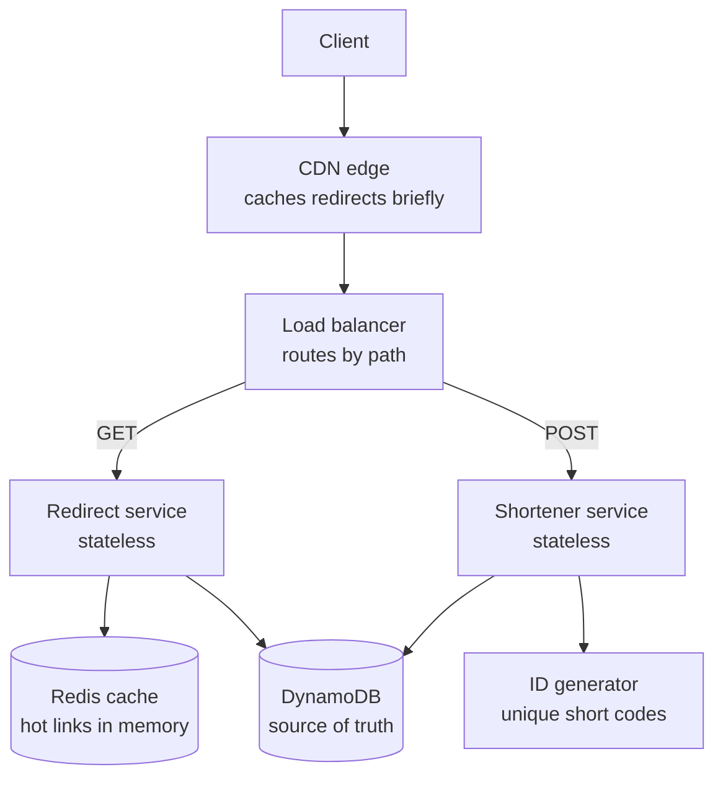
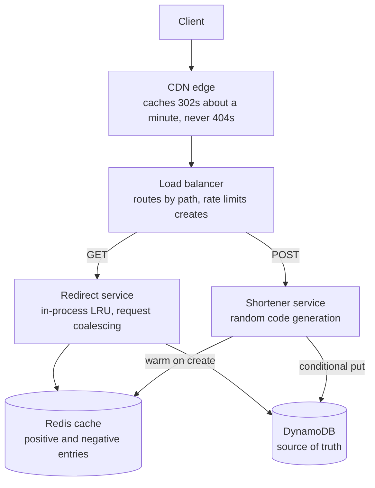

# Q1: URL shortener

**Pattern:** a read-heavy key-value lookup. Writes are trivial, reads are everything, and immutability makes caching safe at every layer.

## Table of Contents

- [Recap](#recap)
- [1. Scope and requirements](#1-scope-and-requirements)
- [2. Scale estimates](#2-scale-estimates)
- [3. API and data model](#3-api-and-data-model)
- [4. High-level architecture](#4-high-level-architecture)
- [5. Deep dives](#5-deep-dives)
  - [Deep dive 1: generating short codes](#deep-dive-1-generating-short-codes)
  - [Deep dive 2: hot keys and cache stampedes](#deep-dive-2-hot-keys-and-cache-stampedes)
  - [Deep dive 3: a new link must work immediately](#deep-dive-3-a-new-link-must-work-immediately)
  - [Final architecture, after the deep dives](#final-architecture-after-the-deep-dives)
- [6. Bottlenecks, failure modes, and trade-offs](#6-bottlenecks-failure-modes-and-trade-offs)
- [7. Tech lead layer](#7-tech-lead-layer)

---

## Recap

**In one line:** a read-heavy key-value lookup, served through layered caches from a partitioned key-value store, with 302 redirects and random 7-character codes inserted conditionally.

**The five decisions that define it**

1. **302, not 301.** You serve every click and keep control of expiry, deletion, and analytics.
2. **Immutable links, new code per request.** No cache invalidation and no lookup before writes.
3. **Key-value store partitioned on short code.** The only access pattern is a point lookup, and 6 TB needs partitioning.
4. **Random 7-character code plus a conditional insert.** Uniqueness with no coordinator, and codes that can't be enumerated.
5. **Layered caching: CDN, in-process, Redis, then the database.** The cache is an optimisation the system can lose, never a dependency.

**Numbers worth remembering**

- New links: 100M a month ≈ 40 writes per second (400 at peak).
- Redirects: 100:1 ≈ 4,000 per second (40,000 at peak).
- Total links in 10 years: 12 billion.
- Storage: ≈ 6 TB (18 TB with three replicas).
- Hot set: ≈ 35 GB, fits in memory.
- Keyspace, 7 characters: 62⁷ ≈ 3.5 trillion.
- Keyspace, 6 characters: 62⁶ ≈ 57 billion.
- 99.99% availability: ≈ 4 minutes of downtime a month.
- Seconds in a day: ≈ 100,000.

---

## 1. Scope and requirements

### Functional requirements

**Core, in scope:**

1. Given a long URL, return a short URL.
2. Given a short URL, redirect to the long URL.
3. Optional custom alias chosen by the user.
4. Optional expiry time.

**Explicitly out of scope:** user accounts and auth, analytics dashboards, billing, abuse and malware detection.

### The four questions that change the design

#### Decision 1.1: Every create request gets a new short code

Question: does the same long URL always return the same short URL? No.

- **Why:** two people shortening the same URL may want different expiry times or aliases, and later their own click counts. It also keeps the write path simple.
- **How:** creation is a plain insert, with no lookup by long URL.
- **Alternatives:**
  - Deduplicate. It needs a second index on the long URL (or its hash) and a read before every write. It is the better pick for a public utility with no per-link settings, where storage matters most.
- **Pros:** simple and fast writes, links are independent.
- **Cons:** duplicate rows for popular URLs, so more storage.

#### Decision 1.2: Links are immutable

Question: can the destination be changed after creation? No. A mapping can only expire or be deleted.

- **Why:** immutability makes caching almost free. A cached entry can never be wrong; it can only be expired.
- **Alternatives:**
  - Editable links. This is the better pick for a marketing product where campaigns get repointed. The cost is cache invalidation across every cache layer, including ones you don't control.
- **Pros:** aggressive caching, simple consistency story.
- **Cons:** a typo in the destination means creating a new link.

#### Decision 1.3: Short codes must not be trivially enumerable

Question: must short codes be hard to guess? Yes.

- **Why:** sequential codes let anyone walk the whole keyspace and scrape every link, including private documents shared by URL.
- **How:** it rules out exposing a raw counter, which shapes ID generation in Deep dive 1.
- **Alternatives:**
  - Plain sequential codes. They are fine for an internal tool behind auth.
- **Pros:** privacy by default.
- **Cons:** ID generation becomes harder than "increment a counter".

#### Decision 1.4: Click analytics are out of scope, but the door stays open

Question: do we need click analytics? Out of scope, but keep the door open.

- **Why raise it at all:** it decides the redirect status code. With a 301, browsers cache the redirect and later clicks never reach you. With a 302, every click hits your servers. So this product question changes your traffic volume. The full treatment is in Decision 3.1.

### Non-functional requirements

- **Read-heavy, about 100 reads per write.** Consequence: optimise the redirect path first, with caches and read replicas. The write path can be simpler and slower.
- **Redirect availability of 99.99%.** Why so high: short links are embedded in emails, posts, and print. An outage breaks other people's content everywhere at once, and you can't fix it on their side. Consequence: no single point of failure on the read path, and reads must survive a database failover.
- **Redirect latency under 100 ms at p99.** Why: you are an extra hop in front of every page load, so your latency is added to someone else's. Consequence: most reads must be served from memory or the edge, not from disk.
- **Creation latency of a few hundred milliseconds is acceptable.** It is a one-time, user-initiated action.
- **Durability: a created link is never lost.** Consequence: replicated storage and acknowledged writes. Losing a mapping is permanent damage.
- **Consistency: split by path.** Uniqueness of short codes needs strict correctness, since two URLs must never share a code. Reads can be eventually consistent, with one caveat: the creator should be able to use the link immediately.

### What to say

> "Let me confirm scope. Core features are create and redirect, plus optional custom aliases and expiry. I'll leave out accounts, analytics, and abuse detection, but I'll note where analytics would plug in. I'm assuming links are immutable, each request gets a new code, and codes shouldn't be guessable. On the non-functional side: this is read-heavy, roughly 100 to 1, redirects need four nines and under 100 ms at p99, and links must never be lost. Uniqueness has to be strictly correct; reads can be eventually consistent. Does that match what you have in mind?"

---

## 2. Scale estimates

### Anchor assumptions

#### Decision 2.1: Anchor on 100 million new links per month

The read ratio is 100:1, from section 1.

- **Why:** for this system, writes are the natural unit. Storage, keyspace, and read load all derive from it.
- **Alternatives:**
  - Start from daily active users and derive actions per user. That is the better pick for user-centric systems like a feed or chat, where behaviour per user drives load.
- **Pros:** three multiplications get you everything.
- **Cons:** the number is an assumption, so state it and ask the interviewer to confirm.

### The calculations

**Write throughput**

- 100M per month ÷ 2.5M seconds ≈ **40 writes per second** on average.
- Plan for a 10× peak: **400 per second**.
- *So therefore:* write volume is small. A single primary database handles this comfortably, so you don't need a write-scaling architecture. Anything you do on the write path is for availability and correctness, not throughput.

**Read throughput**

- 40 × 100 = **4,000 redirects per second** on average.
- 10× peak: **40,000 per second**. The 10× factor is justified because a single viral link can spike traffic far above the daily curve.
- *So therefore:* this is where the design effort goes. To serve 40,000 lookups per second under 100 ms at p99 with four nines, you need a cache in front of the database and more than one read source.

**Storage**

- Retention: 10 years. 100M × 12 × 10 = **12 billion links**.
- Row size: short code, long URL (average around 100 bytes, max about 2 KB), timestamps, expiry, plus index overhead. Call it **500 bytes**.
- 12B × 500 bytes = **6 TB**, or about 18 TB with three replicas.
- *So therefore:* too big for one node to hold comfortably with its indexes in memory, so the data must be partitioned. But it is a modest dataset: tens of nodes, not thousands. Storage cost is not a concern.

**Cache size**

- Daily reads: 4,000 × 86,400 ≈ 350 million.
- Assume a skewed distribution where a small share of links gets most of the traffic. Caching the hottest 20% of a day's requests: 70M entries × 500 bytes ≈ **35 GB**.
- *So therefore:* the hot set fits in memory on a small cache cluster. That makes "serve most redirects from RAM" a realistic plan, which is what the latency requirement needs.

**Code length**

- Base62 alphabet (a-z, A-Z, 0-9).
- 6 characters: 62⁶ ≈ 57 billion codes.
- 7 characters: 62⁷ ≈ 3.5 trillion codes.
- You need 12 billion codes. With 6 characters the keyspace ends up about 21% full. With 7 characters it is 0.3% full.
- *So therefore:* 7 characters, as Decision 2.2 sets out.

#### Decision 2.2: 7-character codes

- **Why:** if codes are generated randomly, the collision rate equals the fill ratio. With 6 characters, by year ten roughly one in five attempts would collide and need a retry. With 7 characters the space is 0.3% full and collisions are negligible.
- **Alternatives:**
  - 6 characters. It works if codes come from a counter, since counters never collide.
  - 8 characters. It gives more headroom and makes guessing harder, at the cost of a longer URL.
- **Pros:** room for decades of growth and for any generation scheme.
- **Cons:** one character longer than the minimum.

### What to skip

Bandwidth: 4,000 requests per second at 500 bytes is about 2 MB per second, which constrains nothing. Say "bandwidth is negligible here, so I'll skip it."

### What to say

> "Assuming 100 million new links a month: that's about 40 writes a second, 400 at peak, so writes are easy. Reads at 100 to 1 are 4,000 a second, 40,000 at peak, so the read path is where I'll focus. Over ten years that's 12 billion links at about 500 bytes, so 6 terabytes, which means partitioning but nothing exotic. The hot set is around 35 gigabytes, so it fits in memory. And 7 base62 characters gives 3.5 trillion codes, which is plenty."

---

## 3. API and data model

### API

```
POST /api/v1/urls
  body: { long_url, custom_alias?, expires_at? }
  201 → { short_code, short_url, expires_at }
  400 invalid URL · 409 alias taken · 429 rate limited

GET /{short_code}
  302 → Location: <long_url>
  404 unknown code · 410 expired
```

Two endpoints are enough. The 410 for expired links (instead of 404) tells clients the link existed and is gone for good.

### Decision 3.1: 302 (temporary redirect), not 301

- **Why:** expiry is in scope. A 301 tells the browser the redirect is permanent, so it caches it and may never ask you again. An expired or deleted link would keep working in that browser, and you would have no way to recall it.
- **How:**
  - With a 302, each click reaches your infrastructure, so you stay in control.
  - To cut load, add a short `Cache-Control: max-age` so the CDN can serve repeat hits for a minute or so, which bounds how stale a redirect can be.
  - This decision links a product requirement to an HTTP detail to a capacity number, which makes it a good one to narrate.
- **Alternatives:**
  - 301. It is the better pick when links are permanent, analytics don't matter, and you want the lowest serving cost, since browsers absorb repeat traffic for free.
- **Pros:** expiry and deletion work, click tracking stays possible.
- **Cons:** you serve every click, so the full 40,000 per second peak lands on you.

### Access patterns

1. Read one record by short code. This is over 99% of traffic.
2. Insert one record, only if the short code is not already taken.

There are no joins, no range scans, and no multi-row transactions. That is a pure key-value workload, and that observation drives the database choice.

### Data model

One table:

| Field | Type | Notes |
|---|---|---|
| `short_code` | string | Primary and partition key |
| `long_url` | string | Up to about 2 KB |
| `created_at` | timestamp | |
| `expires_at` | timestamp, nullable | Checked on every read |

Custom aliases live in the same table and the same key namespace, so one uniqueness check covers both generated codes and aliases. Reserve a small blocklist (`api`, `admin`, and so on) so aliases can't shadow your own routes.

### Decision 3.2: DynamoDB (the self-hosted equivalent is Cassandra)

- **Why:** the property that earns the pick is a hash-partitioned key-value store with built-in replication and conditional writes. Section 2 said 6 TB, which must be partitioned, and this class of store partitions automatically by key. Point reads are single-digit milliseconds regardless of table size.
- **How:**
  - Uniqueness comes from a conditional put ("insert only if this key does not exist"), evaluated atomically on the partition that owns the key. Two concurrent requests for the same code cannot both succeed.
  - In Cassandra the same guarantee comes from lightweight transactions, which run a Paxos round and are several times slower than a normal write. At 40 to 400 writes per second, that cost is irrelevant.
- **Alternatives:**
  - PostgreSQL or MySQL. A unique constraint gives the same guarantee with less ceremony.
    - It is the better pick when the dataset is under roughly a terabyte, or when the product needs relational features such as accounts, teams, and billing.
    - At 6 TB you would have to shard it yourself or adopt Vitess or Citus, and you take on failover and rebalancing work.
- **Pros:** no shard management, predictable read latency, multi-zone replication out of the box.
- **Cons:** no ad-hoc queries, so analytics would need a separate pipeline; read cost grows with traffic, which the cache offsets; and DynamoDB specifically ties you to AWS.

### Decision 3.3: Partition on `short_code`

- **Why:** it is the only thing a redirect request carries, so it must locate the partition by itself. Codes look random, so hashing them spreads data evenly across partitions.
- **Alternatives:**
  - Partition by creator. It is the better pick when the dominant query is "list my links". Here it would make redirects impossible without a second index, and heavy users would create hot partitions.
- **Pros:** even distribution, one-hop reads.
- **Cons:** a single viral link is a hot key. The cache absorbs that (Deep dive 2).

### Decision 3.4: Check `expires_at` on every read, with TTL only for cleanup

- **Why:** TTL deletion is lazy. DynamoDB may remove an expired item hours or days late. If you relied on it alone, expired links would keep redirecting.
- **How:** compare `expires_at` on each read, and use the database's TTL feature only to clean up.
- **Alternatives:**
  - A scheduled sweep job that deletes expired rows. That is the better pick on a relational database with no native TTL.
- **Pros:** expiry is exact, cleanup is free.
- **Cons:** one extra comparison per read, which is negligible.

### What to say

> "Two endpoints: POST to create, GET on the code to redirect. I'll use a 302, because we support expiry and a 301 would get cached permanently by browsers. The access pattern is a point lookup by code plus a conditional insert, so this is a key-value workload. One table keyed and partitioned on short code. I'd use DynamoDB for automatic partitioning and conditional writes; Postgres would work at smaller scale. Expiry is checked on read, with TTL for cleanup. How the code itself is generated is the interesting part, and I'll come back to it."

---

## 4. High-level architecture

### Diagram



### The read path (redirect)

1. The request for `/{code}` reaches the CDN. If the edge has a fresh copy of the redirect, it answers immediately.
2. Otherwise the load balancer sends it to a redirect service instance.
3. The service looks up the code in Redis. On a hit, it checks expiry and returns the 302.
4. On a miss, it reads DynamoDB, writes the entry to Redis with a TTL, and returns the 302.
5. If the code doesn't exist, it returns 404 and caches that negative result for a short time.

### The write path (create)

1. The POST passes through the load balancer, where rate limiting is applied.
2. The shortener service validates the URL.
3. It takes a custom alias if supplied, or else asks the ID generator for a code.
4. It does a conditional put to DynamoDB. If the key exists, an alias gets a 409 and a generated code gets a retry with a new code.
5. It returns the short URL.

### Decision 4.1: Separate read and write services

- **Why:** the two paths have different loads (100:1) and different promises (four nines and 100 ms for redirects, relaxed for creates). Separating them means a bad deploy or a traffic spike on the create path cannot take redirects down.
- **How:** two services, deployed and scaled independently. Both are stateless, so each scales horizontally behind the load balancer on its own metric.
- **Alternatives:**
  - One service with two endpoints. It is the better pick for an MVP or a small team, since there is one thing to deploy and monitor, and you can split later because the boundary is clean.
- **Pros:** fault isolation, independent scaling.
- **Cons:** two pipelines and two sets of dashboards.

### Decision 4.2: Redis with cache-aside

- **Why:** section 2 showed the hot set is about 35 GB, which fits in memory, and section 1 demands most reads be served from RAM. Because mappings are immutable, a cached entry can never be stale; it can only expire.
- **How:** Redis sits in front of DynamoDB and is populated on read miss. The service owns the logic: check cache, fall back to the database, then populate. If Redis is down, reads fall through to DynamoDB, so the system gets slower but stays up. That property is why cache-aside suits an availability-first read path.
- **Alternatives:**
  - Write-through (populate at creation). It gives the creator an instantly warm entry, but most links are never clicked much, so you fill memory with cold data. It is the better pick when nearly every write is read soon after.
  - Memcached. It is a simpler pure cache and a fine swap if you want nothing but get and set.
- **Pros:** only hot data occupies memory, cache failure is survivable.
- **Cons:** the first request for each link pays a database read, and a cold cache after a restart sends a burst to the database.

### Decision 4.3: Negative caching for about a minute

- **Why:** without it, anyone scanning random codes bypasses the cache on every request and hits the database directly.
- **How:** cache "not found" results for about a minute.
- **Alternatives:**
  - A Bloom filter of all existing codes in front of the database. It is the better pick when scanning traffic is heavy, since it rejects unknown codes without any lookup.
- **Pros:** trivial to add.
- **Cons:** a code created within that minute could briefly return 404, which is why the TTL stays short.

### Decision 4.4: CDN in front of redirects

- **Why:** it absorbs viral spikes at the edge before they reach you, and it answers users from a nearby location, which helps the latency target globally.
- **How:** put CloudFront (or any CDN) in front, caching 302s with a max-age of about a minute.
- **Alternatives:**
  - No CDN. It is the better pick when every click must be counted exactly in real time, since edge hits never reach your servers. You can still recover counts from CDN logs, with a delay.
- **Pros:** spike protection, lower global latency.
- **Cons:** expiry and deletion take effect up to a minute late.

### What to say

> "Clients hit a CDN, then a load balancer that splits traffic by path. Redirects go to a stateless read service that checks Redis first and falls back to DynamoDB. Creates go to a separate write service that gets a code from an ID generator and does a conditional insert. I've split the services because the read path has the strict availability and latency targets and I don't want writes to be able to affect it. The ID generator is the box I'd like to dig into next."

---

## 5. Deep dives

The three areas specific to this system:

1. Generating short codes
2. Hot keys and cache stampedes
3. A link that must work the instant it's created

### Deep dive 1: generating short codes

**Constraints:**

- Codes are unique.
- Codes are 7 base62 characters.
- Codes are not guessable.
- No single point of failure.
- 400 writes per second at peak.

#### Decision 5.1: A random 7-character code plus the conditional insert

- **Why:**
  - The conditional insert already exists because custom aliases need it, so uniqueness costs nothing extra.
  - Decision 2.2 showed the keyspace ends up 0.3% full, so about 1 in 300 writes retries once at year ten.
  - It removes a component: the "ID generator" box from the section 4 diagram becomes a function inside the shortener service.
  - Codes are unguessable by construction, and write availability depends on the database alone.
- **How:** generate 7 random base62 characters from a cryptographic random source, then do the conditional put from Decision 3.2. On a collision, generate again.
- **Alternatives:**
  - Hash the long URL (SHA-256, first 42 bits). Truncation still collides, so it needs a uniqueness check and a retry with a salt, and the same URL always gets the same code, which contradicts Decision 1.1. Better when you want deduplication.
  - Counter with range allocation. A coordinator (ZooKeeper, etcd, or one DB row) leases blocks of ~1M numbers to instances. No collisions, no uniqueness check, very high throughput.
    - It costs one more component to run, plus a keyed scramble (Feistel network) to hide the sequence, which is obfuscation that depends on keeping the key secret.
    - A crashed instance's unused block is simply wasted, which is harmless at 3.5 trillion codes.
    - It wins when write volume is in the tens of thousands per second, the keyspace is tight such as 6 characters, or conditional writes are expensive.
    - Many candidates give it as the textbook answer, so be ready to explain why it wasn't needed here.
  - Snowflake-style IDs. 64 bits is 11 base62 characters, which is too long.
- **Pros:** stateless, no coordination, nothing extra to run.
- **Cons:** correctness rests on the conditional write, and the retry rate grows as the keyspace fills.

### Deep dive 2: hot keys and cache stampedes

**Constraints:**

- One viral link can take a large share of the 40,000 requests per second.
- Hot key: all those requests land on one Redis shard and one database partition.
- Stampede: the hot entry expires, and thousands of concurrent requests all miss and all query the database at once. DynamoDB throttles a single overloaded partition, so this can turn into errors.

#### Decision 5.2: Three layers, cheapest first

- **Why:** each layer is a few lines of code and none adds infrastructure. Immutability makes the in-process cache safe, since the only thing a stale entry can get wrong is expiry, and only for as long as its short TTL.
- **How:**
  1. **CDN caching** from Decision 4.4 absorbs most repeat hits at the edge.
  2. **A small in-process cache** in each redirect instance: an LRU of a few thousand entries with a TTL of a few seconds. Hot links are served with no network hop at all.
  3. **Request coalescing plus TTL jitter.** Coalescing means that when many requests miss on the same key at once, one of them fetches from the database and the rest wait for its result. In Go this is the `singleflight` package. Jitter adds a random offset to each TTL so entries don't expire in lockstep.
- **Alternatives:**
  - A distributed lock on cache miss (Redis `SET NX`). It guarantees one fetch across the whole fleet and is the better pick when recomputing the value is expensive. Here the "recompute" is one cheap key lookup, so per-instance coalescing is enough: a fleet of 50 instances produces at most 50 concurrent reads.
  - Refreshing hot entries before they expire. It is the better pick when even one slow miss is unacceptable.
- **Pros:** no new components, protects both Redis and the database.
- **Cons:** expiry can lag by the local TTL, and memory use per instance rises slightly.

### Deep dive 3: a new link must work immediately

**Constraints:**

- Section 1 said the creator should be able to use the link right away.
- DynamoDB reads are eventually consistent by default, so a read a few milliseconds after the write can miss.
- A negative cache entry may exist if someone requested that code before it was created. This is realistic for custom aliases.
- The CDN may have cached a 404 for the same reason.

#### Decision 5.3: Warm Redis on create, and never cache 404s at the CDN

- **Why:** it fixes all three causes with one extra cache write on the low-volume path. Write-through was rejected in Decision 4.2 as the general strategy because most links stay cold. This is a narrow version of it: a short TTL means cold links leave memory within minutes.
- **How:**
  1. On create, write the new entry into Redis with a short TTL of a few minutes. This overwrites any negative entry and serves the creator's first click from the cache, so the eventually consistent database read never matters.
  2. Never cache 404s at the CDN. Negative caching stays in Redis, where you can overwrite it.
- **Alternatives:**
  - Strongly consistent reads on every cache miss. It is the better pick when there is no cache layer to lean on. It doubles the read cost of every miss to fix a window that only matters for seconds after creation.
- **Pros:** read-your-writes for the creator at almost no cost.
- **Cons:** one more write on create, and brief memory use for links nobody clicks.

### Final architecture, after the deep dives



Compared with section 4, the ID generator box is gone, the redirect service gained an in-process LRU and request coalescing, and creates now warm Redis.

### What to say

> "There are three areas worth going deeper on: how codes are generated, what happens when one link goes viral, and making sure a link works the moment it's created. Which would you like first?"

---

## 6. Bottlenecks, failure modes, and trade-offs

### Failure 1: Redis is down or slow

- **What happens:** every read falls through to DynamoDB. That is survivable by design, but the database suddenly receives up to 40,000 reads per second it normally never sees, and may throttle.
- **The slow case:** if Redis hangs instead of failing, every redirect waits on it and the latency target is gone while the database sits idle.

#### Decision 6.1: Replicated Redis, a tight cache timeout, and spare database capacity

- **Why:** the read path has the four-nines target, so the cache must be an optimisation the system can lose, never a dependency it needs. The CDN and the in-process caches from section 5 keep serving hot links, so the fall-through traffic is mostly the long tail.
- **How:** run Redis as a replicated cluster across availability zones with automatic failover; put a tight timeout on cache calls (around 20 ms) with a circuit breaker so a sick cache is skipped quickly; and size database capacity to survive losing part of the cache.
- **Alternatives:**
  - Shed load when the cache is gone, serving hot links and rejecting some cold ones. It is the better pick when over-provisioning the database for a rare event costs too much.
- **Pros:** cache loss degrades latency, not availability.
- **Cons:** you pay for database headroom you rarely use.

### Failure 2: the database or its region is down

- **What happens:** cached links keep redirecting, cold links fail, and all creates fail.

#### Decision 6.2: Replicate the table to a second region for reads, keep writes in one region

- **Why:**
  - The strict availability promise is on redirects. Creates can tolerate a short outage, and the contract from section 1 said so.
  - Why not write everywhere: cross-region replication is asynchronous. The conditional insert only guarantees uniqueness within one region, so two regions could accept the same code at the same moment, and one mapping would silently overwrite the other. That breaks the one guarantee that must hold strictly.
- **Alternatives:**
  - Active-active writes with the keyspace split by region, for example the first character of the code identifies the region, with custom aliases routed to a single home region. It is the better pick when creation must also survive a regional outage.
- **Pros:** redirects survive a region failure, uniqueness stays simple.
- **Cons:** creates are down until the write region fails over, and a new link can take a moment to be readable from the far region.

### Failure 3: a service instance or a deploy goes bad

- **What happens:** nothing is lost, because the services hold no state. Health checks remove dead instances.
- **Mitigation:** canary deploys on the redirect service, since it carries the strict target. The service split from Decision 4.1 means a broken create deploy can't touch redirects.

### Abuse

- **Create floods and spam:** rate limit per IP or API key at the edge.
- **Code scanning:** negative caching, already in place.
- **Malicious destinations:** out of scope, but the design leaves room for it: a blocklist check on create, plus the ability to disable a link quickly. That works because of the 302 and the one-minute edge cache, so a disabled link stops redirecting within a minute. With a 301 you could never recall it.

### At 10×

At 400,000 redirects per second:

- **Storage and database:** partitions scale horizontally. Not the first problem.
- **Redis:** add shards. Not the first problem.
- **The first real pressure is cost,** because the 302 decision means you serve every click. The next move is pushing redirect logic to the edge, with the mapping in an edge key-value store, so most requests never reach your region.

### Trade-offs

| Choice | What it cost | What it bought |
|---|---|---|
| 302 over 301 | Every click hits us | Expiry, deletion, analytics |
| Random codes over a counter | An occasional retry | No coordinator to run |
| No deduplication | More storage | Simple writes, independent links |
| Immutable links | No editing | Caching with no invalidation |
| Eventually consistent reads | A brief window of staleness | Availability and lower cost |
| One-minute edge caching | Delayed expiry and click counts | Spike protection |
| Single write region | Creates fail during a regional outage | Simple, strict uniqueness |

### What to say

> "Let me stress the design. If Redis dies, reads fall through to the database, so I've sized for that and put a tight timeout on the cache so a slow cache can't stall redirects. If the primary region dies, redirects continue from a read replica in a second region; creates pause, which the requirements allow. I've kept writes in one region because cross-region writes would break the uniqueness guarantee. At 10×, the first constraint is cost, since I chose to serve every click, and the fix is moving redirects to the edge. The main things I've traded away are editable links, deduplication, and instant expiry."

---

## 7. Tech lead layer

### Phasing

**Phase 1: MVP**

Trigger: launch.

- One service with both endpoints, DynamoDB, managed Redis, a CDN, one region.
- Random codes with a conditional insert.
- Code generation and storage sit behind interfaces, so they can be swapped later.

**Phase 2: harden**

Trigger: sustained read traffic in the thousands per second, or the first incident where a create deploy affected redirects.

- Split the read and write services.
- Add in-process caching, request coalescing, negative caching, rate limiting, and canary deploys.

**Phase 3: scale out**

Trigger: the availability target is formally committed to customers, or serving cost becomes a line item someone questions.

- Second region for reads, redirects at the edge, and an analytics pipeline fed asynchronously from logs so it never sits on the redirect path.

#### Decision 7.1: The data store is chosen in phase 1

- **Why:** the data store is the one component that is costly to migrate under live traffic, since every existing link must keep working during the move. The model is one key-value table, so there is nothing relational to gain by starting on Postgres.
- **How:** start on DynamoDB, not on a single Postgres instance. Everything else in phase 1 is cheap to change: splitting a service, adding a cache layer, or adding a region are all additive.
- **Alternatives:**
  - Start on Postgres. It is the better pick when the team has no experience with the key-value store, or when accounts and billing are coming soon and need relational modelling anyway.
- **Pros:** no migration later, no capacity planning for storage.
- **Cons:** ad-hoc queries during early product exploration are harder.

### Cost

- **Storage** is small: 6 TB over ten years.
- **Cache memory** is small: tens of gigabytes, replicated.
- **Request serving dominates.** About 350 million redirects a day is roughly 10 billion a month through the CDN, load balancer, and compute.

**The main dial is cache hit ratio.** Each layer that answers a request spares all the layers behind it. The levers, in order of effect:

1. Edge cache TTL: a longer TTL costs less and makes expiry slower.
2. Offering a 301 for links the creator marks permanent, so browsers absorb repeat clicks.
3. A default expiry for anonymous links, which caps storage growth and shrinks the abuse surface.

The metric to track is **cost per million redirects**, because it stays comparable as traffic grows.

### Observability

**Service level objectives:**

- Redirect availability of 99.99%, which is an error budget of about 4 minutes a month.
- Redirect latency at p99, measured at the edge, since that is what users experience.
- Create success rate, with a looser target.

**Leading indicators:**

- Cache hit ratio for each layer. A drop here predicts a database problem minutes ahead.
- Database throttling events.
- Code collision and retry rate. A sudden rise means a bug in the random source or a keyspace filling faster than planned.
- 404 rate, which reveals scanning.

**Two practices:**

- Alert on error budget burn rate, not on CPU or memory. Page people for user impact only.
- Run a synthetic probe that creates a link and follows it every minute from several regions. It tests the whole path, including the read-your-writes guarantee from Deep dive 3.

### Pushback on requirements

| Requirement | What it undermines | What to ask or propose |
|---|---|---|
| "Links should be editable." | Immutability, which is what makes every cache layer safe. | It is possible, at the price of invalidation logic and a shorter edge TTL. |
| "We want exact real-time click counts." | Edge caching. | Offer counts with a few minutes of delay from logs. |
| "Creates need four nines too." | The single write region. It forces multi-region writes and the keyspace-partitioning work from section 6. | Ask what an hour of failed creates per year would cost the business. |
| "Custom aliases for everyone." | The alias namespace. It invites squatting and impersonation. | Introduce accounts and a policy first. |
| "Should we build this at all?" | The case for a custom build. | If it is an internal tool, an existing service may be enough. |

### What to say

> "I wouldn't build all of this at once. Phase one is a single service on DynamoDB with Redis and a CDN, because the data store is the one thing that's painful to change later. I'd split services and add the hardening when read traffic or an incident justifies it, and add a second region when the availability target becomes a commitment. Cost is dominated by request serving, so cache hit ratio is the dial I'd watch. I'd define SLOs on redirect availability and edge latency and alert on budget burn. And I'd push back on editable links and exact real-time analytics, because both undermine the caching the design depends on."
