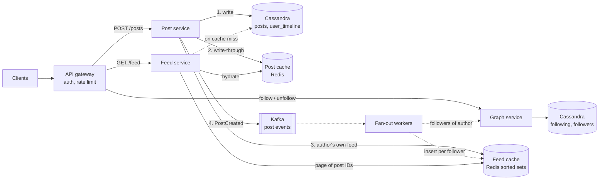
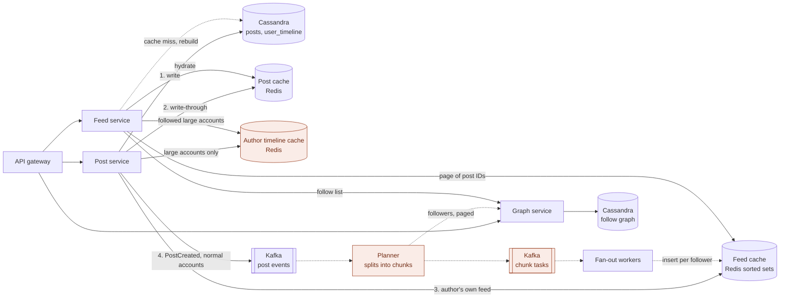

# Q2: News feed (Twitter)

**Pattern:** fan-out on write vs fan-out on read, and the celebrity problem that forces a hybrid of the two.

Reused from earlier questions:

- Q1: cache-aside backfill with a database fallback (the post cache, which is also written through), and Snowflake-style 64-bit IDs, which Q1 rejected for short codes but which suit feed entries that must stay small and sortable.

## Table of Contents

- [Recap](#recap)
- [1. Scope and requirements](#1-scope-and-requirements)
- [2. Scale estimates](#2-scale-estimates)
- [3. API and data model](#3-api-and-data-model)
- [4. High-level architecture](#4-high-level-architecture)
- [5. Deep dives](#5-deep-dives)
  - [Deep dive 1: posts from large accounts](#deep-dive-1-posts-from-large-accounts)
  - [Deep dive 2: reading the feed](#deep-dive-2-reading-the-feed)
  - [Deep dive 3: the fan-out pipeline](#deep-dive-3-the-fan-out-pipeline)
  - [Final architecture, after the deep dives](#final-architecture-after-the-deep-dives)
- [6. Bottlenecks, failure modes, and trade-offs](#6-bottlenecks-failure-modes-and-trade-offs)
- [7. Tech lead layer](#7-tech-lead-layer)

---

## Recap

**In one line:** precompute feeds by pushing post IDs to followers, except for accounts too big to push, whose posts are pulled and merged at read time.

**The five decisions that define it**

1. **Fan-out on write is the default.** It is about 60k cheap inserts a second, against 6M lookups a second if every feed were assembled at read time.
2. **Hybrid above about 100k followers.** A large account's posts are merged at read time, and the threshold comes from the 5-second freshness budget.
3. **Feeds hold IDs, not content.** Feeds stay small (about 16 KB each), deletes need no fan-out, and immutable posts cache almost for free.
4. **Feeds are derived data.** They are kept only for active users, rebuilt on demand behind a cap, and losing them costs latency, never data.
5. **Time-sortable 64-bit IDs.** One value is the sort key, the cursor, and the merge key across both sources.

**Numbers worth remembering**

- **Posts:** 300/s, 3,000/s at peak.
- **Feed reads:** 30k/s, about 100k/s at peak.
- **Fan-out on write:** 60k inserts/s, 600k/s at peak.
- **Fan-out on read, for comparison:** 6M lookups/s.
- **One 100M-follower post, pushed:** about 28 minutes of the system's average delivery load.
- **Large-account threshold:** about 100k followers, 100 chunks of 1,000.
- **Feed cache:** 800 IDs × 500M active users ≈ 8 TB, 24 TB with replicas.
- **Hot large-account timeline:** about 10k reads/s on one key.
- **Storage:** 55 TB of posts, 20 TB of follow graph, before replication.
- **Freshness and latency:** followers within 5 s; feed p99 under 200 ms; author sees own post immediately.

**The phrases to carry into the room**

- "One post becomes N writes. Delivery is the real write load."
- "The average follower count justifies the default; the maximum justifies the exception."
- "Feeds are a cache of a view, so I can lose them."
- "Phase one is pull-only, and that merge code becomes the large-account path later."

---

## 1. Scope and requirements

In this question, the scoping answers decide whether the celebrity problem exists at all, and whether feeds can be precomputed.

### Functional scope

| In scope | Out of scope |
|---|---|
| Post a short text post, optionally with media references | Media upload, transcoding, and delivery |
| Follow and unfollow | Ranking model, ads, recommendations |
| Home timeline: posts from accounts I follow, paginated | Search, trends, DMs, notifications |
| User timeline: one account's own posts | Likes, replies, reposts, auth, and abuse detection |

Ranking is out of scope but gets a named plug-in point: a scoring stage on the read path, applied to the candidates the feed already produces.

### Decisions that shape the design

#### Decision 1.1: one-directional follows, with no cap on followers

- **Why:** this is what makes it Twitter. An account can have 100M followers, so one write can turn into 100M feed updates.
- **How:** follower counts are heavily skewed, so no single delivery strategy works for every account. That skew is the celebrity problem.
- **Alternatives:**
  - **Mutual friendship with a cap**, as with Facebook's 5,000 friends: a bounded fan-out makes plain fan-out on write sufficient. It is the better pick when the product is about people who know each other.
- **Pros:** it matches the product and the interviewer's intent.
- **Cons:** a hybrid delivery path later, with more moving parts.

#### Decision 1.2: reverse chronological ordering

- **Why:** the feed becomes a merge of time-sorted lists. That keeps the design centred on the fan-out pattern instead of on ML.
- **How:** post IDs must be time-sortable, so sorting by ID is sorting by time, and pagination can use an ID cursor.
- **Alternatives:**
  - **A ranked feed:** needs a feature store and model serving, and the final order cannot be fully precomputed. It is the better pick when engagement is the product goal.
- **Pros:** simple, cacheable, and predictable.
- **Cons:** a user who follows many active accounts misses good posts.

#### Decision 1.3: posts can be deleted, not edited

- **Why:** deletion is a legal and safety requirement. Editing is a product feature with a large technical cost.
- **How:** immutable content caches almost for free. Deletion means feeds should hold post IDs rather than copies of content, so a deleted post is filtered at read time instead of being removed from millions of feeds.
- **Alternatives:**
  - **Allow edits:** brings versioning plus invalidation at every cache layer. It is the better pick when the product demands it.
- **Pros:** cheap caching and a simple delete.
- **Cons:** an extra content lookup on every feed read.

#### Decision 1.4: followers see a post within about 5 seconds; the author sees it immediately

- **Why:** nobody notices a few seconds of delay on someone else's post. Everybody notices their own post missing.
- **How:** the delay budget permits asynchronous delivery through a queue. The author's own view is the one read-your-writes path.
- **Alternatives:**
  - **Synchronous delivery before acknowledging the post:** it is the better pick only when follower counts are small and bounded.
- **Pros:** posting stays fast and is isolated from delivery load.
- **Cons:** feeds are eventually consistent, and delivery lag becomes something to monitor.

#### Decision 1.5: the home timeline holds the most recent ~800 entries

- **Why:** almost nobody scrolls further, and an unbounded feed per user cannot live in memory.
- **How:** the cap fixes the size of each stored feed, which makes the memory estimate in section 2 possible.
- **Alternatives:**
  - **Unlimited scroll-back:** served by a slower read-time query past the cap. It is the better pick for an archive-style product.
- **Pros:** bounded, predictable memory.
- **Cons:** a second, slower path if deep scroll is ever required.

### Non-functional requirements

| Requirement | Target | What it forces |
|---|---|---|
| Read/write ratio | Roughly 100 feed reads per post | The feed read path gets the optimisation effort |
| Hidden write load | One post becomes N feed insertions | Posting is cheap; delivery is the real write problem (sized in section 2) |
| Availability | 99.99% on feed reads, 99.9% on posting | No single point of failure on the read path; a stale feed beats an error |
| Latency | Feed load p99 under 200 ms; post acknowledged p99 under 500 ms | Feeds are precomputed and served from memory, not assembled from hundreds of accounts per request |
| Durability | An acknowledged post is never lost | Replicated storage and acknowledged writes for posts and the follow graph |
| Derived data | Feeds can be lost and rebuilt | The feed store is a cache of a view, not a source of truth |

### Consistency by path

- **Strict:** post durability, and the author seeing their own post.
- **Near-strict:** a deleted post stops being served within seconds.
- **Eventual:** everything else, including follower feeds, the effect of follow and unfollow, and any counts. Two followers may see the same post a few seconds apart, and no global ordering is needed.

### What to say

> "Let me confirm scope. Core features are posting, following, and a home timeline of posts from the accounts I follow, plus a per-user timeline. I'll leave out media handling, search, notifications, and ranking, but I'll note where ranking plugs in on the read path.
>
> I'm assuming follows are one-directional with no cap, so some accounts have tens of millions of followers. The feed is reverse chronological. Posts can be deleted but not edited. And the home timeline only needs the most recent 800 or so entries.
>
> On the non-functional side: this is read-heavy, roughly 100 feed loads per post, but each post fans out to every follower, so delivery is the real write load. Feed reads need four nines and p99 under 200 milliseconds, which means precomputed feeds. Posts must never be lost once acknowledged, while the feeds are derived data I can rebuild. The author must see their own post immediately; followers can see it within about five seconds. Does that match what you have in mind?"

---

## 2. Scale estimates

These estimates exist to show why fan-out on write is the default and why it breaks for celebrities.

### Anchor assumptions

Load in this system is driven by behaviour per user, so the anchor is daily active users.

| Assumption | Value |
|---|---|
| Daily active users | 300M (about 500M monthly, 1B registered accounts) |
| Feed loads per active user per day | 10 |
| Posts per day | 30M (the 100:1 ratio from section 1) |
| Average followers, and average accounts followed | 200 |
| Page size | 20 posts |
| Stored post size | About 1 KB including metadata and index overhead |

A day is rounded to 100,000 seconds.

### The numbers and what each one decides

**Post writes**

- 30M ÷ 100k s = 300/s, 3,000/s at peak.
- *So therefore:* post volume is trivial. The post write path is about durability, not throughput.

**Feed reads**

- 3B ÷ 100k s = 30k/s, about 100k/s at peak.
- *So therefore:* needs a memory-served read path with many replicas.

**Fan-out on write**

- 300 posts/s × 200 followers = 60k feed inserts/s, 600k/s at peak.
- *So therefore:* delivery is the real write load: 200 times the post rate. It must be asynchronous and land in memory.

**Fan-out on read**

- 30k reads/s × 200 followed accounts = 6M timeline lookups/s.
- *So therefore:* 100 times more work than fan-out on write, and it sits on the latency-critical path. Fan-out on write is the default.

**Celebrity post (the number that defines the system)**

- 100M followers ÷ 60k inserts/s = about 28 minutes of the whole system's average delivery load.
- The freshness target is 5 seconds, and the delivery pipeline is shared with every other author.
- *So therefore:*
  - One post breaks the 5-second freshness target for everyone.
  - Large accounts cannot use fan-out on write.
  - This is what forces the hybrid in deep dive 1.

**Hydration**

- 30k reads/s × 20 posts = 600k post lookups/s, about 2M/s at peak.
- *So therefore:* post content needs its own cache; the post database must not see this load.

**Post storage**

- 30M × 1 KB × 365 × 5 years = 55B posts, 55 TB, about 165 TB replicated.
- *So therefore:* too big for one node, so posts are partitioned. Storage cost is modest.

**Follow graph**

- 1B accounts × 200 × 50 bytes, stored in both directions = 200B edges, 20 TB, 60 TB replicated.
- *So therefore:* partitioned, and stored twice because both directions are queried.

**Feed cache**

- 500M users × 800 IDs × 8 bytes, with overhead about 10 KB each = 5 TB, 15 TB replicated.
- *So therefore:*
  - Fits in a memory cluster, and RAM becomes the dominant cost.
  - Revised in section 3 to about 8 TB (24 TB replicated, about 30 shards) once the sorted-set encoding is accounted for.

**Recent post content**

- 30 GB/day × 3 days = about 100 GB.
- *So therefore:* the hot content fits in memory easily.

Two numbers are skipped on purpose. Bandwidth is negligible because media is out of scope and text is small. Follow-write throughput is a tiny fraction of post volume.

### Decision 2.1: different peak factors for reads and writes

- **How:** use 3× for feed reads and 10× for posts and fan-out. The delivery pipeline needs a queue that absorbs a 10× burst, while the read tier is sized for a steadier load.
- **Why:** reads are spread across all users and follow the daily cycle. Posts burst during live events, and the burst is multiplied by follower counts.
- **Alternatives:**
  - **One 10× factor everywhere:** an oversized read tier, but a safe ceiling. It is the better pick when you have no traffic intuition.
- **Pros:** each tier is sized for its own load.
- **Cons:** one more assumption to defend.

### Decision 2.2: cache feeds for active users only, and store IDs only

- **Why:** caching all 1B accounts doubles the RAM for users who will not read. Storing content instead of IDs takes 800 KB per user, about 400 TB, which rules it out.
- **How:** keep precomputed feeds for the roughly 500M users active in the last 30 days, as lists of post IDs. Fan-out skips users with no cached feed. When an inactive user returns, their feed is rebuilt once from the accounts they follow, which is fan-out on read as a one-off.
- **Alternatives:**
  - **Cache every account:** doubles the RAM for users who will not read. It is the better pick when the user base is small or returning-user latency is a headline metric.
- **Pros:** it halves the largest cost line and cuts fan-out work.
- **Cons:** a slow first load for returning users and a second code path to maintain.

### What to say

> "Assuming 300 million daily actives, each loading the feed about ten times a day, and 30 million posts a day. That's 300 posts a second, 3,000 at peak, so post writes are easy. Feed reads are 30,000 a second, around 100,000 at peak, so the read path has to be served from memory.
>
> The number that matters is fan-out. With 200 followers on average, 300 posts a second becomes 60,000 feed inserts a second. If I assembled feeds at read time instead, 30,000 reads times 200 followed accounts is 6 million lookups a second, 100 times more work and on the latency-critical path. So I'll precompute feeds on write by default.
>
> That breaks for large accounts: one post to 100 million followers is about half an hour of the whole system's delivery capacity. So celebrities need a different path, and I'll come back to it.
>
> Storage: 55 billion posts over five years at about a kilobyte is 55 terabytes, so posts are partitioned. Feeds as 800 post IDs are about 10 kilobytes each, so 5 terabytes for active users, which fits in a memory cluster. I'll skip bandwidth since media is out of scope."

---

## 3. API and data model

The data model has two kinds of data: a durable source of truth (posts and the follow graph) and a derived view (feeds).

### API

| Endpoint | Request | Response | Errors |
|---|---|---|---|
| `POST /v1/posts` | `{text, media_ids[]}` and an `Idempotency-Key` header | `201 {post_id, created_at}` | 400 too long, 401, 429 |
| `DELETE /v1/posts/{post_id}` | none | `204` | 403 not the author, 404 |
| `PUT /v1/following/{user_id}` | none | `204` | 404, 409 follow limit reached, 429 |
| `DELETE /v1/following/{user_id}` | none | `204` | 404 |
| `GET /v1/feed?cursor=&limit=20` | none | `200 {posts[], next_cursor}` | 401 |
| `GET /v1/users/{user_id}/posts?cursor=&limit=20` | none | `200 {posts[], next_cursor}` | 404 |

Follow uses `PUT` because following is naturally idempotent. This step adds one assumption: an account can follow at most 5,000 others, while followers stay uncapped.

#### Decision 3.1: cursor pagination, with the post ID as the cursor

- **Why:** new posts land on top while the user scrolls. An offset would shift and produce duplicates or gaps.
- **How:** `cursor` means "posts older than this ID", which maps to a range read on a sorted structure.
- **Alternatives:**
  - **Offset and limit:** shifts under inserts. It is the better pick for static lists where users jump to page N.
- **Pros:** stable under inserts and cheap to serve.
- **Cons:** no random access to a page.

#### Decision 3.2: an idempotency key on post creation

- **Why:** mobile clients retry on timeouts. A duplicate post is duplicated into every follower's feed.
- **How:** the client sends a UUID, and the server stores key → post ID for 24 hours using a conditional write. A retry returns the original post.
- **Alternatives:**
  - **Deduplicate on a content hash within a time window:** blocks legitimate repeat posts. It is the better pick when you do not control the clients.
- **Pros:** retries become safe end to end.
- **Cons:** one extra conditional write per post.

#### Decision 3.3: time-sortable 64-bit post IDs (Snowflake style)

- **Why:** sorting by ID is sorting by time, the ID doubles as the cursor, and 8 bytes keeps feed entries small.
- **How:** 41 bits of millisecond timestamp, 10 bits of machine ID, and 12 bits of per-millisecond sequence. Each app server generates IDs locally with no coordinator.
- **Alternatives:**
  - **UUIDv7 or ULID:** also sortable and need no machine IDs, but at 16 bytes they would double the feed cache. The better pick when ID size does not matter.
  - **A database sequence:** the better pick on a single-node database.
- **Pros:** no coordination, and compact.
- **Cons:** machine ID assignment, handling a clock that moves backwards, and ordering that is only approximate within a millisecond, which the requirements allow.

### Access patterns

| Pattern | Key | Rate | Guarantee |
|---|---|---|---|
| Create post | post ID | 300/s | Durable, author reads own write |
| Hydrate posts | Multi-get by post ID | 600k/s, mostly from cache | Eventual |
| User timeline | Author ID, newest first | Low; also used for celebrity merge and feed rebuild | Author reads own write |
| Home feed | User ID, newest 20 older than cursor | 30k/s | Eventual |
| Followers of an author | Followee ID, paged scan | 300/s, 200 rows on average | Eventual |
| Accounts a user follows | Follower ID | On feed read and rebuild | Eventual |

Every pattern is a key lookup or a sorted scan inside one partition. There are no joins and no multi-row transactions, so this is a partitioned wide-column workload.

### Schema

```sql
-- Source of truth
posts          (post_id PK, author_id, text, media_ids, created_at, deleted_at)
user_timeline  (author_id, post_id)        PK (author_id), cluster by post_id DESC
following      (follower_id, followee_id)  PK (follower_id), cluster by followee_id
followers      ((followee_id, bucket), follower_id)   -- bucket = hash(follower_id) % N

-- Derived view (in memory)
feed:{user_id} -> sorted set, member = post_id, score = post_id, trimmed to 800
```

Deletion sets `deleted_at` and evicts the post from the content cache. Feed entries are left alone and filtered during hydration.

#### Decision 3.4: two post tables, one by post ID and one by author

- **Why:** hydration is the dominant request and carries only a post ID. The user timeline needs "newest by author".
- **How:** the post is written first, then the timeline entry, both synchronously. A failure fails the request, and the idempotency key makes the retry safe.
- **Alternatives:**
  - **One table partitioned by author ID:** every feed entry would then need the author ID as well. It is the better pick when listing by author dominates.
- **Pros:** each query hits exactly one partition.
- **Cons:** a non-atomic dual write.

#### Decision 3.5: Cassandra for posts, timelines, and the follow graph

- **Why:** 55 TB and 60 TB must be partitioned, access is by key, and sorted rows within a partition give timelines for free. The property that earns the pick is linear write scaling with tunable consistency.
- **How:** replication factor 3. Posts are written, and read by their author, at `LOCAL_QUORUM`, which gives durability and read-your-writes. Everything else reads at `ONE`.
- **Alternatives:**
  - **Sharded MySQL with Vitess:** the better pick when the team needs secondary indexes or transactions.
  - **A graph database:** the better pick when the product needs multi-hop queries; this design only reads one-hop lists.
- **Pros:** easy horizontal growth and multi-region replication.
- **Cons:** no joins, careful partition sizing, and tombstone overhead from deletes.

#### Decision 3.6: the follow graph stored in both directions

- **Why:** fan-out asks "who follows X" and feed reads ask "whom does X follow". One table cannot serve both from a single partition.
- **How:** `following` is the source of truth and is written first. `followers` is updated from a change event and repaired on mismatch. Bucketing splits a 100M-follower list, about 5 GB, into bounded partitions.
- **Alternatives:**
  - **One table with a secondary index:** a global index scatters the query across every node. It is the better pick at small scale.
- **Pros:** both lookups are single-partition.
- **Cons:** double storage and brief disagreement between the two tables.

#### Decision 3.7: Redis sorted sets for feeds

- **Why:** fan-out delivery retries, so inserts must be idempotent. Posts can arrive out of order, and pagination is a range by cursor.
- **How:** `ZADD` with the post ID as member and score, a trim to 800 after each insert, and `ZREVRANGEBYSCORE` below the cursor to read. The compact-encoding threshold is raised above 800 entries to limit memory.
- **Alternatives:**
  - **A Redis list with push and trim:** uses about half the memory, but you deduplicate and sort at read time. It is the better pick when RAM cost dominates.
- **Pros:** retry-safe and always ordered.
- **Cons:** memory, roughly 16 KB per feed, which revises the section 2 figure from 5 TB to about 8 TB.

### What to say

> "Six endpoints: create and delete a post, follow and unfollow, home feed, and user timeline. Feeds use cursor pagination on the post ID, because the list changes while the user scrolls. Post creation takes an idempotency key, because a duplicated post is duplicated into every follower's feed.
>
> Post IDs are 64-bit and time-sortable, so the ID is also the sort key and the cursor. Every access pattern is a key lookup or a sorted scan in one partition, so this is a wide-column workload. I'd use Cassandra for posts, per-author timelines, and the follow graph in both directions, for partitioned writes and tunable consistency; sharded MySQL would work if we needed transactions.
>
> Feeds are derived data: a Redis sorted set of post IDs per user, capped at 800. How entries get into those sets is the interesting part, and I'll come back to it."

---

## 4. High-level architecture

The baseline architecture delivers every post by fan-out on write. The celebrity case is left as a named problem for section 5.

### Architecture diagram (baseline)

Solid arrows are synchronous calls. Dashed arrows are asynchronous work or a fallback path.



One box is deliberately not drawn: a CDN. Every feed response is personalised, so there is nothing for an edge cache to share. A CDN serves media, which is out of scope.

### Tracing a post (write)

1. The client sends `POST /v1/posts` with an idempotency key. The gateway authenticates and rate limits.
2. The post service claims the idempotency key with a conditional write and generates a Snowflake ID.
3. It writes `posts` and then `user_timeline` at `LOCAL_QUORUM`.
4. It writes the post into the post cache and inserts the ID into the author's own feed.
5. It publishes `PostCreated {post_id, author_id}` to Kafka, keyed by author ID, and waits for the broker acknowledgement.
6. It returns `201`. The whole synchronous path is a few tens of milliseconds.
7. Asynchronously, a fan-out worker consumes the event and pages through the author's followers in batches of 1,000.
8. For each batch, it groups followers by Redis shard and sends one pipelined call per shard. A small script inserts the ID only if that follower's feed key exists, then trims the set to 800.
9. The worker commits its Kafka offset after the last batch.

### Tracing a feed load (read)

1. The client sends `GET /v1/feed?cursor=X`. The gateway routes it to the feed service.
2. The feed service reads 20 IDs older than the cursor from `feed:{user_id}`. This takes about 1 ms.
3. It multi-gets the 20 posts from the post cache. Misses are read from Cassandra and written back to the cache.
4. It drops posts with `deleted_at` set and returns the posts, with `next_cursor` set to the last ID.

If the feed key is missing, the user is returning after inactivity and the feed must be rebuilt. That path is covered in section 5.

### Decisions

#### Decision 4.1: three services plus a worker pool

- **Why:** the read path carries 100 times the traffic and a stricter availability target than the write path. Fan-out is bursty background work that must never slow either.
- **How:** all three services are stateless and scale independently. Fan-out workers scale on Kafka consumer lag.
- **Alternatives:**
  - **One service with fan-out in a background thread:** the better pick for an MVP with a small team, provided the modules stay separable.
- **Pros:** a fan-out backlog or a bad post-service deploy cannot take down feed reads.
- **Cons:** more deployables and network hops.

#### Decision 4.2: asynchronous fan-out through Kafka, published before the acknowledgement

- **Why:** a post cannot wait for 200 or more inserts, and peak delivery is 10× average. The property of Kafka that earns the pick is a durable, replayable log, so feeds can be rebuilt by replaying events after a cache loss.
- **How:** events are keyed by author ID, so one author's posts stay ordered. Delivery is at-least-once, which is safe because inserting an ID into a sorted set twice changes nothing. If the publish fails, the request fails, and the client's retry with the same idempotency key finds the stored post and publishes again.
- **Alternatives:**
  - **Change data capture from the database into Kafka:** the better pick when a request must never fail on a broker outage.
  - **SQS or RabbitMQ:** the better pick when replay is not needed and operational simplicity matters more.
- **Pros:** posting is isolated from delivery load, and bursts are absorbed.
- **Cons:** eventual consistency, a lag metric to watch, and a post write that depends on Kafka being up.

#### Decision 4.3: write-through for the post cache

- **Why:** almost every new post is read within seconds by its followers. Populating on first miss would send a burst of identical misses to Cassandra.
- **How:** the post service writes the cache entry after the database write, best effort, with a TTL of a few days. Reads still fall back to the database and backfill, so a failed cache write only costs a miss.
- **Alternatives:**
  - **Cache-aside only:** the better pick when most writes are never read, as in Q1.
- **Pros:** hot content is in memory before the first read.
- **Cons:** cache space spent on posts nobody reads.

#### Decision 4.4: the author's own feed is updated synchronously

- **Why:** the author seeing their own post is the one strict path, and fan-out is eventual.
- **How:** one extra insert into `feed:{author_id}` before the acknowledgement.
- **Alternatives:**
  - **The client inserts the post locally:** zero server cost, but it fails on the author's other devices. It is the better pick when you want no server work.
- **Pros:** read-your-writes holds across devices for one cheap call.
- **Cons:** a second Redis dependency on the write path, kept best effort so it cannot fail a post.

### What to say

> "Clients hit an API gateway for auth and rate limiting, which routes to three stateless services: post, feed, and graph. I've split them because the read path has 100 times the load and a stricter availability target.
>
> On a write, the post service stores the post in Cassandra, puts it in the post cache, adds it to the author's own feed, publishes an event to Kafka, and then acknowledges. Fan-out workers consume the event, page through the author's followers, and insert the post ID into each follower's feed in Redis. Inserts are idempotent, so at-least-once delivery is safe.
>
> On a read, the feed service takes 20 IDs from the user's sorted set, hydrates them from the post cache with a database fallback, filters deleted posts, and returns a cursor. That is two in-memory lookups, which is how I meet 200 milliseconds.
>
> There's no CDN because every feed is personalised. The fan-out box is where this design breaks for a 100-million-follower account, and that's what I'd like to dig into next."

---

## 5. Deep dives

Three areas are specific to this system: delivering posts from large accounts, reading a feed that comes from two sources, and keeping the fan-out pipeline inside its 5-second budget. In an interview, name all three and let the interviewer pick the order.

### Deep dive 1: posts from large accounts

- One post to 100M followers is about 28 minutes of the system's average delivery load, against a 5-second freshness target.
- Most of those inserts are also wasted, because few followers open the app before the next post arrives.

**Options.**

| Option | How it works | Verdict |
|---|---|---|
| Fan-out on write for everyone | The section 4 baseline | Reads are one lookup, but large accounts break it |
| Fan-out on read for everyone | Assemble each feed from followed accounts at read time | 6M lookups/s on the latency-critical path, so dismissed by the section 2 numbers |
| Hybrid by author size | Fan out normal accounts; merge large accounts' posts at read time | Chosen |
| Fan out only to active followers | Skip users with no cached feed | Already in place, but a 100M account still has tens of millions of active followers |

#### Decision 5.1: hybrid delivery, with a threshold of about 100,000 followers

- **Why:** if one post may use about 20k inserts/s of the pipeline, 100k followers finish in 5 seconds. The threshold is a config value, tuned on fan-out lag.
- **How:**
  - *Write:* the post service checks an `is_large` flag on the author. For a large account, it stores the post, adds the ID to `timeline:{author_id}` in the author timeline cache, and skips fan-out.
  - *Read:* each feed service instance holds the set of large account IDs in memory, refreshed every minute. It intersects that set with the user's follow list, fetches those authors' recent IDs, and merges them with the precomputed feed.
  - *Flapping:* an account is promoted at 100k followers and demoted at 80k, so it does not switch paths with every follow and unfollow.
  - *Hot key:* one 100M-follower timeline gets about 10k reads/s (100M followers × 10 loads ÷ 100k seconds). Each feed service instance caches it in process for 1 to 2 seconds, which is inside the freshness budget.
- **Alternatives:** the options table above, plus:
  - **Pure fan-out on write:** the better pick when follower counts are capped, as with mutual friendships.
  - **Pure fan-out on read:** the better pick when the feed is ranked from candidates at read time anyway, or when most users rarely read.
- **Pros:** write work per post is bounded at 100k inserts, and large-account posts appear faster than normal ones.
- **Cons:** a merge on every read, two delivery paths to test, and read cost that grows with the number of large accounts a user follows.

### Deep dive 2: reading the feed

- A page must combine two sources under one cursor in under 200 ms.
- It must still work when the user's cached feed does not exist.

#### Decision 5.2a: merge two sources under one ID cursor

- **How:** the cursor is the last post ID seen. The feed service takes 20 IDs older than the cursor from the user's feed, and up to 20 from each followed large account. It merges by ID, keeps the newest 20, and returns the 20th ID as the next cursor.
  - *Short pages:* hydration drops deleted posts, so the service fetches 25 IDs to return 20.
  - *End of feed:* after 800 entries the feed ends, as scoped in section 1.
- **Why:** any post in the overall top 20 must be in the top 20 of its own source. One ID works as the cursor because both sources sort by the same key.
- **Cons:** the cost is one feed lookup plus one lookup per followed large account, typically 10 to 20, mostly answered from the in-process cache. The worst case is bounded by the 5,000-follow limit.

#### Decision 5.2b: rebuild a missing feed on demand

Feed keys expire after 30 days without a read. The TTL is refreshed on read only; if writes refreshed it, inactive users would never expire.

| Option | How it works | Verdict |
|---|---|---|
| Rebuild on demand | Read the follow list, fetch recent IDs from each author's `user_timeline`, merge, store 800 | Chosen |
| Keep every feed forever | No rebuild path | Doubles the RAM bill, rejected in section 2 |
| Durable feed table on disk | Fan-out also writes to Cassandra | Multiplies disk writes by 200 to save a rare slow request |

- **Why:** assuming 1% of daily actives are returning users, that is 30 rebuilds/s × 200 followed accounts, about 6k Cassandra reads/s. That is small.
- **How:** a per-user lock (`SET NX` with a short TTL) means two devices opening together trigger one rebuild. The rebuild only looks back a few days per author.
- **Alternatives:** the options table above, plus:
  - **Start the rebuild early:** when the app opens or the session refreshes, before the feed request arrives. It is the better pick if returning-user experience is a headline metric.
- **Pros:** RAM is spent only on active users.
- **Cons:** a slow first load, a few hundred milliseconds, which needs its own latency target separate from the 200 ms one.

### Deep dive 3: the fan-out pipeline

- A 90k-follower post processed as one unit blocks every other author on its Kafka partition.
- A worker crash restarts that unit from zero.

**Options.**

| Option | How it works | Verdict |
|---|---|---|
| One stage | A worker handles the whole follower list per event | Simple, but head-of-line blocking and expensive retries |
| Two stages | A planner pages the follower list and emits chunk tasks of 1,000 follower IDs to a second topic; workers execute chunks | Chosen |
| Priority lanes | Separate topics for small and large fan-outs | A useful add-on if small accounts still wait |

#### Decision 5.3: two-stage fan-out, a planner and chunk workers

- **Why:** chunks from one post spread across the whole worker pool, a crash repeats one chunk, and lag is measurable per stage.
- **How:** with the 100k threshold, a post produces at most 100 chunk tasks. Each worker groups a chunk by Redis shard and pipelines the inserts. Chunks arrive out of order, which the sorted set absorbs.
- **Capacity check:** the feed cache is about 30 shards, so 600k inserts/s at peak is about 20k/s per primary. Raw throughput is not the constraint; burst lag and follower-list reads are.
- **Alternatives:** the options table above, plus:
  - **One stage:** the better pick when the threshold is low enough that every fan-out fits in one chunk.
  - **Priority lanes:** a useful add-on if small accounts still wait.
- **Pros:** no single post can stall the pipeline.
- **Cons:** a second topic and a second lag metric.

#### Deletes

No fan-out. The post is marked deleted, and a tombstone replaces its post cache entry so a stale replica read cannot re-cache it. Hydration filters it out. Fanning out a removal is the better pick when feeds store content, or when deletions are frequent enough to shorten pages noticeably.

#### Follow and unfollow

Both touch one feed, so both are cheap. On unfollow, a consumer reads that author's recent IDs and removes them from the unfollower's feed. On follow, it adds the author's latest posts. Blocks and mutes are filtered at read time instead, because they are safety features and cannot wait for a queue.

### Final architecture, after the deep dives

The deep dives add three components, highlighted: the author timeline cache, the planner, and the chunk-task topic. The feed service also gains a call to the graph service for follow lists. Solid arrows are synchronous calls; dashed arrows are asynchronous work or a fallback path.



### What to say

> "There are three areas worth going deeper on: how large accounts are delivered, how the read path merges and rebuilds, and how the fan-out pipeline stays inside five seconds. Which would you like first?
>
> For large accounts I'd go hybrid. Below about 100,000 followers I fan out on write. Above it I skip fan-out, keep the author's recent posts in a timeline cache, and merge at read time. The threshold comes from the freshness budget: 100,000 inserts is what one post can deliver in five seconds. Pure fan-out on write would be right if follower counts were capped.
>
> On the read path, the cursor is a post ID, so I take 20 from the precomputed feed and 20 from each large account the user follows, merge, and keep 20. If the feed key is missing, I rebuild it from the follow list under a per-user lock. That is rare enough to be cheap.
>
> In the pipeline, a planner splits each fan-out into chunks of 1,000 followers on a second topic, so one big post can't block others and a crash only repeats one chunk. Deletes aren't fanned out; they're filtered at hydration."

---

## 6. Bottlenecks, failure modes, and trade-offs

Most of the answers here come from one property established in section 1: feeds are derived data, so losing them costs latency and freshness but never data.

### Stressing each component

| Component | If it dies | If it is slow | Mitigation | Cost of the mitigation |
|---|---|---|---|---|
| Feed cache node | A replica is promoted in seconds; the last few inserts are lost | Feed reads queue behind it | 20 ms timeout and circuit breaker; replay recent chunk tasks to fill gaps | Small gaps in some feeds until the replay finishes |
| Feed cache shard (all copies) | About 16M feeds are gone | Same as above | Capped on-demand rebuild (decision 6.1 below) | Thin feeds for affected users for minutes |
| Post cache | Hydration falls through to Cassandra at up to 2M lookups/s | Every feed read slows | Consistent hashing so one node loss moves 1/N of keys; in-process cache of hot posts; return a partial page instead of an error | Cassandra over-provisioned for one node's share, not the whole cache |
| Author timeline cache | Large-account posts vanish from feeds | Merge step slows | Rebuild from `user_timeline`; one fetch per instance per key | A burst of Cassandra reads on the hottest partitions |
| Kafka | Posting fails, because the publish happens before the acknowledgement | Fan-out lag grows and freshness is breached | Three brokers across zones with two in-sync replicas required; autoscale workers on lag | Posting availability is tied to Kafka |
| Planner and workers | Uncommitted work is redelivered; inserts are idempotent | Lag grows | Autoscale on lag; dead-letter topic after N retries | A poisoned chunk's followers miss that post until replay |
| Cassandra, posts | One replica down is invisible; two down fails writes for those partitions | Reads stall | `LOCAL_QUORUM` writes; speculative retry on reads | Extra read load; writes prefer correctness over availability |
| Graph service | Follow and unfollow fail; fan-out waits in Kafka | Planner stalls | Cached follow lists on the read path; Kafka retention covers the delay | Stale follow lists; delivery is delayed, not lost |
| Post and feed services | Nothing is lost; they are stateless | Requests time out | Health checks; canary deploys on the feed service | Slower rollouts on the 99.99% path |
| ID generation | No IDs, so no posts | n/a | Machine IDs leased at startup; refuse to issue IDs if the clock moves backwards | A brief write pause on that instance |

A slow dependency is handled the same way everywhere on the read path: a tight timeout, a circuit breaker, and a degraded answer. The read budget is 20 ms for the feed cache, 30 ms for the post cache, and 100 ms for the Cassandra fallback.

### Decisions

#### Decision 6.1: losing a feed cache shard is handled by a capped lazy rebuild

- **Why:** 16M feeds × 200 followed accounts is over 3 billion Cassandra reads if rebuilt eagerly. That would take the post store down with it.
- **How:** feeds are rebuilt only when their owner shows up, behind a global concurrency cap of about 500 rebuilds/s. Users over the cap get a feed built from large accounts only, then the full feed on a later load.
- **Alternatives:**
  - **Restore from Redis snapshots:** a snapshot is minutes stale and still needs a replay to catch up. It is the better pick when rebuild cost per user is high.
- **Pros:** the failure stays contained to one tier.
- **Cons:** a visibly thin feed for some users.

#### Decision 6.2: under overload, lower the large-account threshold

- **Why:** when fan-out lag passes the 5-second budget, the fastest way to shed work is to stop fanning out the biggest remaining accounts.
- **How:** the threshold drops from 100k to, say, 10k. Those authors' posts are served by the read-time merge instead.
- **Alternatives:**
  - **Add workers only:** does nothing when Redis or the graph store is the limit. It is the better pick when the bottleneck is worker count.
- **Pros:** it sheds load in seconds with no data loss.
- **Cons:** a heavier read path, and a bad threshold push can overload either side, so the change is rolled out in stages.

#### Decision 6.3: multi-region with active-active posts and per-region feeds

- **Why:** the strict availability promise is on reads, so every region must serve feeds locally. Posts are immutable and their IDs embed a machine ID, so two regions cannot conflict.
- **How:** Cassandra replicates across regions with `LOCAL_QUORUM`. Events are mirrored to every region, and each region's workers insert only into feeds that exist locally, which the "insert only if the key exists" rule does automatically. After a region failover, missing feeds are rebuilt on demand under the same cap.
- **Alternatives:**
  - **A single write region:** the better pick when a cross-region uniqueness guarantee is required, which this system does not have.
- **Pros:** reads and writes both survive a region loss.
- **Cons:** every region processes every event, and the idempotency check is region-local, so a retry that lands in another region can create a duplicate post. Pinning a user's writes to a home region keeps that rare.

### Abuse

- Rate limits at the gateway cover posts per minute and follows per day.
- The fast response is built into the design: marking a post deleted, or an author suspended, removes it from every feed at the next hydration with no fan-out.

### At 10×

- **First constraint:** cost, not capacity. The feed cache grows from 8 TB to 80 TB of RAM before replication.
- **Levers, in order:** shorten the inactivity TTL from 30 days to 7, cut feeds from 800 entries to 400, switch sorted sets to lists.
- **Next architectural move:** tiered feed storage, with active feeds in RAM and the rest on SSD.

### Single point of failure

- **Kafka on the write path.** Posting cannot succeed without it.
- **The threshold config.** One value decides how load splits between the write path and the read path.

### Trade-offs

| Choice | What it cost | What it bought |
|---|---|---|
| Fan-out on write for normal accounts | 60k inserts/s, about 8 TB of RAM, eventual feeds | One-lookup feed reads at 30k/s |
| Hybrid for large accounts | A merge on every read, two delivery paths | Bounded fan-out and the 5-second target |
| IDs in feeds, not content | A hydration hop at 600k lookups/s | Small feeds, deletes without fan-out, cheap content caching |
| Async delivery through Kafka | Eventual consistency, a Kafka dependency for posting | Fast acknowledgement, burst absorption, replay |
| Sorted sets over lists | About twice the memory | Idempotent, ordered inserts and cursor reads |
| Feeds for active users only | A slow first load and a rebuild path | About half the RAM |
| Reverse chronological order | Less engagement than a ranked feed | A simple merge and a single-ID cursor |
| Cassandra over a relational store | No joins or transactions, dual writes | Partitioned scale and tunable consistency |
| 800-entry cap | No deep scroll | Bounded, predictable memory |

### What to say

> "Let me stress the design. The feed cache is derived data, so if a node dies a replica takes over, and if a whole shard is lost I rebuild feeds on demand behind a concurrency cap, serving a thinner feed meanwhile. An eager rebuild would be billions of reads and take the post store down.
>
> If the post cache degrades, hydration falls back to Cassandra, which is sized for one cache node's share; beyond that I return partial pages. Slow dependencies get tight timeouts and circuit breakers on the read path.
>
> If fan-out lags, I autoscale workers, and if that's not enough I lower the large-account threshold so more posts are merged at read time. Kafka is my single point of failure for posting, which the 99.9% target allows.
>
> Across regions, posts are active-active because they're immutable with coordination-free IDs, and each region keeps its own feeds. At 10×, the first constraint is RAM cost, and the fix is a shorter TTL and then tiered storage.
>
> What I've traded away: feeds are eventually consistent, reads do a merge, feeds cost about 8 terabytes of memory, and there's no deep scroll or ranking."

---

## 7. Tech lead layer

The final design is reached in stages, starting with the simplest delivery model.

### Phasing

**Expensive to change, so decided in phase 1:**

- Time-sortable post IDs, since every cursor and every feed entry depends on them.
- The post and follow-graph schema on Cassandra, since migrating 55 TB under live traffic is costly.
- Feeds holding IDs and never content.
- The cursor-based API and the idempotency key, since clients are hard to change once shipped.

**Cheap to add later:** the feed cache, Kafka and the workers, the large-account path, the service split, more regions.

**Phase 1: MVP**

- Built: one service. Feeds assembled at read time from `user_timeline`, with a short per-user result cache.
- Trigger: feed p99 approaches 200 ms, or feed assembly dominates Cassandra read load.

**Phase 2: precomputed feeds**

- Built: Kafka, single-stage fan-out workers, the feed cache; feed service split from post service.
- Trigger: fan-out lag breaches 5 seconds because of a few large accounts.

**Phase 3: hybrid delivery**

- Built: large-account threshold, author timeline cache, planner and chunk tasks.
- Trigger: a regional outage, a latency commitment for distant users, or the RAM bill being questioned.

**Phase 4: scale-out**

- Built: multi-region, tiered feed storage, a ranking stage if the product asks.
- Trigger: n/a, this is the final phase.

#### Decision 7.1: phase 1 is fan-out on read only

- **Why:** at low traffic, 200 lookups per feed load is affordable, and it needs no queue, no workers, and no feed cache.
- **How:** the read-time merge is written behind a `FeedSource` interface. In phase 2 the precomputed feed becomes a second source, and in phase 3 the same merge code serves large accounts and feed rebuilds. Nothing from phase 1 is thrown away.
- **Alternatives:**
  - **Start with fan-out on write:** the better pick when launch traffic is already known to be large, as in a migration from an existing product.
- **Pros:** the team ships early with a small operational footprint.
- **Cons:** a read path that degrades as users follow more accounts, which the phase 2 trigger watches for.

### Cost

These are rough list-price estimates, good to an order of magnitude.

| Line | Size | Rough monthly cost |
|---|---|---|
| Feed cache RAM | 8 TB × 3 copies, about 100 memory-optimised nodes | About $100k |
| Cassandra fleet | 225 TB replicated, about 110 storage nodes | About $75k |
| Stateless services, Kafka, post cache, network | n/a | About $100k |

- **Dominant driver:** feed cache memory. It is also the line with the most dials.
- **Unit metric:** cost per million feed loads. At 90 billion loads a month this is roughly $3.

| Dial | Effect | Cost in behaviour |
|---|---|---|
| Inactivity TTL from 30 days to 7 | Fewer cached feeds | More rebuilds for returning users |
| Feed length from 800 to 400 | Half the memory per feed | The feed ends sooner |
| Three copies down to two | A third less RAM | More rebuilds after a failure |
| Sorted sets to lists | About half the memory | Deduplication and sorting at read time |
| Tiered storage | Cold feeds move to SSD | Slower reads for less active users |

### Observability

**Service level objectives, one per promise from section 1:**

| Promise | Objective | Error budget or measure |
|---|---|---|
| Feed availability | 99.99%, measured at the gateway | 4.3 minutes a month |
| Feed latency | p99 under 200 ms; rebuild loads p99 under 1 s, tracked separately | Per-request timing at the gateway |
| Post availability | 99.9% | 43 minutes a month |
| Freshness | 99% of fan-outs complete within 5 seconds of the acknowledgement | Post timestamp against the last chunk's insert time |
| Durability | Zero acknowledged posts lost | Daily reconciliation of Kafka events against the posts table |

Freshness is the objective specific to this system. Without it, a healthy-looking read path can hide feeds that are minutes stale.

**Leading indicators:**

- Kafka consumer lag, per stage.
- Feed rebuild rate, which rises before a cache problem is visible.
- Evictions in the feed cache. The target is zero, because an eviction is a silently lost feed.
- Large accounts merged per read at p99, which shows the read path getting heavier.
- Post cache hit ratio.
- Dead-letter topic depth.
- Idempotency key hit rate, which reveals client retry storms.

**Alerting:** page on error budget burn rate, for example a 14.4× burn over one hour, which consumes 2% of the monthly budget. The freshness objective gets the same treatment. CPU and memory go to dashboards only.

**Synthetic probe:** in each region, a canary account posts once a minute and a canary follower polls its feed. This measures end-to-end freshness and read-your-writes. A second canary follows an account flagged as large, to exercise the merge path.

### Pushback on requirements

| Requirement | What it undermines | What to ask or propose if they differ |
|---|---|---|
| Sub-second freshness | Asynchronous delivery | What is one second worth over five? It needs push connections and far more worker headroom. |
| Editable posts | Immutable content and free caching | An edit window with invalidation at two cache layers, or accept 60 seconds of staleness. |
| Ranked feed | Precomputed order and the single-ID cursor | Re-rank the top candidates at read time, after the merge. The cursor becomes session-based. |
| No limit on accounts followed | The bounded merge and rebuild | Keep 5,000 unless data shows real users hitting it. |
| 99.99% on posting | Kafka on the write path | It requires an outbox or change data capture. What does a failed post that the client retries actually cost? |
| Unlimited scroll-back | Bounded feed memory | A second, slower read path with its own latency target. |

**Prerequisites before launch:**

- A takedown process with a response time, since deletion is a legal requirement.
- Data residency rules settled before multi-region, because active-active replication copies every post to every region.

**Should this be built at all?** If the feed is a side feature of a larger product, a managed feed service or the phase 1 design is enough. The full design is justified only when the feed is the product.

### What to say

> "I wouldn't build all of this at once. Phase one is a single service that assembles feeds at read time, on the final data model, because post IDs, the schema, and the API are painful to change later. That read-time merge isn't throwaway: it becomes the large-account path and the rebuild path.
>
> I'd add precomputed feeds when feed p99 approaches 200 milliseconds, the hybrid path when large accounts push fan-out lag past five seconds, and multi-region when there's an availability commitment that needs it.
>
> Cost is dominated by feed cache memory, around 24 terabytes with replicas, so the dials I'd watch are the inactivity TTL, feed length, and replica count. I'd track cost per million feed loads.
>
> I'd define SLOs on feed availability, feed latency, and freshness, which is the one specific to this system, and page on budget burn. A canary account posting every minute measures freshness end to end.
>
> And I'd push back on sub-second freshness, editable posts, and a ranked feed, because each one undermines a property the design depends on. I'd price them and let product decide."
