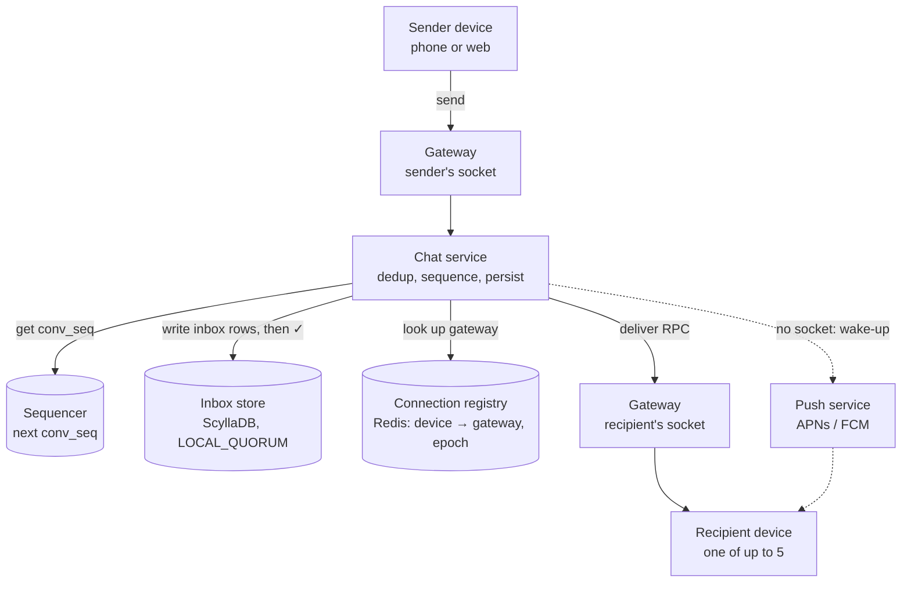
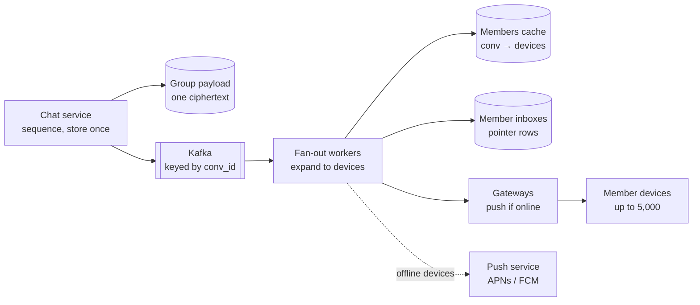
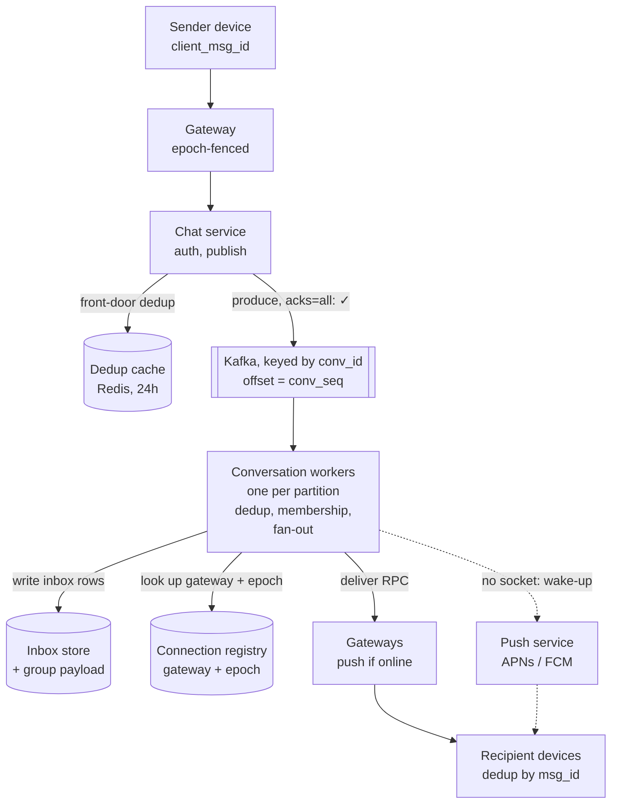

# Q3: Chat (WhatsApp)

**Pattern:** persistent connections, delivery guarantees, message ordering. The server's main job is to hold sockets, keep a durable log, and keep a per-device queue. It is an always-on router, not a read cache.

Reused from earlier questions:

- Q1: cache-aside for device lists and membership, expiry checked on read, and ID generation (made deterministic here, deep dive 2).
- Q2: fan-out on write through a queue, with the celebrity case removed by a group cap.

## Table of Contents

- [Recap](#recap)
- [1. Scope and requirements](#1-scope-and-requirements)
- [2. Scale estimates](#2-scale-estimates)
- [3. API and data model](#3-api-and-data-model)
- [4. High-level architecture](#4-high-level-architecture)
- [5. Deep dives](#5-deep-dives)
  - [Deep dive 1: persistent connections](#deep-dive-1-persistent-connections)
  - [Deep dive 2: delivery guarantees](#deep-dive-2-delivery-guarantees)
  - [Deep dive 3: message ordering](#deep-dive-3-message-ordering)
  - [Final architecture, after the deep dives](#final-architecture-after-the-deep-dives)
- [6. Bottlenecks, failure modes, and trade-offs](#6-bottlenecks-failure-modes-and-trade-offs)
- [7. Tech lead layer](#7-tech-lead-layer)

---

## Recap

**In one line:** a store-and-forward chat service where stateful gateways hold the sockets, a per-device inbox is the delivery guarantee, and a Kafka log keyed by conversation is the sequencer.

**The five decisions that define it**

1. **Store-and-forward with E2E.** The server holds a message only until every device acks it (30-day cap). Bodies are opaque, history lives on devices, and storage is ~150 TB instead of ~27 PB a year.
2. **Stateful gateways split from stateless logic, plus an epoch-fenced registry.** Register only if the epoch is newer, delete only if it is the caller's, and track liveness with one lease per gateway. **The push is best-effort and the inbox is the guarantee.**
3. **Per-device inbox, time-based offsets, write deadline plus lookback.** A 2 s write deadline and a 5 s sync lookback stop a late write from slipping under a cumulative ack. Every hop is at-least-once, and **`msg_id` = hash(sender device, client_msg_id)** gives exactly-once at the front door and on the device.
4. **The log is the sequencer.** Kafka is keyed by `conv_id` and the offset is `conv_seq`. One worker per partition dedups, applies membership changes in order, and fans out. That gives causality, failover and durability from one mechanism, and replaced the sequencer box.
5. **Subscribe-on-demand presence, fan-out on write capped at 1,000 members.** No contact-list broadcast and no celebrity problem. Channels would be a separate fan-out-on-read product.

**Numbers worth remembering**

- **Messages:** 50B/day ≈ 500k/s, 1M/s peak
- **Deliveries:** ~5 device deliveries per message ≈ 5M/s; ~15M/s events at gateways; ~10M/s store operations, half deletes
- **Connections:** ~500M concurrent, ~500k per box, ~1,500 gateways
- **Registry:** ~50 GB, ~400k writes/s of churn
- **Heartbeats:** ~10M/s, end at the gateway
- **Naive presence:** ~80M/s, hence subscribe-on-demand
- **Server time per send:** ~20-50 ms; the mobile last mile takes most of the 500 ms
- **Delivery-guarantee windows:** 2 s write deadline, 5 s lookback
- **Reconnect storm:** 500k clients per dead gateway; the load lands on the registry and inbox, not the gateways
- **Trade-offs to say out loud:** Kafka is on the ✓ path (a partition election stalls sends for seconds); the delivery guarantee depends on a clock-skew bound (workers self-fence); a region loss can drop seconds of ✓'d messages (senders resubmit); no server-side history, search or moderation

**The contract in three ticks**

- **✓** means replicated in the conversation's Kafka log (99.99%).
- **✓✓** means it reached a recipient device (p99 under 500 ms when both are online).
- **Blue ✓✓** means read on any device.
- **Strict:** per-conversation order, and no loss after ✓. **Eventual:** receipts, last seen. **Lossy:** typing.

---

## 1. Scope and requirements

The most useful part of the contract is a precise definition of what each tick promises. Every later design choice follows from those three promises.

### Functional requirements (in scope)

1. **One-to-one messaging.** Text messages between two users, delivered in real time when the recipient is online.
2. **Group messaging.** Groups capped at about 1,000 members.
3. **Offline delivery.** Messages to an offline user are held and delivered when any of their devices reconnects.
4. **Delivery and read receipts.** ✓ means the server has the message. ✓✓ means it reached the recipient's device. Blue ✓✓ means the recipient opened it.
5. **Presence.** Online status and last seen, plus typing indicators.
6. **Multiple devices per user.** One phone plus up to 4 companion devices (web, desktop), each receiving every message.

### Out of scope, stated out loud

- **Voice and video calls:** a separate real-time media system (WebRTC, TURN relays).
- **Media:** the client uploads the file to blob storage and sends a normal message carrying a pointer and a key (the Q4 pattern), so the chat path only carries small messages.
- **End-to-end encryption protocol:** the cryptography isn't designed here, but it is assumed to exist, and that assumption has consequences (below).
- **Message edit and delete-for-everyone:** each is a control message in the same ordered stream that refers to the original message ID, so they need no new machinery.
- Stories/status, payments, message search, contact discovery, spam and abuse detection, and backups.

### Questions that change the design

| Question | Assumption | What changes if the answer flips |
|---|---|---|
| Does the server keep message history? | No. Store-and-forward: the server holds a message only until every recipient device has acknowledged it. | Durable history means storage grows by about 1000× and becomes the main cost, and a search index becomes possible. |
| Is the payload end-to-end encrypted? | Yes. The server treats the body as opaque bytes. | Without E2E, server-side search, moderation and previews become possible. |
| What is the group size cap? | About 1,000. | A small cap means fan-out on write (Q2) is always fine. Channels with millions of members would need fan-out on read. |
| Multiple devices? | Yes, up to 5 per user. | Delivery state is tracked per device, not per user, and the ✓✓ rule has to be defined. |
| Ordering scope? | Per conversation only. | Global ordering would need a single sequencer for the whole system. Nobody needs that. |

### Non-functional requirements, each with its consequence

- **Read/write ratio roughly 1:1, not read-heavy.** Each message is written once and delivered once per recipient device. **Consequence:** no big read cache; the effort goes into the write-and-deliver path and into connections.
- **Delivery latency: p99 under 500 ms end to end when both parties are online in the same region (p50 around 100 ms).** **Consequence:** the server has to push. Polling can't meet this, so every online device holds a persistent connection.
- **Availability: 99.99% on the send path.** ✓ is the promise the user watches. **Consequence:** no single point of failure between the client and a durable write. Presence and typing can degrade without anyone filing a bug.
- **Durability:** once ✓ is shown, the message must not be lost before every recipient device has it. **Consequence:** replicated write before the acknowledgement, never acknowledge from memory.
- **Consistency, split by path:**
  - **Strict:** per-conversation order and no loss after ✓.
  - **Eventual:** ✓✓ and blue ✓✓ receipts, last seen, and group membership views on other devices.
  - **Lossy is fine:** typing indicators and online pings.

### Decision 1.1: store-and-forward instead of durable server history

- **Why:** E2E means the server can't read history anyway, so storing it buys no server-side features. Store-and-forward ties storage to *undelivered* messages (hours to days), not to *all messages ever sent*.
- **How:**
  - A message is replicated before ✓ is returned and queued in each recipient device's inbox.
  - Each device acknowledges after it persists the message locally; when every target device has acknowledged, the server deletes it.
  - Undelivered messages expire after 30 days, checked on read (Q1), not through lazy TTL alone.
  - A new device gets history from the user's primary device, transferred encrypted device to device, not from the server.
- **Alternatives:**
  - *Durable server history,* as Slack, Messenger and Telegram cloud chats do: better when the product needs server-side search, compliance retention, thin web clients with no local store, or instant history on a new device.
- **Pros:** small storage, smaller breach surface, natural fit with E2E.
- **Cons:** history depends on the device (a lost phone with no backup loses it), and adding a device needs the primary online. A product trade-off to state to the interviewer.

### Decision 1.2: order per conversation, not globally

- **Why:** users only perceive order inside a single chat.
- **How:** every message in a conversation gets a monotonically increasing sequence number assigned in one place per conversation. Clients render by that number, not by their own clock. Where it comes from is deep dive 3.
- **Alternatives:**
  - *Global total order:* needs a single sequencer, which caps throughput and adds a single point of failure for no user benefit. Better only if some feature needed one order across all chats, and none does.
  - *Client timestamps:* clock skew reorders messages, and two clients can send in the same millisecond. Better only as a display hint, never as the order.
  - *Causal ordering (vector clocks):* better when there is no central server to assign numbers, as in peer-to-peer or offline-first collaborative systems (relevant again in Q10).
- **Pros:** ordering scales linearly with the number of conversations.
- **Cons:** each conversation's sequencer is a small serialisation point, and a hot group is a hot key (sections 5 and 6).

### Decision 1.3: at-least-once delivery with deduplication, not "exactly-once"

- **Why:** exactly-once over an unreliable mobile network isn't achievable at the transport layer. Users need no lost messages and no duplicates on screen.
- **How:** the client attaches a client-generated message ID. The server deduplicates retried sends on it, and devices deduplicate redeliveries on the message ID. Delivery is at least once, retries are idempotent, and the user sees each message once. The full chain is deep dive 2.
- **Alternatives:**
  - *At-most-once (fire and forget):* better when loss is acceptable, which is exactly typing indicators and presence pings, so those use it.
- **Pros:** no loss, no visible duplicates.
- **Cons:** acknowledgement traffic in both directions and a dedup window the server must keep.

### What to say

> "Let me confirm scope. Core features are one-to-one and group chat with groups up to about 1,000, offline delivery, sent/delivered/read receipts, presence, and up to five devices per user. I'll leave out calls, stories, payments, search and spam. Media plugs in as an upload to blob storage plus a pointer message, and edit or delete plug in as control messages in the same stream. I'm assuming end-to-end encryption, so the server sees opaque payloads, and given that, I'd do store-and-forward: the server keeps a message only until every recipient device acks it, with a 30-day cap. Non-functionally: this isn't read-heavy, it's write-once deliver-once, so the hard path is delivery. That means p99 under half a second when both sides are online, which forces push over persistent connections. The send path needs four nines, and once the user sees a single tick the message can't be lost, so we replicate before we ack. The strict guarantees are per-conversation ordering and no loss after the tick. Receipts and presence are eventually consistent, and typing indicators can be dropped. Does that match what you have in mind?"

---

## 2. Scale estimates

The numbers that shape the design are **concurrent connections**, **deliveries per second** and **connection churn**, not storage or read QPS.

Anchors:

- **1 billion daily active users**, each sending about **50 messages a day**.
- That is 50 billion messages a day, roughly the scale WhatsApp has reported publicly.

**Message writes**

- 50B ÷ 100k s ≈ **500k messages/s average**, **~1M/s at daily peak** (2×, not 10×: global traffic flattens the curve).
- The real spike is New Year's Eve: one region can hit 5-10× for a few minutes. The answer is regional headroom and load shedding (section 6), not provisioning everything for it.
- *So therefore:* no single database absorbs this. The store must be partitioned and write-optimised; unlike Q1 and Q2, writes are the hard part.

**Deliveries and acks (the number that actually loads the system)**

- About 3 recipient users per message × 1.5 devices each, plus the sender's own other devices ≈ **5 device deliveries per message** → **~5M deliveries/s at peak**.
- Each delivery yields a device ack, and each message yields a ✓✓ and usually a blue ✓✓ back to the sender → **~15M small events/s** through the connection layer.
- The store sees an insert on delivery and a delete on ack → **~10M store operations/s at peak, half of them deletes**.
- *So therefore:*
  - Store-once versus copy-per-device looks like a ~5× swing in write volume; section 3 settles it and corrects the framing.
  - Half the load is deletes, and in Cassandra deletes create tombstones, so delete handling matters (sections 3 and 6).

**Group fan-out (reuses Q2)**

- Cap of 1,000 members × 5 devices = **5,000 deliveries for one message**.
- *So therefore:* fan-out on write, always. The cap removes the celebrity problem; million-member channels would switch to the Q2 hybrid.

**Concurrent connections (the system-specific number)**

- ~40% of daily users online at peak, plus companion devices ≈ **500M concurrent persistent connections**.
- A tuned event-loop gateway (Erlang/BEAM, or Go with epoll and small buffers) holds **~500k connections per box**, at ~20 KB each for TLS and buffers ≈ 10 GB RAM, so memory isn't the limit. WhatsApp pushed past 2M per box; 500k leaves room for failover.
- 500M ÷ 500k = **~1,000 boxes, ~1,500 with regional headroom and N+1**.
- *So therefore:*
  - A large fleet of stateful machines, so the cluster needs a **connection registry** (which box holds which device).
  - One box dying means **500k clients reconnect at once**: reconnect storms are a design concern (deep dive 1, section 6), and client backoff needs jitter.

**Connection churn and the registry**

- ~20 connects/day per user (handoffs, backgrounding, NAT timeouts) = 20B/day ≈ **200k registry writes/s average, ~400k at peak**.
- Registry size: 500M × ~100 B ≈ **50 GB**.
- *So therefore:* fits in memory but takes a high write rate, so an in-memory partitioned store (Redis cluster), not the message database.

**Heartbeats**

- Carrier NATs drop idle TCP flows after a few minutes, so keepalive about every 45 s: 500M ÷ 45 ≈ **10M heartbeats/s**.
- *So therefore:* heartbeats end at the gateway and never touch a backend. The interval trades battery against dead-connection detection (deep dive 1).

**Presence**

- ~400k connect/disconnect changes/s at peak; pushed to ~200 contacts each that is **~80M presence events/s**, more than all message traffic.
- *So therefore:* presence can't be broadcast to the contact list. It must be **subscribe-on-demand** (decision 4.4).

**Storage**

- ~500 B per message (100 B text plus encryption overhead and metadata) × 50B ≈ **25 TB/day**.
- Store-and-forward: the backlog is messages for offline devices. Budget 2 days of full volume: 50 TB × 3 replicas ≈ **150 TB**.
- Durable history for comparison: 25 TB × 365 × 3 ≈ **27 PB/year**, growing.
- *So therefore:* store-and-forward is ~200× less storage, confirming decision 1.1.

**Ordering throughput per conversation**

- The busiest conversation, a 1,000-member group, runs ~10-20 messages/s at peak.
- *So therefore:* one sequencer per conversation is never a throughput limit. Hot groups are a fan-out problem, not a sequencing problem.

Skipped: read QPS and hot set (nothing is reread, no read cache), and bandwidth (5M deliveries/s × 500 B ≈ 2.5 GB/s global egress, negligible; media would dominate but goes to blob storage and a CDN).

### What to say

> "Assuming a billion daily users sending 50 messages each, that's 50 billion a day: about 500k a second, a million at daily peak. New Year's Eve spikes are regional and handled with headroom and shedding. Each message goes to about five devices, so the real load is about 5 million deliveries a second, and with acks and receipts about 15 million small events. Every delivery is an insert and a delete, so storing once per conversation instead of once per device matters, and the store must handle deletes well. The system-specific number is connections: about 500 million concurrent. At 500k per box that's a fleet of about 1,500 stateful gateways, which needs an in-memory registry of about 50 GB taking about 400k writes a second. Heartbeats are about 10 million a second, so they stop at the gateway. Naive presence would be 80 million events a second, so presence is subscribe-on-demand. Storage is about 150 TB with store-and-forward versus 27 PB a year with full history, which confirms the scope decision. Max group fan-out is 5,000 deliveries, so fan-out on write, no celebrity problem. I'll skip read QPS and bandwidth because neither constrains anything here."

---

## 3. API and data model

The connection protocol and the message envelope are the main API decisions; the envelope carries the delivery and ordering guarantees from section 1.

### Decision 3.1: a persistent WebSocket for the data plane, plain HTTPS for the control plane

- **Why:** messages, acks, receipts and presence need server push with p99 under 500 ms at ~15M events/s (section 2), which rules out request/response. Rare operations (registering a device, creating a group) benefit from standard HTTP: auth middleware, rate limiting, retries, cacheable device lists.
- **How:**
  - One TLS WebSocket per device to a gateway, kept open. Frames are binary protobuf, not JSON, so a 500-byte message isn't wrapped in 300 bytes of keys.
  - Authenticated once at the handshake; every later frame is trusted as coming from that `device_id`.
  - Ping/pong about every 45 s ends at the gateway.
- **Alternatives:**
  - *MQTT over TCP:* tiny headers, built-in QoS, built for flaky mobile links (Facebook Messenger). better when clients are mobile-only and you want a ready-made broker protocol; web clients still need a WebSocket wrapper.
  - *Custom binary protocol over raw TCP* (WhatsApp's original FunXMPP): better when you have a team to own a protocol and want every byte squeezed. An organisational cost more than a technical one.
  - *Server-Sent Events plus HTTP POST:* better when traffic is mostly server-to-client and sends are rare (notifications, live scores). Chat is symmetric and ack-heavy, so a POST per ack is wasteful.
  - *Long polling:* better only as a fallback for networks whose proxies break WebSockets.
- **Pros:** one protocol for web and mobile, full duplex, cheap frames.
- **Cons:** stateful connections create the gateway fleet and the registry. TCP also doesn't survive network changes: Wi-Fi to 4G drops the connection and the client must reconnect and resync. QUIC (HTTP/3) connection migration fixes that, a later-phase option (section 7).

**Data-plane frames (over the WebSocket)**

| Direction | Frame | Fields | Meaning |
|---|---|---|---|
| C → S | `send` | `client_msg_id`, `conv_id`, `payloads[]` (one per recipient device for 1:1, or one sender-key payload for groups), `device_list_version` | Send a message |
| S → C | `send_ack` | `client_msg_id`, `msg_id`, `conv_seq`, `server_ts` | **✓**: durably stored |
| S → C | `send_error` | `client_msg_id`, code | `409 stale_devices` (with the current list), `403 not_member`, `413 too_large`, `429 rate_limited` |
| S → C | `deliver` | `inbox_offset`, `msg_id`, `conv_id`, `conv_seq`, `sender`, `payload` | A message for this device |
| C → S | `deliver_ack` | `up_to_inbox_offset` | **Cumulative** ack: "I've stored everything up to here" |
| C → S | `receipt` | `conv_id`, `up_to_conv_seq`, `type` = delivered \| read | Becomes **✓✓** / **blue ✓✓** for the sender |
| C → S | `sync` | `last_inbox_offset` | On every (re)connect: "send me what I've missed" |
| C → S | `presence_sub` / `presence_unsub` | `user_id` | Subscribe while a chat is open |
| C ↔ S | `typing` | `conv_id` | Fire and forget, never stored |

**Protocol details that carry the guarantees**

1. **`client_msg_id` makes sends idempotent.** The client generates a UUID before the first attempt and reuses it on every retry.
   - If the connection drops after the server stored the message but before `send_ack` arrived, the retry is deduplicated and returns the same `msg_id` and `conv_seq`.
   - This is the server half of decision 1.3.
2. **`deliver_ack` is cumulative, like TCP.** It cuts ack traffic, and on the store side **one range delete replaces N row deletes**: millions of point tombstones a second become one range tombstone per ack batch.
3. **Two sequence numbers, never confused:**
   - `conv_seq` is per conversation, the **display order** every participant agrees on (the ordering guarantee).
   - `inbox_offset` is per device, the **delivery cursor** (the delivery guarantee).
   - A device's inbox interleaves many conversations, so the client renders by `conv_seq` and acks by `inbox_offset`.
4. **`device_list_version` on send, with `409 stale_devices`.** Under E2E the sender encrypts once per recipient device, so it must know the device list.
   - If the recipient added a laptop a second ago, the server rejects the send with the current list and the client re-encrypts.
   - Multi-device plus E2E forces per-device payloads, which forces ~5 writes per message.
5. **Receipts are cumulative too.** "Read up to conv_seq 812" is one frame however many messages were read, so receipt traffic scales with how often a chat is opened, not with message count.

**Control-plane REST endpoints**

| Endpoint | Purpose | Notable errors |
|---|---|---|
| `POST /devices` | Register a device, upload public keys and push token | `409` if the device cap of 5 is reached |
| `GET /users/{id}/devices` | Device list and keys for encryption (cacheable, versioned) | `404` |
| `POST /groups`, `POST/DELETE /groups/{id}/members` | Group lifecycle | `403` not admin, `409` over the 1,000 cap |
| `POST /media/upload-url` | Pre-signed blob URL (the media plug-in point) | `413` |

### Access patterns

| # | Pattern | Key | Rate (peak) | Guarantee |
|---|---|---|---|---|
| A1 | Append a message to a device inbox | `device_id` | ~5M/s | Durable (quorum) |
| A2 | Read a device inbox from an offset (sync) | `device_id`, range on offset | ~400k/s (reconnects) | Must not skip entries |
| A3 | Delete an inbox range on cumulative ack | `device_id`, range | ~5M acks/s, batched into far fewer range deletes | Eventual is fine |
| A4 | User → devices + keys (every send) | `user_id` | ~1M/s | Versioned; staleness caught by 409 |
| A5 | Group → members (every group send) | `conv_id` | Fraction of 1M/s | Must be current at sequencing time |
| A6 | Device → gateway (every delivery) | `device_id` | ~5M/s reads, ~400k/s writes | In-memory registry |
| A7 | Dedup `(sender_device, client_msg_id)` | composite | ~1M/s | Short window (about 24h) |
| A8 | Next `conv_seq` for a conversation | `conv_id` | ~1M/s total, ≤20/s per conversation | Strictly monotonic |

Every pattern is a point lookup or a range scan inside one partition: no joins, no ad-hoc queries, no cross-partition transactions. With ~10M operations/s, half of them deletes, this is a **partitioned, write-dominated wide-column workload**.

### Decision 3.2: per-device inbox as the unit of delivery; group bodies stored once, inbox rows hold a pointer

Section 2 asked whether storing once per conversation (Option B: one log per conversation plus a cursor per device) beats one row per device per message (Option A, the inbox).

- **Why:** two facts make B's saving mostly illusory, so A, the per-device inbox, wins.
  1. **For 1:1 chats, E2E already makes the payload different per device** (each device has its own pairwise session), so there is nothing to store once. That is ~70% of traffic.
  2. **Every device's delivery state is independent anyway.** B still needs a cursor write per device per ack, and a per-device index of "which conversations have new messages for me", otherwise a reconnecting device scans every conversation it belongs to. That index *is* an inbox.
- **How:**
  - Store-once pays for groups. With sender keys (Signal's group scheme) one ciphertext works for every member device, so the body goes into `group_payload` once and each inbox row holds a ~60-byte pointer instead of a ~500-byte copy.
  - `inbox` rows hold either the inline ciphertext (1:1) or `(conv_id, conv_seq)` pointing at `group_payload`. Sync reads the inbox range and resolves pointers with a batched read.
- **Alternatives:**
  - *B, the conversation log:* better when the server keeps durable history (no E2E, as in Slack or Discord): the log is the product and storing per device would duplicate permanent data.
- **Pros:** draining a backlog is one sequential range read; offline catch-up is trivial; group storage is compact.
- **Cons:** row count stays ~5 per message, so **write operations don't drop, only bytes do** (group bytes drop ~8×). The section 2 "5× write volume" worry is corrected: operations stay at ~5×, and delete cost is controlled with cumulative range deletes, not by reducing rows.

### Schema

**`inbox`**: the delivery queue (the hot table)
```
PRIMARY KEY ((device_id), inbox_offset)       -- clustering ASC
  msg_id          bigint        -- hash(sender_device_id, client_msg_id), see deep dive 2
  conv_id         bigint
  conv_seq        bigint        -- display order
  sender_user_id, sender_device_id
  kind            enum { inline, group_ref, receipt, control }
  payload         blob          -- ciphertext if inline, null if group_ref
  server_ts       timestamp
  expires_at      timestamp     -- server_ts + 30 days, checked on read
```

**`group_payload`**: one ciphertext per group message
```
PRIMARY KEY ((conv_id), conv_seq)
  msg_id, sender_device_id, payload blob, expires_at
  -- TTL 30 days used for cleanup only; expiry is enforced on read
```

**`devices`**
```
PRIMARY KEY ((user_id), device_id)
  identity_key, signed_prekey, push_token, registered_at
  -- plus a static column device_list_version on the user partition
```

**`group_members`** and **`user_groups`** (two tables for the two directions)
```
group_members: PRIMARY KEY ((conv_id), user_id)     role, joined_at_seq
user_groups:   PRIMARY KEY ((user_id), conv_id)
```
`joined_at_seq` records the `conv_seq` at which the member joined, so "a new member can't see messages from before they joined" is a comparison, not a query.

**In memory, not in the database**

- Connection registry: `device_id → (gateway_id, connection_epoch)` in a Redis cluster (~50 GB, ~400k writes/s).
- Dedup window: `(sender_device_id, client_msg_id) → (msg_id, conv_seq)`, 24h TTL.
- The per-conversation sequence counter. Its home is deep dive 3, which replaces the counter with Kafka offsets.

Device lists and group membership are cache-aside (Q1), with the version check catching staleness.

`msg_id` starts as a Snowflake-style 64-bit time-ordered ID, as in Q1 and Q2. It is **not** used for ordering, because cross-node clock skew would reorder messages; `conv_seq` does the ordering. Deep dive 2 changes `msg_id` to a deterministic hash.

### Decision 3.3: database: Cassandra or ScyllaDB for `inbox`, `group_payload`, `devices`, `groups`

- **Why:** 150 TB at ~10M operations/s, all keyed by partition, with range reads and range deletes inside a partition (A1-A3), multi-region from day one.
- **How:** the properties that earn the pick:
  - **LSM storage:** sequential appends to a commit log plus memtable, which a 5M/s insert stream needs.
  - **Clustering keys:** rows in a device partition are physically sorted by `inbox_offset`, so sync is one sequential read.
  - **Range deletes:** `DELETE ... WHERE device_id = ? AND inbox_offset <= ?` writes **one range tombstone**, which is why the cumulative ack matters.
  - **Tunable consistency:** writes at `LOCAL_QUORUM` (2 of 3 replicas) meet durability without a cross-region round trip.
  - **ScyllaDB over Cassandra** is a cost choice: same data model, C++ shard-per-core, roughly 3-5× fewer nodes at this rate.
- **Alternatives:**
  - *DynamoDB / Bigtable:* same data model, fully managed. Better when the team is small and the bill is acceptable; at ~10M ops/s per-request pricing gets very expensive (section 7).
  - *HBase:* strong per-row consistency and good range scans (Facebook Messenger's inbox for years). Better when you already run Hadoop/HDFS; otherwise heavy to operate.
  - *Sharded MySQL with MyRocks (Vitess):* better when you need transactions or secondary indexes, e.g. durable history plus search. This design needs neither.
  - *Kafka with a topic or partition per device:* a billion devices can't be topics, and multiplexing them into partitions loses per-device range reads and deletes.
- **Pros:** high write throughput, linear scaling, multi-DC built in.
- **Cons:** tombstones still need care (range deletes and a short `gc_grace` on the inbox table, section 6); no cross-partition transactions, which matters for membership changes (deep dive 3); operationally demanding.

**Partition keys**

| Table | Partition key | Why | Downside and where it's handled |
|---|---|---|---|
| `inbox` | `device_id` | Every sync, ack and delete carries it; spreads evenly over a billion devices | A device offline 30 days in busy groups grows a large partition (~100k rows). Fine at that size; if not, bucket by day (section 6) |
| `group_payload` | `conv_id` | Fan-out resolves pointers by `conv_id` | A busy 1,000-member group means 5,000 reads of one row. Handled by delivering the payload inline from the fan-out worker's memory |
| `devices` | `user_id` | Every send asks "devices of user X" | Rarely changes, so cached |
| `group_members` | `conv_id` | Every group send asks "members of X" | Cached. Membership changes must order correctly against messages (deep dive 3) |

### What to say

> "Two planes. The data plane is one persistent WebSocket per device with binary protobuf frames: send, send-ack, deliver, deliver-ack, receipts, sync, presence subscribe, typing. The control plane is plain HTTPS for device registration, device lists and groups. MQTT or a custom TCP protocol would also work; I'd pick WebSocket because web clients need it. Three protocol details carry the guarantees. A client-generated message ID makes retried sends idempotent. Acks are cumulative, so one ack covers many messages and becomes one range delete in the store. And there are two sequence numbers: conv_seq for display order within a conversation, and inbox_offset as each device's delivery cursor. Because of E2E with multi-device, the sender encrypts per recipient device and sends a device-list version; a stale list gets a 409 and the client re-encrypts. Every access pattern is a point read or a range within one partition, about 10 million operations a second, half of them deletes, so this is a wide-column workload. I'd use ScyllaDB or Cassandra for the LSM write path, clustered range reads, range deletes and quorum writes. DynamoDB is the better pick for a small team that accepts the bill. The main table is a per-device inbox partitioned by device_id. I considered one log per conversation, but E2E already makes 1:1 payloads per device, and devices need independent cursors anyway. So I store group bodies once and put pointers in the inboxes. The interesting parts, how inbox offsets are assigned without losing late writes and who owns conv_seq, I'll come back to in the deep dives."

---

## 4. High-level architecture

Stateful machines hold connections; stateless machines hold logic. The central question is how a message finds the one gateway, among about 1,500, that holds the recipient's socket. This is the first cut; deep dive 3 removes the sequencer box and routes every message through Kafka.

**One-to-one path (first cut)**



**Group path (first cut)**

Same entry path; after sequencing, fan-out moves behind a queue. This is Q2 fan-out on write, with no celebrity case because of the cap.



Not drawn: an **L4 load balancer** that places each new connection on the least-loaded gateway (uninvolved after the handshake), the **presence service** (in-memory, off the message path), and the **control plane** (stateless API over `devices` and `groups` with cache-aside reads).

### Trace 1: Alice sends to Bob, Bob online (the write path)

1. Alice's phone sends `send{client_msg_id=c1, conv_id, payloads[Bob-phone, Bob-laptop, Alice-laptop], device_list_version}` to **Gateway A**, which forwards it on its gRPC stream to a **chat service** instance.
2. The chat service checks the **dedup** window for `(alice-phone, c1)`. On a hit it returns the stored `msg_id` and `conv_seq` and stops.
3. It checks `device_list_version` against the cached device list; if stale it returns `409` and Alice re-encrypts.
4. It gets `conv_seq = 813` from the **sequencer**.
5. It writes three **inbox** rows (Bob-phone, Bob-laptop, Alice-laptop) at `LOCAL_QUORUM`, each with a new `inbox_offset`.
6. It records `(alice-phone, c1) → (msg_id, 813)` in the dedup store and returns **`send_ack` → ✓**.
7. It looks up the three devices in the **registry**: Bob-phone → Gateway B; Bob-laptop has no entry → **push service**.
8. Gateway B writes `deliver{inbox_offset=…, conv_seq=813, …}` to Bob's phone.
9. Bob's phone persists it, then sends `deliver_ack{up_to_inbox_offset}` (a range delete) and `receipt{delivered, up_to_conv_seq=813}`, routed back to Alice as **✓✓**. When Bob opens the chat, `receipt{read}` gives **blue ✓✓**.

**Latency budget:** gateway hops ~2 ms, dedup and sequencer ~2 ms, quorum write ~10 ms, registry ~1 ms, push RPC ~2 ms ≈ **20 ms on the server**. The rest of the 500 ms p99 is the two mobile last miles, so the server has headroom and the SLO is measured end to end (section 7).

### Trace 2: Bob's laptop comes online (the read path)

1. The laptop wakes from the push, opens a WebSocket through the L4 LB to **Gateway C**, authenticates, and C writes `bob-laptop → (gateway C, epoch 42)` to the registry.
2. The laptop sends `sync{last_inbox_offset=9,120}`.
3. The chat service reads the inbox range `> 9,120` for `bob-laptop` (one sequential partition read) and resolves any `group_ref` rows with one batched read from `group_payload`.
4. Gateway C streams the backlog in pages. The laptop renders each conversation in `conv_seq` order, deduplicates by `msg_id`, and sends one cumulative `deliver_ack` per page, then `delivered` receipts per conversation (senders see ✓✓).

**Group send:** steps 1-4 as above, then one `group_payload` write plus a Kafka publish gives ✓. Fan-out workers expand membership to devices, write pointer rows, push online devices through gateways, and send a wake-up push to offline ones.

### Decision 4.1: separate the stateful gateway tier from the stateless chat service

- **Why:** different loads and failure costs. A gateway restart drops 500k sockets and triggers a reconnect wave; a chat-service restart costs nothing. Combined, every logic deploy is a mass disconnect. They also scale on different dimensions: gateways by connections and memory, the chat service by messages per second.
- **How:** a gateway is a thin event loop. It authenticates the handshake, writes its registry entry, answers pings locally, and forwards data frames to the chat service over long-lived gRPC streams. Chat-service deploys are routine; gateway deploys are rare, slow, and drain connections with jittered reconnect hints.
- **Alternatives:**
  - *Gateway and logic in one process:* better at MVP scale (WhatsApp's early Erlang servers), as long as the boundary is clean enough to split later (section 7).
- **Pros:** independent deploys and scaling; boring, stable gateways.
- **Cons:** an extra hop (~1-2 ms in region) and one more fleet to operate.

### Decision 4.2: route to the recipient via registry lookup and a direct gateway call, with the inbox as the guarantee

- **Why:** the message must reach the one gateway out of ~1,500 holding the device's socket, within the 500 ms budget, at ~5M deliveries/s.
- **How:**
  - Look up `device_id → gateway_id` in Redis (sub-millisecond), then RPC that gateway, which writes the `deliver` frame onto the socket.
  - **The inbox write happens first; the push is only an optimisation.** If the registry is stale, the gateway is gone or the RPC times out, nothing is lost: the device `sync`s from its last `inbox_offset` on its next connect.
  - So the routing layer never needs to be reliable, only fast.
- **Alternatives:**
  - *Redis Pub/Sub with a channel per user:* better when the scale is modest (millions of connections), since there is no registry. At 500M subscribers, channel churn and fire-and-forget behaviour become a problem.
  - *A Kafka topic or partition per gateway:* better when you want per-gateway buffering and replay. Adds 5-20 ms per hop, and the inbox already provides replay.
  - *Broadcast to all gateways:* 1,500× amplification. Better only with a handful of gateways.
- **Pros:** one memory lookup and one RPC, ~5 ms of server time.
- **Cons:** the registry can be briefly wrong after a reconnect. The `epoch` field handles that (deep dive 1) and the inbox catches the rest.

### Decision 4.3: 1:1 synchronous until ✓; groups ✓ on a single write, with async fan-out (reuses Q2)

- **Why:** ✓ means "durably stored". For 1:1 that is a few quorum inbox writes (recipient devices plus the sender's other devices) in ~10 ms, cheap to do synchronously. A 1,000-member group is 5,000 writes the sender can't wait for.
- **How:** for a group, write `group_payload` once and publish `(conv_id, conv_seq, msg_id)` to Kafka keyed by `conv_id` (a conversation's events stay in order in one partition). ✓ returns once **both** writes are acknowledged.
  - Fan-out workers read members from cache, write pointer rows, and push. The Kafka log is what makes "durable after ✓" true for pending fan-out.
- **Alternatives:**
  - *Synchronous fan-out for small groups (say under 20 members), async above:* better when small-group latency justifies skipping the queue hop; a reasonable phase-2 optimisation.
- **Pros:** ✓ latency is flat whatever the group size; a large group can't block the chat service.
- **Cons:** group delivery adds a queue hop (~10-30 ms) and Kafka consumer lag as a failure mode (section 6).

Revised by deep dive 3: 1:1 also goes through Kafka, and ✓ means "replicated in Kafka" for every message.

### Decision 4.4: presence is a separate, in-memory, subscribe-on-demand service

- **Why:** broadcasting would be 80M events/s (section 2), and presence is the loosest promise in the contract.
- **How:**
  - Gateways report connect/disconnect, debounced ~5 s so a blip doesn't flicker "online".
  - When A opens a chat with B, A sends `presence_sub(B)`. The service keeps B's status and current subscribers in memory, sharded by `user_id`, and pushes changes only to them.
  - `last_seen` is written lazily, at most about once a minute.
- **Alternatives:**
  - *Push to the whole contact list:* better when lists are small and presence is the product (gaming friend lists).
  - *Polling on chat open:* simpler still and better for an MVP.
- **Pros:** cost scales with open chat screens, not with churn × contacts.
- **Cons:** the contact list can't show live online dots. A deliberate product limit, to state out loud.

### Decision 4.5: push notifications are a wake-up signal

- **Why:** devices without a socket (backgrounded or killed apps) still need delivery, and under E2E the server can't produce a readable preview.
- **How:** if the registry has no entry for a target device, send an APNs/FCM push carrying the encrypted payload (if it fits) or just "you have messages". The app wakes, connects, `sync`s, decrypts locally and shows the notification.
- **Alternatives:**
  - *Server-generated plaintext notification:* better when there is no E2E.
- **Pros:** works with E2E; the inbox stays the only source of truth.
- **Cons:** dependency on Apple and Google delivery times, outside our control and outside the latency SLO.

### What to say

> "Clients connect through an L4 balancer to a fleet of about 1,500 stateful gateways that only hold sockets, terminate TLS and answer heartbeats. Frames go to a stateless chat service, which dedups, gets a conversation sequence number, writes the per-device inbox rows at quorum and only then sends the single tick. To deliver, it looks up the recipient device's gateway in a Redis registry and calls that gateway directly. That push is best-effort: the inbox is the guarantee, and any device that misses a push drains its inbox from its last offset on reconnect. Offline devices get an APNs or FCM wake-up. Groups store the ciphertext once and publish to Kafka keyed by conversation, and fan-out workers write pointer rows and push, the Q2 pattern with no celebrity case thanks to the cap. Presence is a separate in-memory service with subscribe-on-demand. I split gateways from logic because a gateway restart drops half a million sockets and a logic deploy shouldn't. Let me trace a send… and a reconnect sync… Server time is about 20 ms; the mobile last mile is most of the budget. The three areas I'd go deeper on are connection management, how inbox offsets make the delivery guarantee hold, and sequencing. Which would you like first?"

---

## 5. Deep dives

Three, in the order that builds best: connections, delivery, ordering. The ordering deep dive changes the section 4 architecture, so the final diagram comes at the end.

### Deep dive 1: persistent connections

~500M sockets on ~1,500 gateways. Constraints:

- The registry takes ~400k writes/s; per-device refresh is unaffordable.
- A wrong registry entry must never lose a message (the inbox guarantees that) and must not add **delay**, such as messages sitting in a dead socket for 90 s.
- Losing a gateway means 500k reconnects; losing an availability zone means ~170M.

#### Decision 5.1: epoch fencing plus gateway-level leases keep the registry correct

- **Why:** two failures to design against.
  - **Reconnect race.** Bob's phone switches Wi-Fi to 4G. The old connection on Gateway A is **half-open**: A won't notice until heartbeats are missed (~90 s).
    - The phone reconnects to Gateway C, which writes `bob-phone → C`. Ninety seconds later A runs its cleanup, `DEL bob-phone`, **deleting C's valid entry**.
    - Bob is unreachable by push until his next reconnect.
  - **Writes into a dead socket.** Until A notices, pushes routed to A go into the kernel send buffer of a half-open connection and the write succeeds with no error. The inbox saves correctness, but the message is delayed until Bob's next sync.
- **How:**
  - **Epoch per connection.** On handshake the gateway gets `epoch = INCR conn_epoch:{device_id}`, a monotonic per-device counter in the same Redis shard as the entry.
  - **Conditional writes, in one Lua script so they are atomic:**
    - *Register:* set `device → (gateway, epoch)` **only if** the new epoch is greater than the stored one; return the previous gateway.
    - *Unregister:* delete **only if** the stored epoch equals the caller's. A's late cleanup for epoch 41 finds epoch 42 and does nothing. **Failure 1 fixed.**
  - **Kill the stale socket immediately.** When C registers epoch 42 and the script returns "previously A", C tells A "bob-phone epoch 41 superseded" and A closes the socket at once. **Failure 2 fixed.**
  - **Fenced delivery.** Every `deliver` RPC carries `(device_id, epoch)`. A gateway holding a different epoch answers `NOT_HERE`, and the sender falls back to push. The inbox still holds the message.
  - **Gateway liveness, not device liveness.** Each gateway renews a lease key (TTL 10 s, renewed every 3 s): ~1,500 keys, ~500 writes/s. An entry pointing to a gateway without a live lease is treated as offline, so a dead gateway's 500k entries become invalid in ~10 s **with zero per-device writes**.
- **Alternatives:**
  - *Plain `SET` on connect, `DEL` on disconnect (last writer wins):* exactly the race above. Rejected.
  - *Per-device TTL lease (the entry expires unless the gateway refreshes it, say every 60 s):* 500M ÷ 60 = **8M writes/s** just to stay alive, 20× the churn load. Rejected on the section 2 numbers.
  - *Deterministic placement, `hash(device_id) → gateway`, no registry (the LB routes each device to its hashed gateway; delivery computes the same hash):* better when the fleet is small and stable. Every resize or box failure remaps devices, and mobile clients behind carrier NAT can't easily be steered.
- **Pros:** correct under reconnect races; dead gateways detected in ~10 s at negligible cost.
- **Cons:** one extra Redis round trip per connect (the `INCR`), and a Lua script that must stay single-shard, so the counter and entry share a hash tag.

#### Surviving a reconnect storm

A dead gateway's 500k clients spread over 1,499 boxes is ~330 each, so **the gateways are fine**. The pressure lands on the shared backends: 500k registry writes and 500k inbox sync reads in about one second, on top of a registry sized for 400k/s peak. An AZ failure multiplies it by ~300.

Cheap defences, each covering what the previous one doesn't:

1. **Client backoff with full jitter.** First retry at `random(0, base)`, doubling to a cap. 500k reconnects in 1 s become 500k over ~30 s, ~17k/s.
2. **Server-sent reconnect hints for planned events.** Before a deploy or drain, the gateway sends `reconnect_after = random(0, 120s)` to each client and drains gradually. Planned restarts stop being storms; only crashes are left.
3. **TLS session resumption** (session tickets). A resumed handshake skips the expensive key exchange, ~a tenth of the CPU. This is what saves gateway CPU in the AZ-failure case (170M handshakes).
4. **Admission control.** Each gateway and the L4 LB cap new connections per second and answer overflow with `retry_after`, so the registry and inbox never see more than their designed rate. **Cost:** some users take longer to reconnect.
5. **Cheap empty syncs.** Most reconnecting devices are up to date, so sync reads one partition and returns zero rows, the cheapest read ScyllaDB does.

#### Heartbeats and liveness

- The client pings about every 45 s, inside typical carrier NAT idle timeouts; the server marks the connection dead after two missed intervals.
- **The dial is battery against detection speed.** Shorter means faster presence and fewer half-open sockets but more radio wake-ups. Messenger-style **adaptive heartbeat** learns each network's NAT timeout and stretches the interval when safe.
- Background apps on iOS and Android lose their sockets; the design relies on the push wake-up path (decision 4.5) instead of fighting the OS.

**When to choose differently:** under a few million concurrent connections, or with a small team, use a **managed WebSocket service** (AWS API Gateway WebSockets, Ably, Pusher), which removes the gateway fleet and registry. At 500M connections, per-connection-minute pricing makes owning the fleet far cheaper (section 7).

### Deep dive 2: delivery guarantees

The contract is **no message lost after ✓ and the user never sees a duplicate**, on at-least-once transport. Constraints:

- Section 3 committed to cumulative acks and range deletes.
- There is **no per-device coordination**, since ~5M inbox writes/s come from many writers at once.

#### Decision 5.2: time-based offsets with a write deadline, a lookback window and client dedup

The trap is assigning `inbox_offset`. Bob's laptop inbox receives two messages from two workers at the same moment.

```
t=0   Worker X assigns offset 1000 (msg from Alice) ... its write is slow
t=1   Worker Y assigns offset 1001 (msg from Carol) and commits
t=2   Bob's laptop syncs: reads offset > 999 → sees only 1001
t=3   Laptop sends deliver_ack{up_to=1001} → range delete ≤ 1001
t=4   Worker X's write of offset 1000 commits
      → it is BELOW the acked cursor: never synced, and deleted by the next range delete
```

**That is message loss after ✓.** It happens with any scheme where the order offsets are assigned in differs from the order they commit in, which is true of every scheme with concurrent writers.

- **Why:** it turns a coordination problem into **an overlapping read plus an idempotent apply**, and the idempotent apply (dedup by `msg_id`) had to exist anyway. No extra hop, no per-device counter.
- **How:**
  - **Offset = `timeuuid`** (writer's server clock, node ID, counter). No coordination.
  - **Every inbox write has a hard deadline D = 2 s.** The ScyllaDB write timeout is set below D. A write not acknowledged by D is treated as failed and retried **with a new offset**, so no row can commit with an offset more than D older than "now".
  - **Lookback L = D + maximum clock skew + margin ≈ 5 s.** NTP keeps skew in the tens of milliseconds, and skew is monitored (section 7).
  - **Sync reads from `last_acked_offset − L`**, so the late write at offset 1000 is inside the window and is picked up.
  - **Range deletes only go up to `min(acked_offset, now − L)`**, so a row isn't deleted while young enough to have late siblings; the next ack trims it.
  - **The device deduplicates by `msg_id`** with a unique index in its local database; rows reread from the overlap are dropped.
  - **The live path is unchanged.** A worker pushes only *after* its write commits, so a live device gets the late message by push anyway. The lookback protects the sync cursor. A slow periodic sync every few minutes is a cheap safety net for a device that missed a push without reconnecting.
- **Alternatives:**
  - *Time-based offsets with no protection* (`timeuuid` from the writer's clock): better never, for a no-loss contract. It is exactly the trap above.
  - *Per-device atomic counter plus contiguous acks:* `INCR` per device for a gapless offset; the client only acks the **highest contiguous** offset and waits on gaps; gaps from crashed writers are filled by "skip" markers after a timeout.
    - Better when the client must **prove** completeness, e.g. a regulated audit trail.
    - Not here: an extra round trip on every write, and gap-filling is an error-prone side protocol.
  - *Single writer per device inbox:* route every write for a device through one owner (hash `device_id` to an inbox-writer shard), so commit order equals offset order.
    - Better when the store offers a cheap per-partition append (a log), so the owner comes free.
    - Not here: a second routing hop and ownership failover for a billion inboxes, to fix a timing window.
- **Pros:** zero coordination at 5M writes/s; late writes become harmless.
- **Cons:** each sync rereads up to ~5 s of rows (usually zero to a few); correctness depends on a **monitored clock-skew bound**; the write deadline must be truly enforced, since a write that "succeeds" after D breaks the guarantee, so it lives in the driver, not only in application code.

#### The end-to-end dedup chain

Every hop is at-least-once. Exactly-once is created in exactly two places: once on entry and once at the edge.

| Hop | Where duplicates come from | Where they're removed |
|---|---|---|
| 1. Client → chat service | Client retries after a lost `send_ack` | **Front-door dedup:** Redis `(sender_device, client_msg_id)`, 24h window |
| 2. Chat service → Kafka | Crash after publishing but before recording dedup; the retry publishes again | **Partition consumer dedup** (deep dive 3): the single writer per conversation drops a repeated `msg_id` |
| 3. Kafka → workers | Consumer crashes after writing inboxes but before committing its Kafka offset; replay | Same `msg_id` written again, removed at the device |
| 4. Inbox → device | Push plus sync overlap, lookback rereads | **Device dedup by `msg_id`** |
| 5. Receipts | Any retry | Naturally idempotent: cumulative ("up to conv_seq N"), applied as `max()` |

**Amendment to section 3:** `msg_id` can't be a fresh Snowflake ID per attempt, or retries would get different IDs and dedup would fail. **`msg_id` = a deterministic 64-bit hash of `(sender_device_id, client_msg_id)`**, so every retry has the same identity everywhere.

#### Receipt semantics with multiple devices

- **✓✓ (1:1):** at least one of the recipient's devices has persisted the message. **✓✓ (group):** every member has it on at least one device.
- **Blue ✓✓:** read on any device. The read receipt also goes to the recipient's **own** other devices, so their unread badges clear.
- **Expiry:** after 30 days undelivered the inbox row is dropped (checked on read). The sender's message stays at ✓ forever, and the device gets one "some messages expired" marker on its next sync instead of a silent gap.

**When to choose differently:** with durable history (no E2E, as in Slack), devices read a **conversation log** with a cursor per conversation.

The log's own offsets are the cursor and **the single-writer alternative comes free**: a single append-only log per partition means commit order equals offset order, and the lookback trick isn't needed.

### Deep dive 3: message ordering

Constraints:

- Every participant must see the **same order**.
- The order must respect causality (a reply never appears above its parent).
- It must hold **across sequencer failover**.
- **Membership changes must be ordered against messages**: if Dave is removed at some point, nothing after that point may reach him, and a joining member must not receive messages from before they joined.

#### Decision 5.3: the log is the sequencer

- **Why:** one mechanism gives ordering, causality, durable ✓, failover safety and correct membership ordering. The section 4 sequencer is **removed**, and 1:1 and groups share one path.
- **How:**
  - **Every message, 1:1 and group, is published to Kafka with key `conv_id`.** All events of a conversation, including **membership changes, edits and deletes**, land in **one partition**, appended by its single leader.
  - **`conv_seq` is derived from the partition offset**, returned in the produce acknowledgement. Within a conversation it is increasing **with gaps** (other conversations share the partition). Gaps are fine: `conv_seq` defines order, not completeness; completeness is the inbox's job (deep dive 2).
  - **Durability before ✓:** `acks=all`, `min.insync.replicas=2`, replicas in three AZs, unclean leader election disabled. ✓ now means "replicated in the log".
  - **Failover is Kafka's problem, already solved.** A new leader is elected from in-sync replicas, fenced by its leader epoch; a deposed leader's writes are rejected and acknowledged offsets are never reassigned.
  - **One consumer per partition (the "conversation worker")** processes events strictly in offset order. For each event it:
    1. **Dedups** by `msg_id` (hop 2 of the dedup chain), keeping a short recent-ID set per partition.
    2. **Applies membership changes in order**, keeping its member view updated *by the log itself*, not by cache invalidation.
       - Dave's removal at seq 900 is applied before message 901 is expanded, so he never receives it. A member added at seq 950 has `joined_at_seq = 950` and gets nothing earlier.
       - Under E2E the remaining members' clients also rotate sender keys on removal.
    3. **Fans out:** writes inbox rows (inline payload for 1:1, `group_payload` plus pointers for groups), then pushes through gateways via the registry.
  - **Causality comes free.** Bob can only reply after he received Alice's message, which is after it was appended, so his reply gets a larger offset in the same partition.
  - **Repartitioning** remaps some conversations to partitions with unrelated offsets, so `conv_seq = (partition_generation, offset)` packed into 64 bits, with the generation bumped at each cutover. A moved conversation's new numbers are always greater.
  - **On the client:**
    - Sent messages show at the bottom immediately as **pending (clock icon)** and are repositioned when `send_ack` returns `conv_seq`.
    - Received messages are **inserted by `conv_seq`**, not appended by arrival, so a sync backlog arriving after a live push lands in the right place.
    - In the rare crash-and-retry case where a duplicate publish got a second offset, the consumer drops it, and the **echo** to the sender's own devices carries the canonical `conv_seq`.
- **Alternatives:**
  - *Client timestamps (sort by the sender's clock):* better never for shared order. Skewed phone clocks reorder messages; a reply can appear above its parent.
  - *Server time or Snowflake ID (sort by a server-assigned time-ordered ID):* better when order only needs to be *roughly* chronological, e.g. a comment feed. Same order for everyone, but not causal: if the replier's node runs a few ms behind, the reply sorts above its parent.
  - *Redis `INCR` per conversation, failover epoch in the high bits:* the atomic counter gives `conv_seq = (epoch, counter)`, so a failover that loses increments still moves forward.
    - Better for a **1:1-only** system with no downstream stage that depends on order, where it is simpler and avoids the queue hop.
    - Not here: sequencing is separate from fan-out, so a removal at seq 900 and a message at seq 901 can reach the fan-out worker **in either order**, and Dave can still receive 901.
  - *Dedicated sequencer service, one owner per conversation:* conversations are consistent-hashed to sequencer shards; the owner holds the counter in memory, reserves blocks durably, and gets ownership via an etcd lease with a fencing token.
    - Better when per-conversation **logic** should live with the counter (Slack/Discord channel servers: rate limits, typing aggregation), for channel-style products with **large, very active conversations**, or when a **gapless** sequence is required.
    - Not here: a new stateful service with lease and failover logic, rebuilding what a log already provides.
- **Pros:** one mechanism covers ordering, causality, durable ✓, failover safety and membership ordering; 1:1 and groups share one path.
- **Cons:**
  - **Kafka is on the ✓ critical path.** The send path's 99.99% depends on multi-AZ Kafka. A leader election stalls sends for that partition's conversations for a few seconds; clients retry with the same `client_msg_id` (section 6).
  - 1:1 gains a queue hop (~10-30 ms), affordable against a 500 ms budget with ~20 ms used on the server.
  - A conversation is homed in **one region's** Kafka, which matters for multi-region (section 6).
  - Repartitioning needs the generation scheme.

### Final architecture, after the deep dives

The sequencer box is gone (Kafka offsets are `conv_seq`), 1:1 now goes chat service → Kafka → conversation worker with ✓ meaning "replicated in Kafka", and conversation workers (not the chat service) route to gateways; the registry stores `(gateway, epoch)` plus per-gateway leases.



### What to say

> **Connections:** "The registry has two races: a half-open old socket whose late cleanup deletes the new entry, and pushes into a dead socket. I fence both with a per-device epoch: register only if the epoch is newer, delete only if it's mine, and the new gateway tells the old one to close the stale socket right away. Liveness is a lease per gateway, about 1,500 keys, not per device, which would be 8 million writes a second. For storms, the gateways themselves are fine. The registry and inbox are what get hit, so the layers are jittered backoff, reconnect hints for planned drains, TLS resumption, and admission control at the edge. Below a few million connections I'd use a managed WebSocket service instead."
>
> **Delivery:** "The trap is that with concurrent writers, offset order isn't commit order. A slow write can land below a cursor the device already acked, and the range delete removes it: loss after the tick. Instead of coordinating per device, I bound how late a write can be with a 2-second deadline and re-read a 5-second lookback on every sync. Duplicates from that overlap are removed by msg_id on the device, which we needed anyway. msg_id is a hash of sender device and client message ID, so every retry has the same identity. Each hop is at-least-once, and exactly-once is created at two points: front-door dedup and device dedup."
>
> **Ordering:** "Timestamps aren't causal, and a separate counter can't order membership changes against messages for the fan-out worker. So I let the log be the sequencer: every event for a conversation goes to one Kafka partition keyed by conv_id, the offset is conv_seq, and a single consumer per partition applies removals before expanding the next message. Causality, failover and durability come from Kafka. The cost is that Kafka is on the critical path for the single tick and a leader election stalls a partition for a few seconds. That replaced the sequencer box from my first diagram."

---

## 6. Bottlenecks, failure modes, and trade-offs

The design leans on deliberate fallbacks (the inbox behind the push, the log behind the store, device dedup behind every retry); this is where they are shown to hold.

### Box by box

**Gateways**

- **Dead:** covered in deep dive 1. The lease expires in ~10 s, jittered clients reconnect elsewhere, nothing is lost.
- **Slow, gateway itself** (CPU saturated by TLS, a GC pause): worker `deliver` RPCs have a **200 ms timeout**, treated like `NOT_HERE` (fall back to push; the message waits in the inbox). A per-gateway circuit breaker stops workers queuing behind a sick box.
- **Slow, client** (2G, full TCP window): each socket gets a **bounded send buffer, ~64 KB**.
  - When it fills, the gateway **closes the connection instead of buffering more**; the client reconnects and syncs from its cursor.
  - Without the bound, a few thousand slow clients grow memory until the box dies with its 500k healthy sockets. **Cost:** slow clients see occasional reconnects.

**Chat service**

- **Dead:** stateless. The gateway retries the frame on another instance, and the same `client_msg_id` makes the retry safe.
- **Slow:** tight timeouts plus a breaker at the gateway. The user sees the pending clock a little longer and the client retries.

**Dedup cache (Redis)**

- **Dead or slow:** skipped after a **5 ms timeout** and the send publishes anyway. Duplicates are caught by the conversation worker's dedup (hop 2) and the device (hop 4). **It is an optimisation the system can lose**; the cost is extra Kafka writes, never correctness.

**Kafka: the component everything now depends on**

- **Partition leader dies:** a new leader is elected from in-sync replicas in a few seconds. **Sends to that partition's conversations fail during the election**; clients retry with the same `client_msg_id` and see the clock icon for a few seconds. No ✓'d message is lost (`acks=all`, `min.insync.replicas=2`).
- **A whole AZ goes:** replicas span three AZs and `min.insync=2` still holds, so the send path survives.
- **Slow:** a broker with a sick disk raises produce latency for its partitions, and there is **no way to route around it** because a conversation is pinned to its partition.
  - Mitigations: alert on in-sync-replica shrink and produce p99 per broker, hot spare brokers, automated leader rebalancing off the sick node. **Cost:** spare capacity paid for at all times.

**Conversation workers**

- **Dead:** the consumer group rebalances and the new worker replays from the last committed offset. Replayed fan-out writes the same `msg_id` again, which the device dedups. The recent-ID dedup set is rebuilt by **re-reading the last few minutes of the partition** at startup.
- **Slow, head-of-line blocking:** one 1,000-member group message is 5,000 inbox writes; handled strictly one at a time, every other conversation on the partition waits behind it.
  - **Mitigation: key-ordered parallelism.** Within a partition, events for *different* conversations run concurrently and events for the *same* conversation run in order, exactly what the ordering contract requires. A big group delays only itself.
  - **Cost:** more complex offset commits (only up to the lowest unfinished offset).
- **Consumer lag is the leading indicator for the whole delivery path** (messages ✓ but not ✓✓); the first thing to watch (section 7).

**Inbox store (ScyllaDB)**

- **Node dead:** RF=3 with `LOCAL_QUORUM` keeps working; hinted handoff and repair catch the node up.
- **Slow or degraded:** the 2 s write deadline makes workers fail fast and retry. A prolonged slowdown shows as **consumer lag, not failed sends**: **Kafka absorbs a store outage**, users keep getting ✓ and ✓✓ is delayed. That is the right degradation, since section 1 promised ✓ at 99.99% and made ✓✓ eventual.
- **Tombstones:** range deletes still pile up in busy device partitions and slow sync reads.
  - Mitigations: a **short `gc_grace_seconds`** on the inbox table (hours, not the 10-day default) and compaction tuned for delete-heavy data.
  - The usual risk is **resurrection** (a replica down longer than the grace period brings a deleted row back); here a resurrected row is an already-delivered message, which the device dedups by `msg_id`.
  - A normally serious risk is harmless in this design.

**Connection registry (Redis)**

- **Shard dead:** the replica is promoted in a few seconds; lookups fail meanwhile, so affected devices are treated as offline and get a push wake-up.
- **Writes lost in failover:** the registry is **soft state**. Gateways hold the truth (the sockets): after a shard failover they re-assert connections for the affected hash slots, and any missing device re-registers on its next reconnect. **It can always be rebuilt from the gateways.**
- **Slow:** a 5 ms timeout falls back to push. **Cost:** extra wake-ups.

**Push service (APNs / FCM)**

- **Dead or slow:** an external dependency. Requests are queued with retries and Apple/Google rate limits are respected. Offline devices are delayed, nothing is lost, and the device syncs whenever it opens. **Outside the latency SLO by design.**

**Presence service**

- **Dead:** "online" and "typing" disappear and `last_seen` goes stale. Messages are unaffected; it is deliberately off the message path.

**A failure mode the design created: clock skew**

- The delivery guarantee (deep dive 2) depends on server clocks staying within the lookback margin. A worker whose clock drifts more than ~2 s behind can write inbox rows with offsets outside a device's lookback window: **silent loss after ✓**.
- **Mitigation: self-fencing.** Every worker checks its NTP offset continuously and **refuses to write inbox rows** (and leaves its consumer group) if the offset passes a threshold well below the margin. Clock offset and self-fence events are monitored (section 7).
- **Cost:** a node with a bad clock removes itself, reducing capacity until fixed.

### Multi-region

Users connect to the nearest region's gateways (GeoDNS or anycast). The question is **where a conversation's log lives.**

| Option | How | Better when | Verdict |
|---|---|---|---|
| **One global write region** | All Kafka and workers in one region; others run only gateways | Single-continent products | 150-250 ms cross-ocean round trip on every send for remote users eats half the p99 budget |
| **Home region per conversation** (chosen) | `conv_id` keyspace split across regions; each conversation's partition lives in its home region (where it was created, or where most members are); gateways forward to it | | One writer per conversation, so ordering and dedup are unchanged. Only users far from a conversation's home pay the cross-region hop |
| **Multi-region consensus per conversation** | Spanner-style Paxos across regions for each append | Financial-grade ordering across regions | ~100 ms+ on every send for a guarantee no chat user can perceive |

**Inboxes live in each device's own region.** The home-region worker writes remote inboxes cross-region (~150 ms), well inside the 2 s write deadline.

**Region failure: an honest gap and a cheap fix**

- Kafka is mirrored asynchronously (MirrorMaker 2) to a standby region. If a home region is lost, its conversations fail over, but **the last few seconds of ✓'d messages may not have been mirrored**, breaking "no loss after ✓" in a region-wide disaster.
- Synchronous cross-region replication would close the gap at ~100 ms on every send, too high a price for a rare event.
- **The cheap fix reuses what exists:** the sender's device keeps every message until ✓✓. On a region-failover signal, clients **resubmit everything that is ✓ but not yet ✓✓**, and `msg_id` dedup makes it safe. The only loss is a region dying **and** the sender's phone being lost at the same moment.
- During failover (minutes), conversations homed in the failed region can't send; others are unaffected.

### Abuse

E2E rules out server-side content scanning, so defences are **behavioural and metadata-based**:

- Rate limits at the chat service: messages per device per second, **new conversations per account per day** (the main spam signal), and group-adds of non-contacts.
- Connection attempts per IP and per account at the L4 LB and gateways, which also protects the reconnect path.
- User reports: the reporting client forwards the decrypted messages, the only way content reaches the server.
- **Fast response:** banning a device revokes its credentials in the control plane, and the registry says which gateway holds its socket, so it is **disconnected within seconds**, not at its next reconnect.

### At 10×

- **Gateways (5B connections):** ~15,000 boxes, linear in connections and memory. The registry (~4M churn writes/s) is the shared piece that grows: more Redis shards. Nothing changes architecturally.
- **Chat service:** add instances; never the constraint.
- **Kafka (10M messages/s, ~6 GB/s in, ×3 replication):** operations hit a limit first.
  - **A single cluster's partition count and controller load bite before raw throughput.** The next move is **cells**: independent stacks (Kafka, workers, ScyllaDB), each owning a range of `conv_id`s, with a thin routing layer; repartitioning inside a cell uses the generation scheme.
- **Inbox store (100M operations/s):** linear in nodes, so **the dominant cost line** (section 7) rather than a capacity wall.

### Single point of failure

- **The Kafka partition of a conversation.** Each conversation is sequenced in exactly one place; a leader election is a few-second outage for every conversation on it. The price of getting ordering from the log.
- **The home region of a conversation**, during a regional failover.
- **APNs/FCM for backgrounded devices.** iOS has no alternative; the one dependency outside the system's control.

### Trade-offs

| Choice | What it cost | What it bought |
|---|---|---|
| Store-and-forward over durable history | History lives on devices: a lost phone without backup loses it, and a new device needs the primary online | ~150 TB instead of ~27 PB a year; fits E2E |
| Per-device inbox over a conversation log | ~5 rows per message; write operations don't drop | Independent device cursors; offline catch-up is one sequential read |
| Persistent WebSockets over polling | ~1,500 stateful boxes, a registry, reconnect storms | Server push within the 500 ms p99 |
| Push as best-effort, inbox as the guarantee | Late or missed pushes wait for the next sync | Routing never needs to be reliable, only fast |
| Epoch fencing plus gateway leases over per-device TTLs | Extra `INCR` per connect, single-shard Lua | Race-free registry without 8M writes a second |
| Lookback window over per-device coordination | Rereads up to 5 s per sync; correctness depends on a monitored clock-skew bound | No coordination at 5M inbox writes a second |
| Kafka offsets as `conv_seq` | Kafka on the ✓ critical path; seconds of stall per partition election; repartitioning needs generations | Ordering, causality, failover, durability and membership ordering from one mechanism; no sequencer service |
| ✓ means replicated in Kafka, async fan-out for everything | 1:1 gains a 10-30 ms queue hop | One path for 1:1 and groups; a store outage delays ✓✓ instead of failing sends |
| Home region per conversation, async cross-region mirror | A region loss can drop seconds of ✓'d messages (closed by client resubmit) | Local-latency sends for most users, with no cross-region consensus |
| Subscribe-on-demand presence | No live online dots on the contact list | ~80M a second of presence traffic avoided |
| E2E encryption | No server-side search, previews or content moderation | Privacy, a smaller breach surface, a small server footprint |

### What to say

> "Let me stress the design. If a gateway dies, its lease expires in ten seconds, clients reconnect with jitter, and nothing is lost because the inbox is the guarantee. If a gateway is slow, deliver RPCs time out at 200 ms and fall back to push, and slow clients get a bounded buffer and are disconnected rather than allowed to bloat memory. Kafka is the critical dependency: a partition election stalls those conversations for a few seconds and clients retry idempotently, and three AZs with min-ISR 2 survive an AZ loss. If ScyllaDB degrades, Kafka absorbs it: sends still get the single tick and only delivery lags, which is the degradation the contract allows. Worker head-of-line blocking from big groups is fixed with key-ordered parallelism. The registry is soft state that gateways can rebuild. One failure mode I created is clock skew, because the lookback relies on it, so workers self-fence when NTP drifts. Multi-region: each conversation has a home region; a region loss can drop a few seconds of ticked messages, which senders resubmit because they keep anything not yet double-ticked, and dedup makes that safe. At 10× the first constraint is operational, a single Kafka cluster's size, and the move is to cells. Cost-wise it's the inbox store. My single points of failure are the conversation's partition, its home region during failover, and APNs on iOS. The main things I traded away are server-side history, search and moderation, live presence on contact lists, and a few seconds of send availability per partition election, in exchange for ordering and durability from one mechanism."

---

## 7. Tech lead layer

Phasing is unusually sharp in chat because some decisions are compiled into **clients that can't be force-upgraded**.

### Phasing

**Decide early (expensive to change):**

| Decision | Why it's expensive later |
|---|---|
| **End-to-end encryption and store-and-forward** | Retrofitting E2E means a new client protocol, key management and a migration of every conversation. Removing server history later breaks user expectations |
| **The wire envelope**: `client_msg_id`, deterministic `msg_id`, `conv_seq`, `inbox_offset`, cumulative acks, `device_list_version` | Old app versions stay in the wild for years. A protocol without idempotency keys or a device-list version can't be fixed server-side |
| **Per-device inbox, partitioned by `device_id`** | Re-keying 150 TB under 5M writes/s is a quarter-long migration |
| **Kafka keyed by `conv_id` as the source of `conv_seq`** | The ordering contract comes from it. Changing the sequencer later means renumbering live conversations |

**Defer (cheap to add):**

- The gateway/logic split, epoch fencing, admission control and TLS resumption (server-side only).
- Multi-region home regions and cells (additive, routed by `conv_id` range).
- Subscribe-on-demand presence, adaptive heartbeat and QUIC (additive protocol features).
- Key-ordered parallelism (internal to the worker).

**Multi-device is the instructive case.** The **protocol** must support it from day one (per-device payloads, `device_list_version`, the device ID in every key), even if companion devices **ship** in phase 2. Building the protocol later breaks every installed client; building the feature later is just a release.

**Phases, each tied to a trigger**

**Phase 1: MVP.** Single region, three AZs.
- Trigger: launch, with nothing built yet.
- One combined gateway-plus-chat-service process (Go, event loop). Redis registry with plain epoch-checked writes. Managed Kafka (MSK or Confluent) keyed by `conv_id`. Managed ScyllaDB for inboxes. FCM/APNs wake-ups.
- Groups capped at 256. Presence fetched when a chat is opened. One device per user in the app, but the full multi-device wire protocol.
- **Interfaces from day one:** `Transport` (WebSocket now, QUIC later), `ConnectionRegistry`, `Append(conv_id, event) → conv_seq` (so Kafka could be replaced by owner-sequencers), `PushProvider`.

**Phase 2: Harden.**

- *Trigger: concurrent connections exceed ~5M, or a deploy causes the first all-user disconnect* → split gateways from chat logic.
- *Trigger: first reconnect-storm incident, or before the first planned rolling gateway deploy at scale* → admission control, TLS resumption, reconnect hints.
- *Trigger: worker lag p99 exceeds 1 s because of large groups* → key-ordered parallelism.
- *Trigger: product commits to them* → companion devices and the 1,000-member group cap (the protocol is already ready).
- *Trigger: presence traffic exceeds ~20% of gateway events* → subscribe-on-demand presence.

**Phase 3: Scale out.**

- *Trigger: more than ~30% of users have over 150 ms RTT to the only region, or a data-residency commitment to a market* → home regions per conversation.
- *Trigger: a single Kafka cluster approaches its partition or controller limits* → cells.
- *Trigger: reconnects caused by network handoffs are a measurable share of reconnects* → QUIC.
- *Trigger: the inbox store is the line item finance questions* → inbox fast-path (see Cost).

### Cost

| Line | Share | Driven by |
|---|---|---|
| Inbox store (ScyllaDB) | ~35-40% | **Device deliveries** × ~2 operations (insert and delete) |
| Gateway fleet | ~20-25% | Concurrent connections (memory-bound boxes) |
| Kafka | ~15% | Messages × replication × retention |
| Workers and chat service | ~10% | Messages and deliveries (CPU) |
| Cross-region and internet egress | ~10% | Remote participants, sync traffic |
| Redis (registry, dedup) and push | ~5% | Connection churn |

**Dominant driver:** cost scales with **deliveries (messages × recipients × devices)**, not messages. Multi-device alone multiplies the biggest line by 1.5-2.

**The main dial is store operations per delivery.** Levers and their behavioural cost:

1. **Inbox fast-path.** The worker pushes first and holds the delivery ~1-2 s. If the device acks in that time, **the inbox row is never written or deleted**; only devices that don't ack get a row.
   - Durability holds because the Kafka offset isn't committed until each delivery is acked or persisted, so a crash replays from the log.
   - Most targets are online, so this removes the large majority of inbox writes and deletes.
   - **Cost:** worker memory for in-flight deliveries, more complex offset commits, and Kafka retention must cover the hold window.
2. **Ack batching** (one cumulative ack per ~100 ms or N messages): fewer range deletes. **Cost:** a little more redelivery on reconnect, absorbed by `msg_id` dedup.
3. **Connections per gateway** (500k to 1M): halves the gateway fleet. **Cost:** double the blast radius per box.
4. **Kafka retention** (24 to 72 hours): shorter is cheaper. **Cost:** a shorter replay window for worker bugs and region failover.
5. **Managed vs self-hosted:** managed Kafka and databases in phase 1; self-hosting is cheaper once operations reach millions a second. **Cost:** a team to run it.

**Unit metrics:** **cost per million device deliveries** (store, Kafka, workers, egress) and **cost per thousand concurrent connections per month** (gateways, registry).

### Observability

**SLOs: one per promise, measured where the user experiences it**

| Promise (section 1) | SLO | Error budget |
|---|---|---|
| ✓ (send available) | 99.99% of send attempts get `send_ack` within 5 s, from **client telemetry** | ~4.3 minutes a month |
| ✓✓ latency (both online) | p99 from `send_ack` to recipient `deliver_ack` under 500 ms | 1% of messages a month above 500 ms |
| No loss after ✓ | **Zero** lost messages, measured by synthetic probe | None: any loss is an incident |
| Per-conversation order | Zero order disagreements between devices, by probe | None |
| Offline catch-up | 99% of reconnecting devices fully synced within 5 s | 1% |

**Why durability and ordering need a probe:** under E2E the server can't inspect content, and loss is by definition silent, so **the synthetic probe is the only honest measurement**.

Pairs of bot accounts in every region pair send numbered messages every few seconds through the full path: 1:1, a group, a bot device that goes offline and reconnects periodically, and a multi-device bot.

They verify every number arrives, in the same order on every device, with ✓, ✓✓ and latency recorded.

**Leading indicators (move before users notice)**

- **Kafka consumer lag, max per partition:** the earliest sign of ✓-but-no-✓✓.
- **Kafka produce p99 and in-sync-replica shrink:** the ✓ path is about to degrade.
- **Inbox write deadline-exceeded rate:** the store is slowing.
- **Lookback catches** (rows a sync found inside the lookback window that the device hadn't seen): normally near zero; a rising trend means late writes and the delivery machinery doing real work.
- **Worker NTP offset and self-fence events.**
- **`NOT_HERE` / push-fallback ratio:** registry staleness or a sick gateway.
- **Reconnects per second per gateway and per region:** a storm in progress.
- **Front-door dedup hit rate:** a spike means clients retrying, usually network or Kafka trouble.
- **Slow-client disconnects, sync read p99, tombstones scanned per read:** gateway and store health.
- **New conversations per account per hour, top-N:** abuse.

**Alerting**

- **Page only on error-budget burn rate**, multi-window (e.g. a 1h/5m fast burn and a 6h/30m slow burn) for the ✓ and ✓✓ SLOs, and **immediately on any probe-detected loss or order violation.**
- Leading indicators go on dashboards and become tickets. Clock skew is a ticket rather than a page *because* workers self-fence: the design turned a silent correctness risk into a visible capacity reduction.
- Never page on CPU or memory.

### Pushback on requirements

| Requirement | What it undermines | What to ask or propose |
|---|---|---|
| "Keep full history on the server, searchable, and instantly on any new device" | Store-and-forward and E2E. Price: storage goes from ~150 TB to ~27 PB a year and growing, **and** either E2E is lost or a key-escrow system must be built | Client-encrypted backup to blob storage the user owns; device-to-device history transfer |
| "Show online dots on the contact list" | Subscribe-on-demand presence. Price: ~80M events/s, more than all message traffic | Online and typing in the open chat header; last seen on profile |
| "Unlimited groups, broadcast channels to millions" | The fan-out cap, single-worker conversations, per-device E2E. Price: a celebrity problem (Q2) and a hot partition | **A separate channels product**: fan-out on read (Q2 pattern), server-readable, different SLOs |
| "Synchronous cross-region replication so nothing is ever lost" | The send latency budget. Price: ~100 ms on every send, to cover a rare regional disaster that client resubmit already mostly covers | Ask what a few seconds of loss in a regional disaster costs the business, then decide |
| "Deliver even after 30 days offline" | Bounded inbox growth. Price: storage for long-offline devices grows without bound | Keep 30 days with an explicit "messages expired" marker |
| "Scan messages for abuse or compliance" | E2E itself. Price: a policy decision before an engineering one | Metadata and behaviour signals, user reports with client-side forwarding |
| "Delete for everyone", "read receipts mandatory" | Nothing technical. Price: **needs policy first**, a time limit on deletes and privacy settings for receipts | Ship after policy is set; both are control messages in the same ordered stream |

**And should this be built at all?** If chat is a **feature** (support chat, an internal tool, a marketplace under a few million users), use **Matrix** or a managed SDK (Stream, Sendbird, Twilio Conversations), or at least a managed WebSocket service.

This architecture is worth its gateway fleet and operations team only when **chat is the product**.

### What to say

> "I wouldn't build all of this at once. In chat the expensive-to-change things are in the clients: E2E, store-and-forward, and the wire envelope with client message IDs, conversation sequences, cumulative acks and a device-list version. Old app versions live for years, so those ship in phase one even though companion devices ship later. Phase one is one region, a combined gateway and chat process, managed Kafka keyed by conversation and ScyllaDB inboxes. I'd split the gateways when we pass about five million connections or a deploy first disconnects everyone; add storm protection after the first storm; go multi-region when RTT or data residency forces it; and go to cells when one Kafka cluster nears its limits. Cost tracks device deliveries, and the inbox store is the biggest line. The big lever is pushing first and only persisting to the inbox if the device doesn't ack within a second or two, with Kafka covering durability. I'd track cost per million deliveries and per thousand connections. SLOs are one per tick: send availability at four nines, double-tick p99 under 500 ms, and zero loss and zero order violations, which under E2E only a synthetic probe can measure. I'd page on burn rate and on any probe loss. And I'd push back on server-side searchable history, contact-list presence, unlimited groups and sync cross-region replication, pricing each one. If chat isn't our product, I'd ask whether we should buy it instead."
