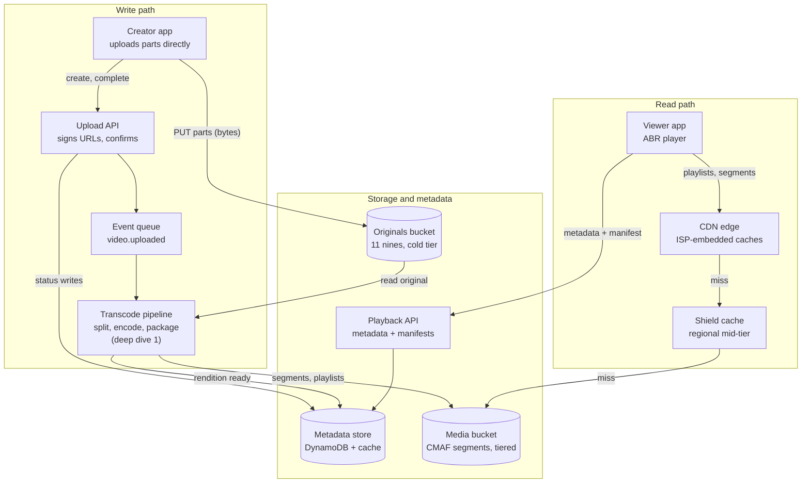
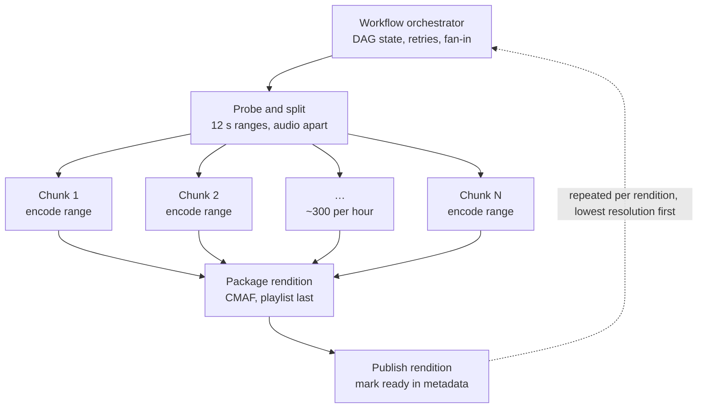
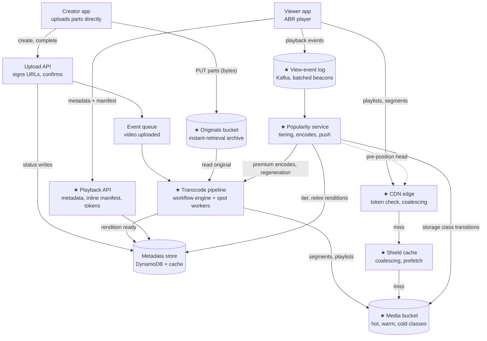

# Q4: Video streaming (YouTube)

**Pattern:** blob storage, transcoding pipeline and CDN. The bytes never touch your servers, derived data is regenerable, and the edge *is* the read path.

Reused from earlier questions:

- **Q1:** non-enumerable ID generation, cache-aside, negative caching, CDN edge caching, expiry checked on read.
- **Q2:** async delivery through a queue.
- **Q3:** idempotency keys, home region per entity, and the "client uploads to blob storage, sends a pointer" plug-in point.

## Table of Contents

- [Recap](#recap)
- [1. Scope and requirements](#1-scope-and-requirements)
- [2. Scale estimates](#2-scale-estimates)
- [3. API and data model](#3-api-and-data-model)
- [4. High-level architecture](#4-high-level-architecture)
- [5. Deep dives](#5-deep-dives)
  - [Deep dive 1: the transcoding pipeline](#deep-dive-1-the-transcoding-pipeline)
  - [Deep dive 2: CDN delivery: viral head and long tail](#deep-dive-2-cdn-delivery-viral-head-and-long-tail)
  - [Deep dive 3: blob storage lifecycle: tiering and regenerating derived data](#deep-dive-3-blob-storage-lifecycle-tiering-and-regenerating-derived-data)
  - [Final architecture, after the deep dives](#final-architecture-after-the-deep-dives)
- [6. Bottlenecks, failure modes, and trade-offs](#6-bottlenecks-failure-modes-and-trade-offs)
- [7. Tech lead layer](#7-tech-lead-layer)
- [Related systems](#related-systems)

---

## Recap

**In one line:** upload straight to object storage, keep originals as the source of truth, transcode in parallel chunks into immutable CMAF segments, and serve everything from a pull-through CDN with a shield tier.

**The five decisions that define it**

1. **Bytes bypass the services both ways.** Uploads go straight to object storage via pre-signed multipart URLs, and the `complete` call is the durability acknowledgement. Playback is all CDN after one Playback API call.
2. **Originals are the source of truth; renditions are derived.** Originals sit at the highest durability (later in instant-retrieval archive). Renditions are tiered, deleted or regenerated by popularity, which is the main storage lever.
3. **Immutable CMAF segments, HLS and DASH manifests, 4 s, keyframe-aligned.** Segments are cached for a year everywhere. The master manifest is the one dynamic, per-viewer piece (progressive publish, device filtering, private-video tokens).
4. **Chunk-parallel transcoding under a workflow engine.** 12 s ranges, deterministic output keys, priority classes (a new upload's 360p first), manifest written last. Premium codecs are triggered by popularity.
5. **Pull-through CDN with a shield tier.** Coalescing and hot-object replication handle viral videos; the first segments are always kept close for the tail; edge-validated tokens stay out of the cache key; push only for predictable demand.

**Numbers worth remembering**

- **Uploads:** 500 h/min ≈ 50 videos/s, so row writes are trivial
- **Ingest:** ~1.6 PB/day ≈ 130 Gbps
- **Storage growth:** +6.5 PB/day, ~75% derived
- **Transcode:** ~300k cores for H.264 alone; AV1 costs 5–10× more
- **Chunks:** a 1-hour video ≈ 300 × 12 s
- **Egress:** 90 Tbps avg, 200 Tbps peak; 700:1 bytes out to in
- **Edge misses at 95% hit:** ~10 Tbps, hence the shield
- **Segment requests:** 10–20M/s, none touching a database
- **Hot set:** ~40 TB per region
- **One viral video:** 5 Tbps for a single key
- **SLOs:** play-start 99.99%, first frame p95 < 2 s, rebuffering < 1%, publish p95 < 5 min
- **Cost split:** delivery 50–60%, storage 20–25%, transcode 15–20%

---

## 1. Scope and requirements

YouTube is a dozen systems. The video pipeline is the part that teaches this pattern, so most of the scoping is cutting.

### Functional requirements (in scope)

1. **Upload** of large files (a few GB, a few hours), surviving flaky connections.
2. **Process** into streamable formats: several resolutions and bitrates, cut into small segments, plus a thumbnail.
3. **Watch** with fast start, adaptive quality and seeking.
4. **Video page metadata:** title, description, uploader, visibility (public, unlisted, private), view count.

### Out of scope, said out loud

| Excluded | Where it would plug in |
|---|---|
| Recommendations, home feed, subscriptions | Read from the metadata store and view-event stream. A subscription feed is the Q2 fan-out pattern. |
| Search | Consumes a "video published" event |
| Comments, likes | Plain CRUD keyed by video ID |
| **Live streaming** | A separate real-time ingest path (RTMP or SRT into a packager) writing into the **same** storage and CDN layer |
| Ads, DRM | DRM plugs into packaging as segment encryption plus a licence server |
| Copyright and moderation | One more pipeline stage that can block publish |

Live streaming is the item worth naming: a product feature with hidden technical weight. It turns the pipeline from batch into real time, with a seconds-level latency target.

### Questions that change the design

- **Mutability:** can a video change after upload? Assume **no**. An edit is a new upload with a new ID. *Consequence:* every segment is cacheable forever under an immutable URL, so there is no content invalidation problem. Metadata is mutable and separate.
- **Exposure:** private and unlisted videos? Assume **yes**. *Consequences:* non-enumerable IDs (Q1, random base64 here), and private videos need short-lived signed tokens instead of plain public CDN URLs (5.2c).
- **Time to publish:** assume the **low-resolution version within minutes (p95 < 5 min), the full ladder later**. This one answer sets the shape of the pipeline (parallel and progressive). It is the hard part (deep dive 1).
- **Device range:** phones, browsers and TVs. *Consequence:* more resolutions and possibly several codecs per video, which multiplies storage and transcode compute, and it is the main cost dial later.
- **Identity:** the same file uploaded twice is **two videos**. Content-hash dedup is an optional cost lever, not a correctness requirement.

### Non-functional requirements, each with its consequence

| Requirement | Target | What it forces |
|---|---|---|
| **Read/write shape** | Views exceed uploads by orders of magnitude, and every read moves **megabytes, not rows** | The axis is **bandwidth**, not QPS. Origin can't serve it, so a CDN carries the read path. |
| **Playback availability** | 99.99% | Watching *is* the product. Playback must not depend on upload or processing being up. |
| **Upload availability** | 99.9% | Brief outages are tolerable if uploads resume, so this path can be cheaper and less redundant. |
| **Playback latency** | First frame p95 < 2 s; rebuffering < 1% of watch time; seek < 1 s | Latency here means startup and stalls. Serve segments from the edge, adapt bitrate in the player, keep the first segment small. |
| **Processing latency** | Low-res playable p95 < 5 min after upload completes | Forces chunk-level parallelism and progressive publish (deep dive 1). |
| **Durability** | Originals never lost (11 nines); transcoded versions re-creatable | Decision 1.1 |
| **Consistency** | Split by path | Decision 1.2 |

### Decision 1.1: originals are the source of truth, transcoded versions are derived data

- **Why:** the only thing we can't recreate is the creator's upload. Every resolution and segment is a pure function of the original plus encoding settings.
- **How:** originals go to 11-nines object storage (S3 Standard or equivalent) and can move to a cold tier after processing. Segments also live in object storage but carry a lower obligation: if lost, or deliberately deleted for an unwatched video, the pipeline regenerates them.
- **Alternatives:**
  - *Treat every version as equally precious:* better when re-transcoding is expensive relative to storage (small catalogue, costly encodes, no long-term access to originals).
- **Pros:** opens the biggest cost lever, since most videos get almost no views after the first weeks; and a new codec just means re-running jobs over stored originals.
- **Cons:** the first view after a deletion pays a regeneration delay or falls back to a lower resolution; the pipeline must stay deterministic and runnable for years.

### Decision 1.2: consistency split by path

- **Why:** strictness costs coordination, so pay only where a mistake is visible and harmful (a lost upload, a broken player). A view count 30 s stale harms nobody.
- **How:**
  - **Strict:**
    - "Upload complete" is returned only after the original is durably written. A creator must never see success and then lose the video.
    - No half-published video: a rendition is advertised only after all its segments exist, so the manifest is written *last* and a player can never request a segment that isn't there.
  - **Bounded-stale (minutes):** visibility changes and takedowns. Edge-cached content can't change instantly; the bound comes from short-lived tokens plus a CDN purge.
  - **Eventual:** view counts, metadata edits, search index.
- **Alternatives:**
  - *Strictly immediate takedown:* do not edge-cache sensitive content and authorise every segment at origin. Better for paid or licensed content with contractual takedown windows, at the cost of the CDN's benefit for those videos.
- **Cons:** a known window of minutes in which a just-privated video is still watchable by someone holding a valid token. Product and legal must accept it explicitly.

### What to say

> "Let me confirm scope. Core features are upload, processing into streamable formats, and playback with adaptive quality, plus a basic video page with metadata and a view count. I'll leave out recommendations, search, comments, ads and DRM. I'll also leave out live streaming, because it's a different real-time pipeline, but it would reuse the same storage and CDN layer, so I'll note where it plugs in.
>
> I'm assuming videos are immutable once uploaded, which means every segment is cacheable forever; that private and unlisted videos exist, so IDs must be non-guessable and private playback needs signed access; that a low-resolution version should be watchable within a few minutes of upload; and that we serve phones, browsers and TVs.
>
> Non-functionally, this is massively read-heavy, and the reads are bytes, not rows, so bandwidth is the real scaling axis and a CDN carries playback. Playback needs 99.99% availability, startup under 2 seconds at p95 and rebuffering under 1% of watch time. Upload can be 99.9% because it's resumable. Originals must never be lost; transcoded versions are derived and can be regenerated. Strict guarantees are that a confirmed upload is durable and that a player never sees a half-published resolution. Takedowns propagate within minutes, and view counts are eventually consistent. Does that match what you have in mind?"

---

## 2. Scale estimates

Measured in bytes and CPU time, not rows and requests. There are two anchors, because uploads and viewing scale independently:

- **500 hours of video uploaded per minute.** Roughly YouTube's published figure, and a good anchor because ingest, storage and transcoding are all driven by hours of video.
- **1 billion hours watched per day.**
- Supporting assumptions: the average video is ~10 min, the average uploaded original is ~5 Mbps (1080p from a phone), and the average delivered stream is ~2.5 Mbps (a mix of mobile and TV).
- Rounding rules: a day is about 10⁵ seconds, and 8 bits is a byte.

**Upload rate**
- 500 h/min of 10-min videos = 3,000/min ≈ **50/s** (~150/s peak).
- *So therefore:* row writes are trivial. The write path is hard because of bytes and compute.

**Ingest**
- 720k h/day × 2.25 GB/h ≈ **1.6 PB/day ≈ 130 Gbps**.
- *So therefore:* bytes must **not** pass through app servers. Clients upload directly to object storage with pre-signed resumable URLs (Q3's plug-in point, now a hard requirement).

**Storage**
- Ladder (240p–1080p) ≈ 2× the original; a second codec (VP9/AV1) → ~3×. That is ≈ 1.6 PB originals + ~5 PB derived ≈ **6.5 PB/day ≈ 2.4 EB/yr**, before ~1.5× erasure coding.
- *So therefore:*
  - Exabyte scale, never deleted: object storage plus tiering only.
  - **~75% of bytes are derived**, so deleting or never generating renditions for cold videos targets most of the bill (confirms 1.1).

**Transcode compute**
- 30,000 video-seconds arrive per second × ~10 core-s per video-s ≈ **300k cores** for H.264 alone. AV1 costs 5–10× more.
- *So therefore:*
  - A top-three cost line: the pipeline must be elastic (spot, queue-driven).
  - Expensive codecs only for popular videos, so encoding effort depends on view count (5.1d).
  - At this scale hardware encoders pay off (mention, don't design).

**Chunks (the system-specific number)**
- A 1-hour video encoded serially at ~real time takes ~1 hour. In 12 s chunks (3 × 4 s segments, decision 3.2) that is **~300 jobs**. In parallel, wall-clock ≈ one chunk's encode plus overhead = minutes.
- *So therefore:* split, encode in parallel, stitch. One job per video can't meet the publish target. This is the core of deep dive 1.

**Egress (the number that defines the system)**
- 10⁹ h × 3,600 s × 2.5 Mbps ÷ 8 ≈ **1.1 EB/day ≈ 90 Tbps avg, ~200 Tbps peak**. Bytes out to bytes in: **700:1**.
- **Peak factor is 2×, not 10×:** billions of viewers smooth into a daily curve. The 10× viral spike hits **one video**, a hot-key problem that immutable edge segments absorb (5.2a), not a global capacity number.
- *So therefore:*
  - **The edge is the read path.**
  - Needs thousands of locations including ISP-embedded caches (Google Global Cache, Netflix Open Connect); a rented CDN alone gets very expensive.
  - A 95% edge hit still leaves **~10 Tbps of misses**, too much for origin, so a **regional shield tier** sits between.

**Segment requests**
- 10⁹ h/day ÷ 24 ≈ 40M concurrent viewers (80M peak), one request per ~4 s ≈ **10–20M/s**.
- *So therefore:* the load lands on the edge, spread over thousands of machines; origin sees only misses. Segments must be static immutable files with no per-request logic.

**Hot set**
- Power-law popularity. Per region ≈ 100k videos × 2 watched renditions (360p, 720p) × ~10 min ≈ **40 TB**.
- *So therefore:* the head fits in one edge site (tens to hundreds of TB of disk). The long tail doesn't fit anywhere near the user, so tail views miss to the shield and origin, and tail startup becomes a deep-dive concern (the first segment is the one that matters).

**Metadata and view events**
- Playback starts ≈ 12B/day ≈ **120k/s (300k/s peak)**. New records ~4M/day × 2 KB ≈ a few TB/yr.
- *So therefore:*
  - Small dataset, high read rate: key-value store plus cache-aside (Q1); rendition playlists are CDN-cacheable.
  - View events at 300k/s can't be row increments (a viral video becomes a hot row). They are **events on a log, aggregated in batches**, hence eventually consistent view counts (distributed counters get full treatment in Q9).

Skipped: API server QPS for upload and metadata, and comment/like storage (constrain nothing).

### What to say

> "I'll anchor on 500 hours uploaded per minute and a billion hours watched a day. Uploads are only about 50 a second, so metadata writes are trivial. What's hard is the bytes. That's about 1.6 petabytes of originals a day, 130 gigabits a second, so clients must upload straight to object storage with pre-signed URLs. With a rendition ladder and a second codec, derived data is about three times the original, so we're adding roughly 6 petabytes a day, exabytes a year. Most of that is derived and regenerable, which is the cost lever. Transcoding is about 300,000 cores for H.264 alone, so the pipeline must be elastic, and the expensive codecs go only on popular videos. A one-hour video encoded serially takes an hour, so to publish in minutes we split it into about 300 twelve-second chunks and encode them in parallel. On the read side, egress is about 90 terabits a second on average and 200 at peak, 700 times the ingest, so the CDN is the read path. Even at a 95% hit rate the misses are 10 terabits, which is why I'll put a shield tier in front of origin. The popular head is about 40 terabytes per region and fits at the edge; the long tail doesn't, and I'll deal with that in the deep dives."

---

## 3. API and data model

Two storage systems carry the data: a small metadata database (what exists, its state) and object storage (the bytes). The work is deciding which data lives where, and keeping 10–20M segment requests per second off the database.

### API

**Upload (resumable, bytes go directly to object storage)**

1. **`POST /v1/videos`** creates the video and an upload session.
   - Request: `title, description, visibility, file_size, content_type`, plus an `Idempotency-Key` header (Q3: a retry after a timeout must not create two videos).
   - Response `201`: `video_id`, `upload_id`, **pre-signed part URLs** (S3 multipart, 16–64 MB parts), `expires_at`.
   - Errors: `400`, `413` (over size limit), `429` (upload quota).
2. **Client `PUT`s each part straight to the pre-signed URLs.**
   - Object storage serves this, not our API.
   - A failed part retries alone, which is the resumability.
   - The 130 Gbps never touches our servers.
3. **`POST /v1/videos/{id}/upload:complete`** with the part ETags.
   - The server completes the multipart upload, verifies size and checksum, sets `UPLOADED`, and publishes `video.uploaded`.
   - Returns `200` **only after storage confirms the assembled object** (the strict durability guarantee).
   - Errors: `409` (parts missing or mismatched), `410` (session expired, checked on read as in Q1).

**Watch**

4. **`GET /v1/videos/{id}`** returns metadata, `status`, view count and the **master manifest inline** (plus a short-lived token for private videos).
   - Inlining saves a startup round trip (5.2b). For public videos it is edge-cacheable with a ~30 s TTL.
   - Errors: `404`; `403` private and unauthorised; `451` takedown.
   - `status`: `UPLOADING → UPLOADED → PROCESSING → PARTIALLY_READY → READY`, plus `FAILED` and `BLOCKED`. `PARTIALLY_READY` exists because low resolutions go live first.
5. **Through the CDN:**
   - `GET /v/{id}/master.m3u8` (HLS) or `master.mpd` (DASH): built by the same manifest builder, for players that must be handed a URL (native TV players).
   - `GET /v/{id}/{rendition}/playlist.m3u8`
   - `GET /v/{id}/{rendition}/{n}.m4s`: one ~4 s segment.
6. **`POST /v1/playback-events`:** batched player beacons (start, heartbeats, QoE samples: time to first frame, rebuffers, rendition switches).
   - The handler appends to a log and returns `202`.
   - They feed view counts and the playback SLOs.

**Manage**

7. **`PATCH /v1/videos/{id}`** edits title, description, visibility. A visibility change also triggers a CDN purge (the bounded-stale path of 1.2).

**The protocol chain**

- Immutability (a product decision) lets segments and rendition playlists carry `Cache-Control: public, max-age=31536000, immutable`.
- That sets the biggest capacity number: at 200 Tbps each point of hit ratio is ~2 Tbps that doesn't reach the shield.
- The master manifest is the exception, since it changes while renditions are added (3.3).

### Decision 3.1: CMAF segments, served via both HLS and DASH manifests

- **Why:** phones, browsers and TVs. Apple requires HLS; much of Android, web and TV uses DASH. Storing every segment twice adds ~5 PB/day for no viewer benefit.
- **How:** each rendition is encoded once into **fragmented MP4 (CMAF)** segments. Two small manifests (`.m3u8`, `.mpd`) point at the **same segment files**. The player downloads the manifest, measures throughput and picks a rendition per segment (adaptive bitrate, ABR); the server knows nothing about it.
- **Alternatives:**
  - *HLS only with fMP4:* simpler. Better when the device matrix lacks DASH-only TVs (increasingly true).
  - *Progressive download* (one MP4, range requests): simplest. Better for short clips or a small catalogue, but it fails the rebuffering target on variable mobile networks because quality can't drop mid-stream.
- **Pros:** one copy of the bytes; ABR lives in the client, so serving is static files.
- **Cons:** a packaging step and two manifest generators to keep consistent.

### Decision 3.2: ~4 second segments

- **Why:** startup waits for at least one segment, and ABR can only switch at segment boundaries; the targets are first frame < 2 s and rebuffering < 1%.
- **How:** every segment starts on a keyframe, so the encoder places keyframes every 4 s. The player starts on a low rendition so the first segment arrives fast. Transcode chunks end on segment boundaries, so a chunk is **12 s (3 × 4 s)**.
- **Alternatives:**
  - *2 s:* faster startup and adaptation, but doubles the request rate (20–40M/s) and compresses worse. Better for low-latency live (out of scope).
  - *6–10 s:* fewer requests and better compression. Better for TV-first or long-form on stable connections.
- **Pros:** a balanced middle that fits both the startup target and the request-rate number.
- **Cons:** about 5–10% bitrate overhead from frequent keyframes compared with long segments, paid on every byte of egress.

### Decision 3.3: the master manifest is generated per request; everything below it is static

- **Why:** the master is the one mutable, per-viewer piece. It changes as renditions finish, should list only codecs the device supports, and for private videos carries a short-lived token. Rendition playlists and segments are immutable once written.
- **How:**
  - A lightweight **manifest builder inside the Playback API** builds it from the metadata row: ready renditions, filtered by device, token added for private videos.
  - Public results are CDN-cached with a **~30 s TTL**, so a new rendition appears within half a minute.
  - Rendition playlists are written once as complete VOD playlists and cached forever.
- **Alternatives:**
  - *Static master rewritten as each rendition finishes, short TTL:* better when everything is public and every device gets the same ladder (no service to run).
- **Pros:** per-device ladders, signing and progressive publish in one place that sees ~300k/s peak, not 20M/s.
- **Cons:** a dynamic service on the front of playback inherits the 99.99% target (section 6). Private manifests can't be shared across viewers in cache.

### Decision 3.4: segments are addressed by a deterministic path, never looked up in the database

- **Why:** 10–20M requests/s rule out any per-segment lookup.
- **How:** `/v/{video_id}/{rendition}/{n}.m4s` *is* the object key and the cache key; the edge maps the URL straight to object storage on a miss.
- **Alternatives:**
  - *Content-addressed segments* (key = hash, with a lookup table): better when deduplicating identical re-uploads saves meaningful storage; adds a lookup on every miss.
- **Cons:** URLs can't change, so tiering must happen *inside* the object store under the same key (lifecycle rules), never by moving objects.

### Access patterns and database choice

- **Read metadata by `video_id`:** ~120k/s avg, 300k/s peak; eventual, cacheable.
- **Build the manifest:** must reflect only finished renditions.
- **Create and update status:** ~50/s creates; conditional write so status only moves forward.
- **List a creator's videos:** low rate.
- **Fetch a segment:** CDN and object storage, no database.
- **View and QoE events:** appended to a log (~300k/s, at-least-once, aggregated).

Metadata is point lookups by one key: a **key-value workload**, a few TB per year, growing without end.

### Schema

**`videos`** (partition key `video_id`)

| Field | Notes |
|---|---|
| `video_id` | 11-char random base64, non-enumerable (Q1) |
| `uploader_id`, `title`, `description`, `visibility` | Mutable metadata |
| `status`, `status_version` | Moves forward only, by conditional write |
| `original_key`, `size`, `duration`, `content_hash` | Pointer to the original; the original's region is the video's home region |
| `renditions` | Map `rendition_id → {codec, resolution, bitrate, state, ready_at}`; `state` is `encoding`, `ready` or `retired` |
| `tier` | `hot`, `warm` or `cold`, set by the popularity service (5.3) |
| `created_at`, `published_at`, `view_count` | `view_count` is approximate, written in batches by the aggregator |

**`videos_by_uploader`** (partition `uploader_id`, clustering `created_at DESC`): `video_id`, title, thumbnail. A denormalised copy for the channel page.

**`upload_sessions`** (key `upload_id`): `video_id`, multipart upload ID, `expires_at` (checked on read). A lifecycle rule aborts incomplete multipart uploads after a few days.

Per-chunk job state is **deliberately not** in `videos`: ~50 videos/s × ~50 chunks × several renditions is thousands of short-lived updates a second. It belongs to the pipeline orchestrator; `videos` gets only the rendition-level outcome.

**Object storage layout**

| Bucket | Key | Class |
|---|---|---|
| `originals` | `{video_id}/source` | Highest durability; moves to instant-retrieval archive after processing |
| `media` | `{video_id}/{rendition}/init.mp4`, `{n}.m4s`, `playlist.m3u8` | Derived; tiered by popularity; regenerable (1.1) |
| `media` | `{video_id}/thumbs/…` | Derived |

The random `video_id` at the start of each key spreads load across the store's internal partitions with no extra hashing.

### Decision 3.5: database: a partitioned key-value store

**DynamoDB, Cassandra or Bigtable** for `videos` and `videos_by_uploader`.

- **Why:** point lookups by key, TBs a year with no end, hundreds of thousands of reads per second before caching.
- **How:** the property that earns the pick is horizontal partitioning by key plus **conditional writes**. A late, retried "PROCESSING" update must not overwrite "READY", so status transitions are compare-and-set on `status_version`.
- **Alternatives:**
  - *Sharded MySQL via Vitess* (what YouTube built): better when the team has deep MySQL expertise and wants transactions and secondary indexes (creator-studio queries across a channel).
  - *Plain Postgres:* better at MVP scale, under ~1 TB.
- **Cons:** no joins or ad-hoc queries. Analytics ("views by country for my channel") go to a warehouse fed from the event log.

### Decision 3.6: partition keys

- **Why:** the playback start carries `video_id` and random IDs spread evenly. "List everything belonging to X" is the case where partitioning by owner wins.
- **How:**
  - **`videos` by `video_id`.**
  - **`videos_by_uploader` by `uploader_id`.**
- **Cons:**
  - A viral video is a hot key on `videos`, absorbed by cache-aside (Q1) and the CDN-cached manifest.
  - A channel with millions of videos makes one huge partition in `videos_by_uploader`; bucket as `(uploader_id, year)` if that becomes real.

### What to say

> "Uploads take three calls. The first creates the video and returns pre-signed multipart URLs, with an idempotency key so retries don't duplicate. The client uploads parts straight to object storage, so they're resumable and our servers never see the bytes. Then a complete call, which returns success only after storage confirms the assembled object. That's the durability guarantee. Playback is one metadata call that returns the master manifest inline, then playlists and segments through the CDN. I'm using CMAF segments with both HLS and DASH manifests, so we store the bytes once and still cover Apple and everything else, with 4-second segments as the compromise between startup time and request rate. Segments and rendition playlists are immutable and cached for a year, and that cache header is what drives our edge hit ratio. The master manifest is the one dynamic piece: a small builder creates it per request, so it can list only finished renditions, filter by device and sign private videos.
>
> Metadata is point lookups by video ID, a few terabytes a year, so a key-value store like DynamoDB or Cassandra partitioned on video ID, with conditional writes so status only moves forward. A second table partitioned by uploader serves the channel page. Segment paths are deterministic, so 20 million segment requests a second never touch the database. The pipeline and the CDN behaviour are the interesting parts, and I'll come to them after the architecture."

---

## 4. High-level architecture

The write and read paths meet only in object storage and the metadata store. That separation is the main architectural point.

Also present, not drawn here: the **playback-events path**. Players send batched beacons to a small ingest endpoint that appends to a Kafka topic; an aggregator updates `view_count` in batches and feeds QoE dashboards. It appears in the final diagram because the popularity service consumes it.

### Trace 1: a write (upload to playable)

1. **Creator app → Upload API:** `POST /v1/videos` writes a `videos` row (`UPLOADING`) and an `upload_sessions` row, and returns pre-signed multipart URLs.
2. **Creator app → originals bucket:** parts upload **directly**, in parallel, each retried alone.
3. **Creator app → Upload API:** `upload:complete`. The API has storage assemble the parts, verifies the checksum, then sets `UPLOADED` by conditional write and returns `200`. **This is the durability guarantee.**
4. **Upload API → event queue:** `video.uploaded {video_id, original_key}`.
5. **Queue → pipeline:** reads the original, splits into 12 s chunks, encodes chunks in parallel per rendition, packages as CMAF, writes segments and each rendition playlist to the **media bucket**.
6. **Pipeline → metadata:** as each rendition completes (segments, then playlist last) it is marked `ready`; `status` becomes `PARTIALLY_READY`, then `READY`. Within ~30 s the master manifest lists it.

### Trace 2: a read (pressing play)

1. **Viewer → Playback API:** `GET /v1/videos/{id}`. Metadata comes through the cache (Q1 cache-aside), visibility is checked, and metadata plus master manifest return inline. Public responses are edge-cached ~30 s; a miss goes back to the manifest builder.
2. **Viewer → CDN edge:** the rendition playlist, then segments, starting low and adapting.
3. **Edge miss → shield → media bucket:** each layer caches the immutable object on the way back, so the next viewer in that region or ISP is served from the closest layer holding it.
4. **Viewer → playback events:** heartbeat and QoE beacons every ~30 s.

After the first call, nothing on the read path touches our services, which is the requirement at 10–20M segment requests/s.

### Decision 4.1: three separate services: upload, pipeline, playback

- **Why:** different promises (playback 99.99%, upload 99.9%, pipeline judged on freshness) and load shapes (playback high-QPS and latency-sensitive, upload low-QPS, pipeline compute-heavy and bursty). A bad pipeline deploy or upload spike must not touch playback.
- **How:** each is stateless and scales on its own metric: playback on request rate, upload on sessions, pipeline workers on queue depth. They share only stores; playback reads what the others write.
- **Alternatives:**
  - *One service with modules:* better for an MVP or small team (section 7), if the boundaries are clean enough to split later.
- **Pros:** fault isolation matching the per-path targets, independent scaling.
- **Cons:** three deployables and on-call surfaces; the metadata schema becomes a contract between teams.

### Decision 4.2: queue between upload and pipeline, triggered by the API, storage event as backstop

Async delivery through a queue is from Q2; what's new is **who publishes the trigger**.

- **Why:** the Upload API has just made the strict durability check, so it knows exactly when an original is complete and valid.
- **How:**
  - The API publishes `video.uploaded` after confirming.
  - Separately, the object store's "object created" notification feeds a **reconciler**: if an original exists but its video is still `UPLOADING` after a few minutes (the client died before `complete`), the reconciler completes it.
  - The pipeline is **idempotent per `video_id`**: chunk outputs go to deterministic keys, so a duplicate trigger redoes work but corrupts nothing.
- **Alternatives:**
  - *Trigger from the storage event only:* better when uploads arrive in one piece with no client confirmation (server-to-server partner ingest), at the cost of the synchronous acknowledgement.
- **Pros:** a synchronous, strict acknowledgement for the creator, plus a safety net for clients that vanish.
- **Cons:** two trigger sources, so duplicates are normal and idempotency is mandatory.

### Decision 4.3: pull-through caching with a shield tier, not push-to-edge

- **Why:** the catalogue is exabytes and only the head (~40 TB per region) fits at the edge. Pushing every new video to thousands of edges wastes most of the copying on unwatched videos. Without a shield, every edge's misses hit origin independently at ~10 Tbps.
- **How:**
  - An edge miss goes to its **regional shield**, a large mid-tier cache; a shield miss goes to the media bucket; every layer caches on the way back.
  - The shield **collapses concurrent misses**: a thousand edges missing the same segment send one request to origin. That is also the first defence against viral spikes (5.2a).
- **Alternatives:**
  - *Push (pre-position):* better for **predictable** demand: a scheduled premiere, a big show's new episode, yesterday's top videos pushed into ISP caches overnight (Netflix Open Connect). In the final design it is an **addition for the head**, not a replacement for pull.
- **Pros:** edge storage goes only to what's watched; origin traffic is bounded by the shield.
- **Cons:** the first viewer of a cold video in a region pays the full miss chain (the long-tail startup problem, 5.2b).

### What to say

> "Two paths that only meet in storage. On the write side, the creator gets pre-signed URLs from the Upload API and uploads parts straight to an originals bucket. The complete call verifies the assembled object and only then acknowledges, which is our durability guarantee. The API then publishes a `video.uploaded` event, and a storage-event reconciler catches clients that vanish before calling complete. The transcode pipeline consumes it, writes segments to a media bucket, and marks renditions ready in the metadata store as each one finishes. I'll come back to the pipeline; it's the first hard part.
>
> On the read side, the player calls the Playback API once for metadata and the manifest. From then on everything is the CDN: playlists and segments. Edge misses go to a regional shield that coalesces requests, then to the media bucket. I'm pulling rather than pushing because only the popular head fits at the edge. Pushing is something I'd add for predictable demand. Upload, pipeline and playback are separate services because they have different availability targets and load shapes, and a bad pipeline deploy must never touch playback.
>
> Let me trace a play: metadata and manifest from the cache, then segments edge, shield, bucket, with every layer keeping a copy. The three areas I'd like to go deeper on are the transcoding pipeline, how the CDN serves both viral videos and the long tail, and how the storage tiers keep exabytes affordable."

---

## 5. Deep dives

Three, one per new pattern: the transcoding pipeline, CDN delivery for the viral head and long tail, and the blob storage lifecycle. Offer the order to the interviewer: "Three areas worth going deeper on: the pipeline, CDN delivery, and storage lifecycle. Which first?"

### Deep dive 1: the transcoding pipeline

Constraints:

- ~300k cores for the baseline ladder.
- A low-res version playable within minutes, even for a one-hour video.
- Workers on spot capacity, so **any task can die at any moment**.
- No half-published rendition.
- Triggers may arrive twice (4.2), so everything is idempotent.

#### Decision 5.1a: unit of parallelism: chunk-parallel encoding

| Option | How it works | Verdict |
|---|---|---|
| One job per video | One worker encodes the whole file, rendition by rendition | 1-hour video takes ~1 hour or more; fails the publish target, and a lost spot instance wastes an hour |
| One job per rendition | Five workers, one per resolution | Only 5× parallel; 360p alone still takes ~1 hour. Fails. |
| **Chunk-parallel** (chosen) | 12 s time ranges; each (chunk, rendition) pair is an independent task | ~300 tasks per rendition per hour of video, so wall-clock ≈ one chunk's encode plus overhead: minutes |

- **Why:** the chunk-count number from section 2. It is the only option that makes "a few minutes" independent of video length.
- **How:**
  - **Split without re-encoding.** The splitter only *probes* (duration, codec, frame rate, rotation) and emits time ranges `[0,12), [12,24), …`. Each task ranged-reads the original, seeks to the **source keyframe before its start**, decodes, discards frames before `t`, and encodes exactly 12 s.
  - **Segment alignment.** Each task forces output keyframes at exact 4 s marks, so every chunk is three complete, independently decodable CMAF segments whatever the source's keyframe spacing. Chunks concatenate without re-encoding.
  - **Audio is one separate task:** cheap to encode, and chunking it causes audible clicks at boundaries.
  - **Idempotency.** Outputs go to deterministic keys (`work/{video_id}/{rendition}/{chunk}`); a retried or duplicated task overwrites identical bytes (Q3's idempotency, applied to files).
- **Alternatives:**
  - *Whole-file encoding* (the first row of the table): better for **short videos (under ~1 minute)**, where split and fan-in overhead exceeds encode time (use a threshold), and when **maximum compression quality** matters more than speed, since a whole-file two-pass encoder allocates bits globally.
  - *One job per rendition:* only 5× parallel, so 360p alone still takes ~1 hour; fails the publish target.
- **Pros:** publish time stays flat as length grows; spot-friendly (a lost task costs ≤ ~12 s); idempotent retries.
- **Cons:** **quality steps at chunk boundaries**, since each chunk's rate control is blind to its neighbours. Mitigate with constant-quality (CRF) encoding plus bitrate caps instead of target-bitrate, at the cost of a more variable bitrate, which the ABR ladder absorbs.

#### Decision 5.1b: orchestration: a workflow engine, not queue choreography

- **Why:** the ~300-way **fan-in** is the hard part: packaging waits for *every* chunk of a rendition.
  - The DAG has fan-out, fan-in, priorities, per-stage retry policies and optional branches (thumbnails, moderation).
  - The property that earns the pick is **durable workflow state with built-in fan-in and timers**. This is where per-chunk state lives, out of `videos`.
- **How:**
  - A **workflow engine** (chosen: **Temporal**, AWS Step Functions or Google Workflows) defines the DAG per video and durably records step state, retries with backoff, enforces timeouts and resumes after crashes.
  - The workflow dispatches chunk tasks onto **task queues** polled by stateless workers.
  - A worker **leases** a task and heartbeats; if a spot instance is reclaimed the lease expires and another worker takes it.
  - When all chunks of a rendition finish, the workflow runs the packager, then publish.
  - **Stragglers:** with 300 parallel tasks, publish time equals the **slowest** chunk. The workflow launches a **backup copy** of any task running far longer than its peers (MapReduce-style speculative execution); first to finish wins, and idempotent keys make the duplicate harmless.
- **Alternatives:**
  - *Choreography over Kafka or SQS* (each stage consumes an event, emits the next): simple for linear flows and needs no extra infrastructure.
    - Better for a **linear** pipeline with no fan-in ("transcode one file, then notify").
    - With fan-in it needs a counter per (video, rendition), and "where is video X stuck?" means stitching logs.
- **Cons:** another stateful system to run. At ~50 workflows/s with ~250 tasks each (average 10-minute video; ~1,500 for a 1-hour one) it must be sized and partitioned, and its persistence (Cassandra under Temporal) becomes something the team operates.

#### Decision 5.1c: progressive publish through priority

- **Why:** "playable within minutes" must hold **under load**, not only on an idle cluster.
- **How:**
  - **Priority classes on the task queues:**
    1. The **first rendition (360p)** of a new upload.
    2. The remaining baseline renditions.
    3. Premium re-encodes and backfills.

    When saturated the backlog builds in 2 and 3, and a new upload's 360p still jumps the queue.
  - **Publishing a rendition is strictly ordered:** all segments written → playlist written → `renditions[r].state = ready` (conditional write) → the manifest builder lists it within its ~30 s TTL. That ordering *is* the no-half-publish guarantee.
- **Alternatives:**
  - *Publish only when the full ladder is done:* better when a video must launch at full quality (scheduled premiere, paid content) and a low-res first impression is unacceptable.
- **Pros:** the creator sees a playable video in minutes; overload degrades the least urgent work first.
- **Cons:** early viewers get 360p only. Class 1 can be starved by an upload burst (priority inversion), so the fleet autoscales on **class-1 queue age**, not total depth.

#### Decision 5.1d: encoding effort depends on popularity

- **Why:** AV1 costs 5–10× the compute of H.264, and its ~30% byte saving pays off only per **byte delivered**. A 50-view video never repays an AV1 encode; a 10-million-view video repays it many times.
- **How:**
  - Every upload gets the cheap, universal **baseline H.264 ladder**.
  - A **popularity service** consumes the view-event stream. When a video crosses a view-rate threshold it enqueues a class-3 workflow: AV1 or VP9 plus a **per-title ladder**, tuned to content (a static lecture or cartoon needs far fewer bits per resolution than sport).
  - New renditions publish like any other, and the manifest builder offers them to capable devices.
  - **Break-even:** re-encode when *(expected future bytes delivered × egress price × ~30% saving) > premium encode cost*.
- **Alternatives:**
  - *Premium-encode everything up front:* better when **every title is watched heavily** (a small curated catalogue like Netflix applies per-title, even per-shot, optimisation to every title).
- **Pros:** compute goes where it reduces egress, the largest cost line.
- **Cons:** a video that goes viral serves heavier H.264 for its first hours; the popularity service is a cost dependency, not an availability one.

### Deep dive 2: CDN delivery: viral head and long tail

Constraints:

- 90–200 Tbps, first frame < 2 s p95, rebuffering < 1%.
- The head can spike beyond what one server or site delivers.
- The tail isn't cached near the viewer.
- Private videos must use the same edge without becoming public.

#### Decision 5.2a: viral videos: layered defences, cheapest first

What's video-specific is the **size of one hot key**: a viral 1080p video watched by 1M people at ~5 Mbps is **5 Tbps for one object**. No server or single site carries that, so defences must spread one object across very many machines.

| Layer | What it does | What it leaves for the next layer |
|---|---|---|
| 1. **Immutable segments** (section 3) | Every edge caches every segment it serves, for a year, with no revalidation | The first request at each edge still misses |
| 2. **Request coalescing at edge and shield** | 10,000 concurrent misses for a segment at one edge become **one** upstream fetch; same at the shield | One server in a site may still be overloaded by one object |
| 3. **Hot-object replication within a site** | Objects normally map to one server per site (consistent hashing); above a request-rate threshold an object is **replicated to several servers** and the load balancer spreads requests | Demand may exceed what one site can deliver |
| 4. **Spread across sites and ISP caches** | DNS or anycast steering moves viewers to nearby sites with spare capacity | Predictable spikes still start cold |
| 5. **Pre-positioning (push)** for predictable demand | Premieres, a big creator's upload, yesterday's top videos pushed into ISP caches off-peak (4.3) | Truly unpredictable spikes are handled by layers 1–4 |

- **Why:** the order is cheapest first: each layer is cheaper than the next and absorbs most of what reaches it. A **distributed lock** isn't needed: a segment is cheap to re-fetch and coalescing already removes the stampede.
- **Pros:** origin load for a viral video is about one fetch per segment per shield, whatever the audience.
- **Cons:** layers 3 and 4 are CDN-internal capabilities. On a third-party CDN they are the vendor's to provide, one argument for owning the edge at this scale (section 7).

#### Decision 5.2b: long-tail startup: keep the first seconds close, prefetch the rest

- **Why:** startup depends almost entirely on the **first segment**; later segments only need to arrive before the buffer runs out. A cold play goes edge miss → shield miss → origin: tens of ms per hop plus ~50–100 ms object-storage first byte (more cross-region), a large share of the 2 s budget.
- **How:** these combine:
  1. **Start at a low rendition:** the first segment at 360p is ~0.4 MB, not ~2.5 MB at 1080p.
  2. **Parallel startup fetches:** the Playback API returns the manifest *contents* inline with metadata, so the player fetches the first segment immediately.
  3. **Keep the first ~3 segments of 360p and 720p (the two renditions every tier keeps) on the fastest tier in every region, even for cold videos:** a few MB per video buys a startup guarantee across the catalogue.
  4. **Prefetch at the shield:** on a miss for segment `n`, also fetch `n+1 … n+3` in the background.
- **Alternatives:**
  - *Push everything to every region's shield:* better when the catalogue is small enough to replicate; at exabytes it isn't.
- **Pros:** tail startup approaches head startup at a tiny storage cost.
- **Cons:** speculative prefetch wastes origin reads when viewers quit early, so cap it at a few segments.

#### Decision 5.2c: private videos: signed tokens, validated at the edge, outside the cache key

- **Why:** the edge path stays free of service calls, and expiry of a few minutes plus a CDN purge on visibility change sets the **takedown bound** from 1.2.
- **How:**
  - The manifest builder issues one short-lived *signed token scoped to the video prefix* (HMAC over `video_id`, expiry, optionally viewer IP range), carried as a signed cookie or path prefix, granting access under `/v/{video_id}/`.
  - The edge verifies the HMAC with a shared key, **statelessly, no callback**.
  - The token is **excluded from the cache key**, so one cached copy of each segment serves every authorised viewer.
  - The player refreshes the token via the Playback API before expiry.
- **Alternatives:**
  - *Per-request auth callback:* strictly correct with immediate revocation, so better for paid or licensed content where revocation must be immediate (the strict path of 1.2). Puts our services back on the 20M/s path and loses cache efficiency.
  - *Signed URLs per segment:* a bulky manifest of unique URLs.
- **Pros:** stateless, cache-friendly, and the bound is explicit.
- **Cons:** a leaked token works until it expires, and rotating the signing key needs a period where both keys are valid.

### Deep dive 3: blob storage lifecycle: tiering and regenerating derived data

Constraints:

- +6.5 PB/day forever, ~75% derived and regenerable.
- Popularity is power-law.
- **URLs can't change** (3.4), so tiering happens under the same key.
- A player must never be offered a segment that doesn't exist (1.2).

| Option | How it works | Fails or wins when |
|---|---|---|
| Keep everything hot | Standard class for all | Cost grows linearly forever. Wins only for a small catalogue. |
| Age-based lifecycle rules | 30 days → infrequent access; a year → archive | Age isn't popularity: an old clip goes viral from an archive that takes **hours to restore** and playback breaks. Wins when access genuinely tracks age (news clips). |
| **Popularity-driven tiering plus deleting derived data** (chosen) | A popularity service assigns a tier; the storage class and *which renditions exist* follow it | Below |

#### Decision 5.3: popularity-driven tiers

| Tier | Which videos | What is stored | Storage class |
|---|---|---|---|
| **Hot** | Head (top few % by view rate) | Full ladder, premium codecs, replicated to every major region | Standard |
| **Warm** | Modest, steady views | Baseline H.264 ladder only; premium copies deleted | Infrequent-access (millisecond reads, cheaper storage, higher per-read cost) |
| **Cold** | Near-zero views | **Two renditions** (360p, 720p) plus the first-segments guarantee from 5.2b; everything else deleted | Infrequent-access or instant-retrieval archive |
| **Originals** (all) | — | The source file | **Instant-retrieval archive** (S3 Glacier Instant Retrieval or equivalent) |

- **Why:** storage is the cost line that grows without limit, and most bytes are derived and regenerable.
- **How:**
  - **Same key, different class.** Storage-class transitions keep the object key, so URLs and cache keys never change.
  - **Deletion order prevents broken playback:**
    1. Set `renditions[r].state = retired` so the manifest builder stops listing it.
    2. Wait out the manifest TTL plus a margin so no live manifest references it.
    3. Only then delete.

    Delete first and a player holding an old manifest gets a 404 mid-playback.
  - **Regeneration on demand.** If a cold video's view rate rises, the popularity service enqueues a class-3 workflow (deep dive 1) to rebuild renditions from the original. Meanwhile viewers get what exists: briefly lower quality, never a broken player.
  - **Originals in *instant-retrieval* archive, not deep archive,** because regeneration must read them in minutes; hours-long restores would turn "regenerable" into "regenerable tomorrow". The property that earns the pick is **millisecond access at archive-like storage cost**.
  - **Durability:** erasure coding across zones (11 nines), plus asynchronous **cross-region replication of originals only**. Derived data isn't replicated cross-region except the hot tier.
- **Alternatives:**
  - *Age-based rules:* better when access tracks age and the team wants zero extra machinery.
  - *Never delete derived data:* better when regeneration costs more than storage (very high-quality masters, expensive per-title encodes, a catalogue where every title stays popular).
- **Pros:** attacks the largest growing cost; the tiering decision lives in one service; the strict guarantee holds because the manifest is driven from `renditions` state.
- **Cons:** a cold video that suddenly goes viral starts at 720p and gains higher renditions minutes later; operational complexity; per-read pricing on infrequent-access tiers punishes a wrong classification, so thresholds need tuning and observation.

### Final architecture, after the deep dives

New or changed components are marked ★: a workflow-orchestrated spot worker fleet, a **view-event log** and **popularity service** (driving premium encodes, tiering and pre-positioning), an edge that validates tokens and coalesces, a multi-class media bucket, and originals in instant-retrieval archive.

### What to say

> "There are three areas worth going deeper on: how the transcoding pipeline publishes within minutes at this scale, how the CDN serves both viral videos and the long tail, and how we keep exabytes of storage affordable. Which would you like first?"
>
> **Pipeline:** "One encode job per video takes an hour for an hour-long video, and one job per rendition is only 5× parallel, so I cut the video into 12-second time ranges. Each task seeks to the preceding keyframe, encodes exactly its range with keyframes forced every 4 seconds, and writes to a deterministic key. Chunks concatenate cleanly, and retries on spot instances are harmless. Audio is one separate task. A workflow engine like Temporal owns the DAG, because the 300-way fan-in, retries, timeouts and 'where is this video stuck' are exactly what it's for, and it launches backup copies of straggler chunks. Task queues have priorities: a new upload's 360p version first, the rest of the ladder next, premium re-encodes last, so a backlog hurts the least urgent work. A rendition is published only after all its segments and its playlist exist. Premium codecs like AV1 cost 5 to 10 times the compute, so they're triggered by popularity: they pay back only on bytes delivered.
>
> **CDN:** For viral videos I layer the cheap defences first: immutable segments cached everywhere, request coalescing at edge and shield so origin sees one fetch per segment per shield, hot-object replication within a site, steering across sites, and pre-positioning for predictable premieres. For the long tail, startup depends on the first segment, so I start at low resolution, return the manifest inline, keep the first few segments of every video on the fast tier everywhere, and prefetch the next few at the shield. Private videos get a short-lived HMAC token scoped to the video, validated at the edge with no callback and kept out of the cache key. Its expiry is the takedown bound.
>
> **Storage:** Three quarters of the bytes are derived, so a popularity service tiers each video. Hot keeps everything, warm keeps only the baseline ladder on infrequent-access storage, cold keeps two renditions and the first segments. Originals go to instant-retrieval archive so regeneration takes minutes, not hours. Retirement is ordered: stop advertising the rendition, wait out the manifest TTL, then delete, so no player ever asks for a segment that's gone."

---

## 6. Bottlenecks, failure modes, and trade-offs

The read path must survive almost anything; the write and background paths may pause. The service split in 4.1 was made for exactly this.

### Read path (99.99%)

| Box | Failure | What happens | Mitigation | Cost |
|---|---|---|---|---|
| **Playback API** | Dies | **Plays in progress continue** (segments from CDN, tokens last minutes). **New plays can't start**: it is the only service on the playback path. | Stateless, active-active across regions behind global load balancing; CDN serves the metadata-and-manifest response **stale-if-error** for minutes past the 30 s TTL | A newly finished rendition or visibility change can take longer to appear during an outage |
| | Slow | Startup rises for all new plays; the 2 s target burns first | Tight edge timeouts (~300 ms) falling back to the stale response; circuit breaker on the metadata store; inline manifest means one call, not two | A stale fallback can mask a real bug, so alert on the fallback rate |
| **Metadata cache** | Lost | ~300k/s peak lands on the store | **A cache is an optimisation the system can lose.** Size the store for at least half the cache disappearing, plus a seconds-long in-process cache in the Playback API for viral-video hot keys | Idle store capacity most of the time |
| **Metadata store** | Region dies | Cache hits keep working; misses fail | Global table replication (DynamoDB global tables, Cassandra multi-DC), local reads; visibility checks tolerate seconds of lag (1.2) | Async replication: a just-privated video stays visible for seconds in another region |
| **CDN edge site** | Dies | Viewers there lose connections mid-play | Anycast or DNS steering to neighbouring sites; the **player retries the segment elsewhere** within its ~10–30 s buffer | **N+1 spare capacity in every metro**, typically 20–30% idle: the largest reliability cost |
| | Slow (congested ISP peering) | Throughput drops and the player **downgrades quality**: ABR is itself a reliability mechanism | QoE beacons by ISP and site feed traffic steering; with multiple CDNs, move traffic to the healthier one | Multi-CDN: per-vendor contracts and some lost cache efficiency (hot set cached twice) |
| **Shield cache** | Dies | Every edge in the region misses to origin: **~10 Tbps onto object storage**, which can't absorb it | Edges fail over to the **neighbouring region's shield**, never to origin; origin sheds load, prioritising first segments (startup) over mid-video | Cross-region transfer during failover; slightly higher tail latency |
| **Media bucket** | Region down | **Hot tier:** shields fail over to another region's replica, no user impact. **Warm/cold tail:** one region only, so those videos are **unavailable** until recovery. | Degraded path: originals are cross-region replicated, so the popularity service can **regenerate** a requested tail video in another region | Tail videos go dark in a regional outage; the alternative is replicating exabytes of rarely watched data |
| | Slow (per-prefix throttling) | Miss latency rises, especially during pipeline write bursts | Random `video_id` at the key start already spreads load; shield coalescing caps reads per object | None meaningful |

### Write path (99.9%, may pause)

| Box | Failure | What happens | Mitigation | Cost |
|---|---|---|---|---|
| **Upload API** | Dies | New uploads can't start; **in-progress uploads continue** on pre-signed URLs | Multi-region, stateless; client retries `complete` with backoff; the **reconciler** (4.2) completes uploads whose client vanished | Duplicate `complete` calls are normal, so the call is idempotent |
| **Originals bucket** | Region down | Uploads to that region fail | The Upload API issues URLs for a **healthy region's** bucket; each video records its original's region (Q3 home region per entity), and the pipeline runs there, so status writes never conflict across regions | Creators far from the healthy region upload slower during the outage |
| **Event queue** | Dies or loses messages | Uploads confirmed but never processed | The reconciler also **scans for videos still `UPLOADED` after N minutes** and re-enqueues. The queue is a fast path; metadata state is the source of truth. | Processing lags by the scan interval |

### Background paths (pause is fine, but cost and freshness drift)

| Box | Failure | What happens | Mitigation | Cost |
|---|---|---|---|---|
| **Orchestrator** (Temporal and its store) | Dies | No new publishes; **playback untouched** (4.1) | Durable workflow state resumes where it stopped; partitioned so one shard's failure pauses only some workflows | Freshness SLO burns; creators see "processing" longer |
| **Worker fleet** | Spot reclaimed in bulk | Queue age climbs | Priority classes protect class 1; **class 1 falls back to on-demand** when spot runs dry, classes 2–3 wait | On-demand pricing on the most urgent ~20% of work |
| | **Poison file** (crashes encoders) | Infinite retries waste cores and starve other work | Max attempts then `FAILED`, dead-letter queue, creator notified; **sandboxed workers** (gVisor, no network) because decoders parsing untrusted files are a known exploit surface | A few percent of CPU for the sandbox |
| **Popularity service** | Dies | No tier changes, premium encodes or push; cost drifts up slowly, nothing user-facing | Nothing urgent: deliberately off the availability path | — |
| | **Bug: classifies hot videos as cold** | Deletes renditions people are watching: a mass quality drop | Delete only after **sustained** low view rate (weeks); a **cap on the share of the catalogue retired per day**; dry-run mode for new thresholds; ordered retirement (5.3) | Tiering reacts slower, so savings arrive later |
| **View-event log** | Lag or loss | View counts stale or slightly low; QoE dashboards delayed | Accepted: view counts are eventual by design | — |

### Abuse

Detection is out of scope; the design makes these cheap:

- **Upload abuse:** per-account quotas and size limits at `POST /v1/videos` (`429`, `413`), before any storage is reserved.
- **Cache-busting with random query strings:** normalise the cache key to the path only (the token is excluded anyway, 5.2c).
- **Nonexistent segments:** **negative caching** at the shield (Q1), so scans never reach origin.
- **Piracy of private videos:** the scoped, short-lived token. For public videos, scraping is accepted as unpreventable; pretending otherwise is a weak answer.
- **Volumetric DDoS:** absorbed by the edge's own capacity, one more argument for a large footprint.

### At 10×

- **Egress bites first:** 200 Tbps becomes 2 Pbps, a problem of **edge capacity and peering cost**. Next: deeper ISP embedding, AV1 for a much larger share of the head (the popularity threshold drops as egress dominates), lower default mobile renditions.
- **Transcode cost second:** ~3M cores. Next: hardware encoders (YouTube's own transcoding chip) plus a **lazy ladder**: low-view uploads get only 360p and 720p, and the rest is encoded on demand once the video earns views (the regeneration logic of 5.3, applied from day one).
- **Storage** scales linearly and is handled by tiering, with more aggressive thresholds. **Metadata** at ~3M reads/s peak is handled by the partitioned store plus cache; not the constraint.

### Single point of failure

- **The honest SPOF is the edge fleet's configuration and steering layer.** A bad CDN config push or broken steering rule reaches thousands of sites at once, and large CDN outages are usually exactly this.
  - *Mitigation:* **staged rollout** (one site, a region, then global), automatic rollback on QoE regression, and a "last known good" config every edge can revert to.
  - *What it costs:* config changes take hours, not minutes, to reach the fleet.
- **Runner-up: the token signing key.** A bad rotation fails every private video at once, so keep two keys valid during rotation (5.2c).

### Trade-offs

| Choice | What it cost | What it bought |
|---|---|---|
| Upload directly to object storage, not through our servers | More complex client (multipart, pre-signed URLs, `complete`, a reconciler) | No 130 Gbps ingest tier; resumability for free |
| Originals as source of truth, derived data regenerable | A deterministic pipeline that must stay runnable for years; regeneration delays | Deleting ~three quarters of the bytes for cold videos |
| CMAF with HLS and DASH manifests | A packaging step and two manifest generators | One copy of the bytes for every device |
| 4-second segments | ~5–10% bitrate overhead, more requests | Fast startup and responsive adaptation |
| Dynamic master manifest | A service on the 99.99% path | Progressive publish, per-device ladders, private-video tokens |
| Chunk-parallel encoding | Possible quality steps at chunk boundaries; ~300-way fan-in | Publish in minutes regardless of length; spot-friendly |
| Workflow engine | Another stateful system to run and size | Fan-in, retries, timeouts, stuck-workflow visibility |
| Popularity-driven premium encoding | Viral videos serve heavier H.264 for their first hours | Compute spent only where it saves egress |
| Pull-through CDN with shield, push only for predictable demand | Cold first view per region pays the full miss chain | Edge storage only for what's watched; origin protected |
| Edge-validated tokens, minutes of expiry | Takedown is bounded-stale, not instant | No service call on 20M/s segment requests; shared cache across viewers |
| Popularity-driven tiering and deletion | An old video going viral starts at 720p; complexity; misclassification risk | Long-term storage cost that grows far slower than uploads |
| Tail stored in one region only | Tail videos unavailable during a regional storage outage | Not replicating exabytes of rarely watched data |
| N+1 edge capacity per metro | 20–30% idle edge capacity | Site failures invisible to viewers |

### What to say

> "Let me stress it. The read path is what must survive. If the Playback API dies, plays in progress continue because segments come from the CDN and tokens last minutes; new plays fail, so it's active-active across regions and the CDN serves the metadata-and-manifest response stale-if-error. If the metadata cache goes, the store is sized for half the cache missing, plus an in-process cache for viral IDs. If an edge site dies, steering moves viewers and the player retries elsewhere within its buffer; that's why we keep N+1 capacity per metro. If a shield dies, edges fail over to a neighbouring shield, never to origin, because 10 terabits would flatten object storage. If a storage region goes, the hot tier is replicated, but tail videos stored in one region go dark. That's a deliberate trade, with regeneration from the cross-region original as the degraded path.
>
> The write and background paths can pause. In-flight uploads continue on pre-signed URLs; a reconciler catches lost events and vanished clients; the pipeline resumes from durable workflow state; and playback never notices. Poison files get capped retries and sandboxed workers. The scariest background bug is the tiering service deleting renditions of hot videos, so deletions need sustained low views and a daily cap.
>
> At 10×, egress and peering cost bite first, then transcode cost, which is where hardware encoders and a lazy ladder come in. The real single point of failure is edge configuration: a bad global push. So config rolls out in stages with automatic rollback. The main things I've traded away are instant takedown, full quality for cold videos that suddenly go viral, and tail availability during a regional storage outage."

---

## 7. Tech lead layer

Unusually, the hard-to-change decisions here are about bytes and formats, not the database: the catalogue is exabytes of files, and anything baked into them is very expensive to redo.

### Phasing

**Decide early (expensive to change):**

| Decision | Why it's expensive later |
|---|---|
| **Keep originals, always** | Discard them to save money and derived data stops being regenerable, permanently. Every later cost lever (tiering, deleting renditions, premium re-encodes, new codecs) depends on this. |
| **Object key and URL scheme** (`/v/{video_id}/{rendition}/{n}.m4s`) | URLs are cache keys and live in players' manifests (3.4); changing them means rewriting or redirecting exabytes of references |
| **Segment format and keyframe alignment** (CMAF, 4 s) | Changing means re-packaging or re-encoding the catalogue |
| **`video_id` format** | Non-enumerable and embedded in every URL and external link |
| **The `renditions` map as the manifest's source of truth** | Progressive publish, safe deletion and tiering all depend on "the manifest lists only what metadata says is ready" |

**Defer (cheap to add):** the shield tier, own edge, chunked encoding, the workflow engine, priority classes, premium codecs, the popularity service, multi-region playback.

- Each is additive or internal to one box. Moving from whole-file to chunked encoding changes nothing outside the pipeline as long as the output format is fixed.
- **On metadata:** Postgres is fine under ~1 TB (3.5), but start on **DynamoDB**: managed, cheap at small scale, already key-value, and MVP metadata is GBs, so any migration is days of work, not months.
- **The irreversible "data model" here is the file layout, not the table.**

**Phases, each triggered by a metric**

**Phase 1: MVP (one region, mostly managed)**

- Trigger: none, it is the starting point.
- Direct-to-S3 uploads via pre-signed multipart URLs (`complete` is the durability ack), with a reconciler on storage events.
- **Whole-file encoding per rendition** on a queue-driven worker pool or AWS MediaConvert; baseline H.264 only.
- CMAF with HLS and DASH, 4 s segments, keyframe-aligned **from day one**.
- **CloudFront with Origin Shield** (the shield is a setting, not a project) and signed cookies for private videos.
- Playback API with the dynamic master manifest, since private videos need it from the start.
- One lifecycle rule moving originals to instant-retrieval archive after 30 days: a cheap win needing no popularity data.
- Encoder, CDN and token signer behind interfaces.

**Phase 2: harden and get efficient**

- *Trigger: p95 time to publish breaches target (long videos waiting an hour)* → chunk-parallel encoding, workflow engine, priority classes, spot workers.
- *Trigger: CDN or storage becomes the top bill line* → view-event log, popularity service, premium codecs for the head, popularity-driven tiering.
- *Trigger: first regional incident, or a large audience far from the region* → multi-region Playback API, metadata global tables, cross-region replication of originals.

**Phase 3: scale out the edge**

- *Trigger: committed CDN spend exceeds the cost of owning capacity* (typically hundreds of Gbps to Tbps, visible at contract renewal) → own edge and ISP-embedded caches, multi-CDN steering, push pre-positioning.
- *Trigger: transcode spend still climbing after popularity-gating* → hardware encoders and the lazy ladder.

### Cost

| Line | Share | Driver |
|---|---|---|
| **Delivery (egress / CDN / edge)** | ~50–60% | ~1.1 EB/day out |
| **Storage** | ~20–25%, growing monthly | +6.5 PB/day, kept forever |
| **Transcode compute** | ~15–20% | ~300k cores baseline plus premium re-encodes |
| Everything else | < 5% | Services, metadata, queues, workflow engine |

**Dominant driver: delivery.** The dial is **bytes delivered per hour watched**. Levers and their behavioural cost:

- **Codec efficiency** (AV1/VP9 on the head): ~30% fewer bytes for 5–10× encode compute per premium video, only on capable devices.
- **Per-title ladders:** fewer bits for simple content; costs analysis compute and pipeline complexity.
- **Default rendition and mobile caps:** a direct saving paid for in perceived quality: a product decision.
- **Cache hit ratio:** each point at 200 Tbps is ~2 Tbps less from shield and origin; costs edge disk and capacity.
- **Own versus rented edge:** the biggest lever at full scale; costs capital, ISP partnerships and a team.

**Second dial: storage,** through the retention policy for derived data (renditions kept for warm and cold videos, time to retirement, the lazy ladder), paid for in lower quality for cold videos and a short regeneration wait.

**Unit metrics:** **cost per million minutes watched** (delivery plus playback serving), tracked per quarter; **cost per thousand hours uploaded** (ingest, transcode, first-year storage), which shows whether a codec or ladder change paid off.

### Observability

Most playback SLOs are measured from **player beacons**, not server logs: a CDN log can't see a stall or slow startup.

| Promise | SLO | Error budget |
|---|---|---|
| Playback availability | **Play-start success ≥ 99.99%** (attempted plays that render a first frame) | ~4.3 min/month |
| Startup | **First frame p95 < 2 s** | — |
| Smoothness | **Rebuffering < 1% of watch time** | — |
| Upload availability | **Upload completion ≥ 99.9%** | ~43 min/month |
| Freshness | **p95 low-res playable within 5 min of upload complete** | — |
| Durability | **Zero confirmed uploads without an original**, verified by a daily audit matching every confirmed `video_id` to its original object | Zero |
| Takedown | **p99 visibility change effective within 10 min** | — |

**Leading indicators**

- **Cache hit ratio per layer and origin egress in Tbps:** first sign of a shield problem or cache-busting.
- **Shield failover events and the stale-if-error serve rate:** the Playback API or metadata store is unwell.
- **Class-1 queue age, spot reclaim rate, chunk retry and dead-letter rates:** freshness is about to burn.
- **Token validation failure rate:** a botched key rotation shows here first.
- **Renditions retired per day, and 404s for retired renditions:** the 404s must be zero, or the retirement ordering is broken.
- **Throughput and rebuffering by ISP and edge site:** peering congestion shows hours before a support ticket.

**Alerting**

- Alert on error-budget burn rate over two windows (fast 1 h, slow 6 h), not CPU or disk.
- Page a human only for play-start, startup and rebuffering burn. Freshness and tiering go to tickets.

**Synthetic probe**

- Canary clients in several regions and ISPs run the full loop every few minutes: upload a short test video, poll until playable, play it, and also play a **known-cold tail video**.
- One probe covers upload, time to publish, the warm playback path and the cold miss path.

### Pushback on requirements

| Requirement as asked | Its price | What to propose |
|---|---|---|
| **"Takedowns must be instant"** | Per-request authorisation at origin, so no edge caching for affected content; the 20M/s path returns to our services | Bounded minutes (token expiry plus purge). **Ask legal what window is actually required**; strict mode only for content that contractually needs it. |
| **"Every upload in 4K/HDR, every codec"** | Multiplies storage (already ~75% derived) and compute for videos that mostly get few views | Baseline ladder for everyone; premium formats gated by popularity |
| **"Old videos must never lose quality"** | Every rendition of an exabyte catalogue kept forever; removes the main storage lever | A quality floor for cold videos (720p) and a regeneration SLA |
| **"Full quality the moment upload finishes"** | Impossible for long videos without enormous compute | Progressive publish: 360p in minutes, full ladder later, status visible to the creator |
| **"Add live streaming while we're at it"** | A different real-time pipeline | A separate project reusing storage and the CDN, staffed separately |
| **Public uploads without moderation and copyright handling** | Legal exposure from day one | **A prerequisite, not a feature:** a takedown workflow and a pipeline hook before public launch |
| **"Build it ourselves"** | A team of engineers for years | **Ask whether to build at all.** Managed platforms (Mux, Cloudflare Stream, AWS media services) are right until per-minute pricing exceeds a team's cost, or the product needs encoding and delivery control a vendor won't give. |

### What to say

> "I wouldn't build all of this at once. What's expensive here is the bytes, not the database. So on day one I'd lock in keeping every original, the URL and key scheme, CMAF with 4-second keyframe-aligned segments, and a manifest driven by the renditions map, because changing any of those means touching exabytes. Phase one is mostly managed: direct-to-S3 uploads, whole-file encoding on a worker pool or MediaConvert, CloudFront with Origin Shield, signed cookies, DynamoDB. I'd add chunked encoding and a workflow engine when time to publish breaches target, popularity-driven codecs and tiering when CDN or storage tops the bill, and our own edge when committed CDN spend exceeds owning capacity.
>
> Cost is about 50 to 60 percent delivery, so the dial is bytes per hour watched: codecs, per-title ladders, hit ratio, eventually own edge. Storage comes second and is controlled by how long derived renditions live. I'd track cost per million minutes watched. SLOs come from the player, not the CDN: play-start success at four nines, first frame under 2 seconds at p95, rebuffering under 1%, upload completion at three nines, publish within 5 minutes, and a daily audit that every confirmed upload has its original. Alerts fire on budget burn, plus a canary that uploads and plays end to end from several regions. And I'd push back on instant takedown, 4K-everything and never degrading old videos, because each one removes a property the design depends on, and I'd ask whether a managed video platform is enough before we build any of it."

---

## Related systems

**Spotify** and **TikTok** aren't separate questions; each combines this pattern with Q2's fan-out.

- **Spotify:** this pipeline with smaller files (audio segments, fewer renditions) plus playlist and follow feeds.
- **TikTok:** this pipeline with short videos (whole-file encoding wins under the chunking threshold, plus aggressive edge prefetch of the next videos) plus a ranked feed in the Q2 family.
