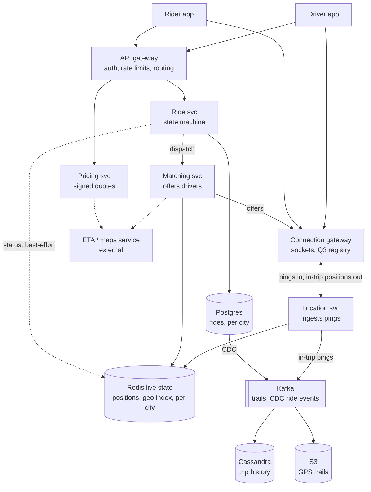
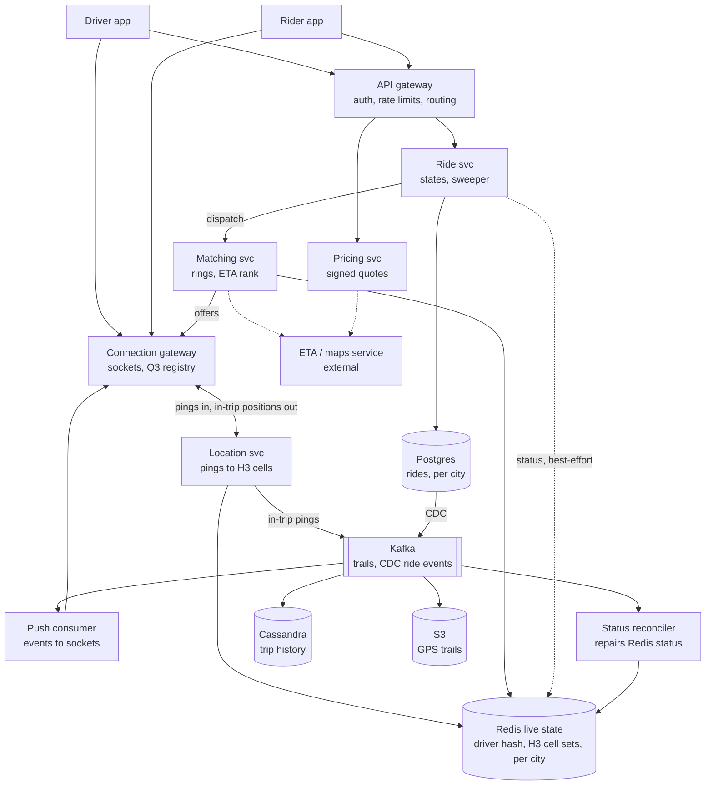

# Q5: Ride hailing (Uber)

**Pattern:** geospatial indexing plus real-time matching. A very high-rate stream of lossy position writes feeds an in-memory spatial index, which generates candidates for a low-rate, strictly correct assignment step. The two paths share nothing except the driver ID.

Reused from earlier questions:

- **Q1:** expiry checked on read, cache-aside, ID generation.
- **Q2:** async delivery through a queue.
- **Q3:** persistent connections, per-key ordering through a log partition, client-side resubmit and resync, idempotency keys, home region per entity.
- **Q4:** signed tokens, request coalescing, safe deletion order, source of truth vs derived data, SLOs measured on the client.

## Table of Contents

- [Recap](#recap)
- [1. Scope and requirements](#1-scope-and-requirements)
- [2. Scale estimates](#2-scale-estimates)
- [3. API and data model](#3-api-and-data-model)
- [4. High-level architecture](#4-high-level-architecture)
- [5. Deep dives](#5-deep-dives)
  - [Deep dive 1: the geospatial index](#deep-dive-1-the-geospatial-index)
  - [Deep dive 2: the matching decision](#deep-dive-2-the-matching-decision)
  - [Deep dive 3: keeping the index truthful](#deep-dive-3-keeping-the-index-truthful)
  - [Final architecture, after the deep dives](#final-architecture-after-the-deep-dives)
- [6. Bottlenecks, failure modes, and trade-offs](#6-bottlenecks-failure-modes-and-trade-offs)
- [7. Tech lead layer](#7-tech-lead-layer)

---

## Recap

**In one line:** split the system by guarantee, so a lossy in-memory H3 geo index per city generates candidates and a Postgres constraint alone decides who is assigned.

**The five decisions that define it**

1. **Split the system by guarantee.** Location is lossy, in memory and 99.9% (Redis per city, unacknowledged pings, only the latest position kept for idle drivers). Assignment is strict, durable and 99.99% (Postgres per city). Redis filters candidates; Postgres alone decides.
2. **The strict guarantee is a database constraint:** `UPDATE … WHERE status = 'searching'` plus a partial unique index on `driver_id` over active statuses. No distributed transaction is needed because a ride and every driver who could take it live on the same city shard, and the city is embedded in `ride_id`.
3. **H3 cell sets scored by last-ping time:** resolution 8 (~0.74 km²), searched ring by ring from k = 1 to k = 5 until there are 20 candidates. Staleness (30 s) is checked on read. Plain Redis GEO is enough for a one-city MVP.
4. **Greedy matching by ETA with sequential dispatch:** top 10 by straight-line distance, ranked by real ETA, offered one driver at a time with a 10 s `SET NX` lock. Batched assignment saves pickup time only in contended zones and breaks the p99 < 1 s target there.
5. **Keeping the index honest, layered from cheapest:** staleness on read, Lua scripts serialise status changes and pings, a CDC-fed reconciler, the app auto-declines offers while on a trip, Postgres rejects the accept with 409.

**Numbers worth remembering**

- **Ping interval:** 4 s; a driver counts as offline after 30 s of silence
- **Location writes:** 250k/s global peak; ~12.5k/s for the biggest city
- **Ride requests:** ~200/s average, ~1,000/s peak; local spikes of 10×+
- **Driver index:** ~100 MB globally (~150 MB with cell sets), so partition for write rate and blast radius, not size
- **Concurrent trips:** ~600k at peak, giving ~150k durable in-trip pings/s
- **Trail:** ~15 KB per trip, ~110 TB/year to S3
- **Connections:** ~2M at peak, ~20-40 gateway nodes
- **Density:** ~33 drivers/km² downtown vs 0-3 within 2 km in suburbs (100x spread)
- **Matching:** p99 < 1 s to first offer; 10 s accept window; at most 5 attempts; ~10k ETA calls/s
- **Postgres failover:** sync standby, 30-60 s, uses about a quarter of a city's 4.3 min monthly budget
- **Lines worth repeating:**
  - "The geo index is tiny; I partition it for write rate and blast radius, not size."
  - "Slow ingestion is worse than dead ingestion, because it makes the supply look like it vanished."
  - "The stadium spike is a matching-quality problem, not a throughput problem."
  - "The app protocol is as expensive to change as the schema."

---

## 1. Scope and requirements

### Functional requirements (in scope)

1. **Driver location updates.** Online drivers report their GPS position on a fixed interval while the app is open.
2. **Request a ride.** A rider sends a pickup and a destination, sees a fare estimate and confirms.
3. **Matching.** The system finds nearby available drivers, offers the ride to one of them, and assigns the trip when that driver accepts.
4. **Live trip tracking.** The rider sees the driver approaching and then the trip progressing. Both sides see state changes: matched → driver arriving → in progress → completed.

Driver location streams and rider updates reuse **Q3's persistent connections**: a long-lived socket per online driver and per active rider, with a gateway that knows which server holds which connection.

### Out of scope

- **Payments, ratings, receipts.** Trip completion emits an event that a payments service consumes.
- **Routing and ETA computation.** An external maps/ETA service that we call.
- **Surge pricing.** Hidden technical weight: it needs per-area supply and demand counts, an aggregation over the same geo index used for matching. It attaches at the per-cell counts (section 5) and the Pricing service (section 4).
- **Ride pooling.** Hidden weight: matching becomes a multi-stop route insertion problem and a driver can hold more than one trip. Left out because it would change the strict guarantee below.
- Scheduled rides, rider-driver chat, driver onboarding and documents, fraud detection.

### Questions that change the design, and the assumptions proposed

#### Decision 1.1: Offer each ride to one driver at a time (sequential dispatch)

**Assumption:** each request is offered to **one driver at a time** with a **10-second accept window**. On decline or timeout it moves to the next-best candidate. A driver holds at most one pending offer (a **soft** limit enforced by a Redis lock in section 3; the strict guarantee below is unaffected).

- **Why:** only one driver can say yes to a given request at a time and a driver never has two offers competing, so "no double assignment" is cheap to enforce. It also gives the rider a predictable experience.
- **How:** each request runs an offer loop: `searching → offered(driver X, expires T) → accepted | declined/expired → offered(driver Y) …`.
  - The Matching service runs it as a logical state machine; the persisted ride status stays `searching` while offers are in flight and the offer lives in Redis (section 3).
  - The 10 s expiry is checked whenever the offer is read (**Q1's expiry checked on read**), so a late accept is rejected even if no timer has fired.
- **Alternatives:**
  - *Broadcast to the N nearest drivers; first to accept wins.* Better when acceptance rates are low or speed matters more than fairness (food delivery batching). Drivers race for one request, so a compare-and-set is needed and losing drivers have a bad experience.
  - *Batched global assignment* over a 1-2 s window, minimising total pickup time. Better at high density, where greedy matching is globally poor (deep dive 2).
- **Pros:** simple, fair to drivers, easy to enforce.
- **Cons:** each decline adds 10 s to the rider's wait, so attempts are capped at ~5 with a fallback (section 4).

#### Decision 1.2: Idle position is ephemeral, the in-trip trail is durable

**Assumption:** for an **idle** driver only the **latest position** matters and each ping overwrites the previous one. During a **trip** the GPS trail is kept durably, because distance-based fares and disputes depend on it.

- **Why:** the biggest lever on cost and on the store chosen. Most pings come from idle drivers, nobody reads their history, and a dropped ping costs nothing because the next one arrives seconds later.
- **How:** idle pings update an in-memory geospatial index and nothing else. In-trip pings additionally go to an append-only stream persisted per trip.
- **Alternatives:**
  - *Persist every ping.* Better if the business wants supply heatmaps, behaviour analytics or ML data, and even then through a log into a data lake asynchronously, never on the serving path.
- **Pros:** the serving path stays in memory and cheap.
- **Cons:** a crash of the index loses current positions, acceptable because every driver repopulates within one ping interval (section 6 leans on this).

#### Assumption: rides are local, so the city is the unit of locality

A rider and candidate drivers are within a few kilometres, and a trip never needs data from another continent. This is **Q3's home region per entity** with the city as the entity: each city's matching state lives in one region (sections 3 and 6).

#### Assumption: ping interval of 4 seconds

It sets the dominant write load and the staleness the rider sees, so section 2 derives from it. It is tunable, and lowering it is a product decision with a direct cost line (section 7).

### Non-functional requirements

| Requirement | Target | What it forces |
|---|---|---|
| **Load shape** | Location writes outnumber ride requests by orders of magnitude | Location writes are the scaling problem. Ride requests are low-volume and their difficulty is correctness. |
| **Availability: request and matching path** | 99.99% (~4 min/month) | A rider who can't book opens a competitor's app and idle drivers earn nothing. No single point of failure. |
| **Availability: location ingestion** | 99.9%, lossy degradation | Losing a few seconds of pings degrades matching quality but doesn't break it. No synchronous durable write. |
| **Matching latency** | p99 < 1 s from ride request accepted to first offer reaching a driver (system time only) | Nearby search, ranking and offer run in memory, bounded to a small area. The only disk-backed write is the single ride-row insert (section 4). |
| **Location freshness** | Rider sees driver position ≤ ~5 s old; a driver silent for **30 s** is offline | Positions carry a timestamp and staleness is checked on read, so ghost drivers are never offered rides. |
| **Durability** | Trips, state transitions and the in-trip trail never lost; idle pings may be | Trip data needs replicated, acknowledged writes. Location state doesn't. |

### Consistency split by path

- **Strict:** a driver is assigned to **at most one active trip** and a trip to **exactly one driver**. A double booking means two riders waiting for one car. This is the one place that needs an atomic conditional write.
- **Eventual everywhere else:** driver position in the index, the nearby-cars map, ETAs, trip history, analytics.

AP for the location path and CP for the assignment point.

### What to say

> "Let me confirm scope. Core features: drivers stream their location every 4 seconds, riders request a ride and get a fare estimate, we match them to a nearby available driver, and both sides track the trip live. I'll leave out payments, ratings, pooling and scheduled rides, and I'll treat routing and ETA as an external service. Surge is out too, but it would sit on top of the same geo index as supply and demand counts per area, so I'll show where it plugs in.
>
> I'm assuming we offer each request to one driver at a time with a 10-second accept window, rather than broadcasting, because it makes double assignment easy to prevent. I'm assuming idle driver pings are ephemeral, so we keep only the latest position, while in-trip GPS trails are stored durably for fares and disputes. And rides are local, so each city's matching state can live in one region.
>
> Non-functionally, this is dominated by location writes, not ride requests. Booking and matching need 99.99%, and we should get to a first driver offer within a second at p99, which means the nearby-driver search runs in memory. Location ingestion can be lossy. A driver silent for 30 seconds counts as offline. The one strict guarantee is that a driver can't be assigned two trips and a trip can't get two drivers; everything else, including positions, can be eventually consistent. Does that match what you have in mind?"

---

## 2. Scale estimates

Anchors: **20 million rides a day** (requests, trips, storage), **1 million drivers online at peak** (location writes, index, connections), and the **4 s ping interval**.

**Location writes (the dominant load)**
- 1M drivers ÷ 4 s = **250,000 writes/s globally at peak**. The biggest city has ~50,000 drivers online, so **~12,500 writes/s**.
- *So therefore:*
  - Too much for one store globally, but one city fits comfortably on one in-memory node (a Redis shard handles roughly 100k+ simple ops/s). This is why the index is partitioned by city and lives in memory.
  - A disk-backed database taking 250k overwrites/s to keep the latest position would be expensive and pointless, since nothing reads history.
  - Bandwidth (~250k × 100 B ≈ 25 MB/s) constrains nothing.

**Ride requests (low volume, hard correctness)**
- 20M ÷ ~100,000 s ≈ **200/s average**; peak factor 5x (rush hours overlapping across time zones, weather) gives **~1,000/s**. About 2 offers per request and ~6 state transitions per trip give a few thousand transitions/s.
- *So therefore:* write throughput on this path is trivial. It is about availability (99.99%) and the strict guarantee.
- **The local spike matters more than the global peak.** A stadium emptying can put several thousand requests into a handful of cells within ten minutes (10×+ on one area). Section 6 treats it as a hot-cell problem, not a capacity problem.

**Nearby-driver reads**
- Matching: one search per request plus one per re-offer, at most **~2,000/s at peak** (candidate lists are reused for up to ~30 s, so this is an upper bound).
- Browsing map: 5 app opens per ride, ~30 s each, refresh every 5 s: 20M × 5 × 6 ≈ 600M/day, **~6,000/s average, ~30,000/s at peak**.
- *So therefore:* reads are the same order as writes, so the index must be good at both. The map is the bulk of reads and doesn't need exact data: serve it from a **per-cell snapshot cached for a few seconds** (**Q1's cache-aside**, keyed on cell).

**Active trips and in-trip location**
- ~25 min per trip: 20M × 25 ÷ 1,440 ≈ **350k concurrent trips on average, ~600k at peak** (about 60% of drivers busy). In-trip pings: 600k ÷ 4 s = **~150,000/s**, durable and pushed to riders.
- *So therefore:* large but append-only with no random reads, so a **partitioned log (Kafka)** later compacted into blob storage, not a transactional database. The 150k/s push to riders is Q3's fan-out shape at a fraction of a chat system's volume.

**Storage**

| Data | Calculation | Result | Conclusion |
|---|---|---|---|
| **Trip records** | 20M/day × ~1 KB | ~20 GB/day, ~7 TB/year, ~22 TB replicated ×3 | Needs partitioning within a year or two, but the **active** set is 600k × 1 KB ≈ **600 MB**. |
| **In-trip GPS trails** | ~375 pings/trip (25 min × 15/min) × ~40 B compressed ≈ 15 KB/trip × 20M | ~300 GB/day, ~110 TB/year | **Cheap blob storage** after the trip ends: written once, read rarely (fare checks, disputes). |
| **Idle pings** | — | 0 | Not stored. The line that saves the most money. |

**Hot set: the whole driver index fits in RAM**
- 1M drivers × ~100 B (ID, lat/lng, timestamp, status, vehicle type, cell ID) ≈ **100 MB globally** (~150 MB with section 5's cell sets).
- *So therefore:* memory is **not** the reason to partition. The index is partitioned by city for **write rate** (12.5k/s vs 250k/s), **blast radius** (a Mumbai outage shouldn't affect London) and **latency** (sit in the city's region). "Shard the geo index because it's big" is the wrong reason.

**Persistent connections (Q3 pattern)**
- 1M drivers + ~600k riders in trips + browsing riders ≈ **~2M concurrent connections**; at ~50-100k per gateway node, **~20-40 nodes** across regions, reusing Q3's gateway design with a connection registry.

**Candidates per match (the system-specific number)**
- Dense city: ~50,000 drivers over ~1,500 km² ≈ **~33 drivers/km²**; a 2 km radius (~12.5 km²) holds **~400 drivers**. A suburb: **0-3** in the same 2 km.
- *So therefore:*
  - **A fixed radius is wrong both ways.** The search must **start small and expand** until it has enough candidates, on a structure that makes expansion cheap.
  - **ETA can't be called for every candidate.** Straight-line distance is a poor proxy for pickup time (a river or one-way grid can make the nearest car 10 minutes away), but ETA calls are expensive.
  - Candidates are **pre-filtered by straight-line distance to the top ~10**: 1,000 requests/s × 10 = **~10,000 ETA calls/s at peak**, fine for a maps service and the dial if it gets expensive.

All figures assume the fixed 4 s interval; section 7's adaptive interval roughly halves idle ping volume.

### What to say

> "I'll anchor on 20 million rides a day and a million drivers online at peak. With a 4-second ping, that's 250k location writes a second globally, and about 12k a second in the biggest city. So the index needs partitioning by city for write rate and blast radius, not for size, because a million drivers at 100 bytes each is only 100 MB and the whole index fits in RAM. Ride requests are about 200 a second, 1,000 at peak, so that path is about correctness and availability, not throughput; the real spike is local, like a stadium emptying, which I'll treat as a hot-cell problem later. Nearby reads are around 30k a second at peak, mostly the browsing map, which I can serve from a per-cell cache. About 600k concurrent trips at peak means 150k durable in-trip pings a second, which goes to a log and then blob storage, roughly 15 KB per trip. Trip records are around 7 TB a year, so they need partitioning eventually, but the active set is under a gigabyte. Finally, density varies 100× between downtown and the suburbs, so the search has to expand outward, and I'll only call the ETA service for the top 10 candidates by straight-line distance."

---

## 3. API and data model

### API

#### Rider

| Endpoint | Request → response | Errors |
|---|---|---|
| `POST /v1/fare-estimates` | `{pickup, dropoff, vehicle_type}` → `{quote_token, fare_range, pickup_eta, expires_at}` | 422 pickup outside service area |
| `POST /v1/rides` + `Idempotency-Key` header | `{quote_token, payment_method_id}` → `202 {ride_id, status: "searching"}` | 409 rider already has an active ride; 410 quote expired; 429 |
| `POST /v1/rides/{id}/cancel` | → `200 {status, cancellation_fee}` | 409 trip already completed |
| `GET /v1/rides/{id}` | → full ride state + `version` | 404 |
| `GET /v1/drivers/nearby?lat&lng&vehicle_type` | → approximate car positions for the browsing map | — |

**Pushed over the rider's socket:** `ride.matched {driver, vehicle, pickup_eta}`, `driver.location {lat, lng, heading, ts}`, `ride.status_changed {status, version}`.

#### Driver

| Endpoint | Request → response | Errors |
|---|---|---|
| `PUT /v1/drivers/me/status` | `{online \| offline, vehicle_type}` → 200 | 403 driver not approved |
| **Location ping, over the socket** | `{lat, lng, heading, speed, accuracy, client_ts, seq, client_state}`, no response. `client_state` (`available \| on_trip:{ride_id}`) is added for section 6. | — |
| **Offer, pushed over the socket** | `{offer_id, ride_id, pickup, dropoff_area, expires_at}` | — |
| `POST /v1/offers/{offer_id}/accept` | → `200 {ride}` | 409 offer expired, ride taken, or driver already on a trip |
| `POST /v1/offers/{offer_id}/decline` | → 200 | — |
| `POST /v1/rides/{id}/arrived \| start \| complete` + `expected_version` | → `200 {ride}` | 409 version mismatch (stale client) |

### Protocol decisions

#### Decision 3.1: Location pings ride the existing socket, fire-and-forget, with a sequence number

- **Why:** pings are lossy by design at 250k/s, so a per-ping ack would double the message rate for a guarantee we don't want. The driver needs a socket for offers anyway (**Q3**), so pings add no connection.
- **How:** each ping carries a monotonically increasing `seq`; ingest drops any ping with a lower `seq` than stored, so a delayed packet can't move a driver backwards. `client_ts` lets the server measure staleness; the 30 s offline rule uses server receive time.
- **Alternatives:**
  - *HTTP POST every 4 s.* Better if drivers had no other reason to hold a connection (a fleet tracker with no offers). Costs a TLS handshake or keep-alive plus headers at 250k/s.
  - *MQTT.* Better on very poor networks where broker session state and per-message QoS are wanted. A swap for the gateway, not a different design.
- **Pros:** the cheapest possible write path.
- **Cons:** "stopped moving" can't be told from "pings are being lost" without the staleness check.

#### Decision 3.2: The fare quote is a signed token, not a stored record

- **Why:** a quote is read once, lives ~2 minutes and must be tamper-proof. This is **Q4's signed tokens**, used for a price.
- **How:** `quote_token` = `{fare, vehicle_type, pickup, dropoff, expires_at}` plus an HMAC. `POST /rides` verifies signature and expiry (**Q1's expiry checked on read**) with no lookup.
- **Alternatives:**
  - *Quotes in Redis with a TTL.* Better when quotes must be revocable (surge drops and a lower price should be honoured) or abandoned quotes are analysed.
- **Pros:** no store, no lookup.
- **Cons:** a quote can't be revoked before it expires.

#### Decision 3.3: `POST /rides` takes an idempotency key (Q3 pattern)

- **Why:** a retry over a flaky mobile network must not create two rides and dispatch two drivers.
- **How:** the key is unique per rider and a duplicate returns the original `ride_id`. The one-active-ride constraint (below) returns 409 as a second guard.

#### Decision 3.4: Accept goes over HTTP, not the socket; state transitions carry `expected_version`

- **Why:** accept needs a synchronous yes or no, because the driver must not drive to a ride they don't have; it is idempotent per `offer_id`.
- **How:** each transition is conditional on the version, so a stale driver app (tapping "start" after the rider cancelled) gets 409 instead of corrupting state. Reconnecting clients re-sync with `GET /rides/{id}` (**Q3's client-side resync**).

### Access patterns

| # | Pattern | Key | Rate (section 2) | Guarantee |
|---|---|---|---|---|
| 1 | Upsert driver position | driver_id | 250k/s global, 12.5k/s biggest city | Lossy, latest wins |
| 2 | **Find available drivers near a point, by vehicle type** | location | up to ~2k/s matching + ~30k/s map | Seconds-stale is fine |
| 3 | Reserve a driver for an offer | driver_id | few k/s | Soft |
| 4 | Create a ride, run its state transitions | ride_id | few k/s | **Strict: one driver per ride, one active ride per driver** |
| 5 | Rider's active ride (reconnect, duplicate check) | rider_id | low | Strict (one active ride) |
| 6 | Trip history for a rider or driver, newest first | rider_id / driver_id | low | Eventual |
| 7 | Append to a trip's GPS trail; read it whole at completion | ride_id | 150k/s appends | Durable |

Patterns 1, 3, 4, 5, 7 are key-based. Pattern 2 is a **spatial range query** no plain key-value store answers. Pattern 4 needs a **conditional write touching a ride and a driver at once**. Pattern 6 is "list everything belonging to X". No single store does all of these well, so the system gets three stores plus the log.

### Store A: live driver state and geo index (Redis, partitioned by city)

```
driver:{driver_id}  (hash)
  lat, lng, heading, seq, server_ts
  status: available | offered | on_trip | offline
  vehicle_type, city_id, cell_id, current_ride_id

offer_lock:{driver_id}  → offer_id   SET NX EX 10
offer:{offer_id}        → {ride_id, driver_id, expires_at}

geo index per (city, vehicle_type)  → H3 cell sets, defined in section 5
```

#### Decision 3.5: Redis for live state

- **Why:** ~100 MB of index and 12.5k writes/s per city is an in-memory workload. Durability isn't needed; atomic per-key ops (SET NX, Lua) and TTLs are.
- **How:** each city maps to its own shard or small cluster in its home region. A ping updates the hash and the index entry in one Lua script so they can't diverge. If the shard is lost, online drivers repopulate it within one 4 s interval.
- **Alternatives:**
  - *PostGIS.* Better at low write rates (a few thousand vehicles, under ~1k writes/s) where SQL, durability and polygon queries are wanted. At 12.5k overwrites/s per city it burns time on index churn and WAL for data nobody reads twice.
  - *Elasticsearch geo queries.* Better with rich filters and slow writes; refresh interval and segment merging handle 250k updates/s poorly.
  - *Custom in-memory index service sharded by cell.* Better at the largest scale, where matching logic runs next to the data (roughly where Uber ended up). More to build, so start with Redis behind an interface.
- **Pros:** fast, cheap, atomic primitives.
- **Cons:** not a source of truth for anything strict, hence assignment lives in Store B.

The "one pending offer per driver" limit is enforced by `SET NX EX 10` on `offer_lock`, a **soft** guarantee: a Redis failover could lose the lock and let two offers reach one driver. Acceptable, because the **hard** guarantee sits in Store B and at most one accept can commit.

### Store B: active rides (PostgreSQL, partitioned by city)

```sql
rides (
  ride_id        BIGINT PRIMARY KEY,    -- Snowflake-style, city shard bits embedded
  city_id        INT,
  rider_id       BIGINT,
  driver_id      BIGINT NULL,
  status         TEXT,  -- searching | matched | arriving | in_progress | completed | cancelled
  version        INT,
  vehicle_type, pickup, dropoff, quoted_fare, final_fare,
  idempotency_key TEXT,
  created_at, matched_at, started_at, completed_at
)
UNIQUE (rider_id, idempotency_key)
UNIQUE (rider_id)  WHERE status IN ('searching','matched','arriving','in_progress')
UNIQUE (driver_id) WHERE status IN ('matched','arriving','in_progress')
```

**The assignment is one statement:**

```sql
UPDATE rides SET driver_id = :d, status = 'matched', version = version + 1
WHERE ride_id = :r AND status = 'searching';
```

- 0 rows updated: the ride was cancelled or already taken, so accept returns 409.
- Unique violation on the driver index: the driver is already on an active trip, so 409.
- Otherwise assigned. **Both halves of the strict guarantee come from a single-row conditional update plus a partial unique index.** No multi-row transaction, no distributed lock.

#### Decision 3.6: A relational store, partitioned by city

- **Why:** the strict guarantee spans a ride and a driver. A relational store expresses it as a constraint enforced inside one node.
  - Partitioning by city puts a ride and every driver who could take it on one shard, since matching never crosses cities.
  - Volume fits: ~600 MB active set and a few thousand transitions/s globally, so even the biggest city is a few hundred writes/s on one primary.
- **How:** the city comes from the pickup point via service-area polygons held in memory by every service. `ride_id` embeds the city shard in its bits (**Q1's ID generation**), so later requests with only a `ride_id` route without a lookup.
- **Alternatives:**
  - *DynamoDB `TransactWriteItems`* (conditional write on the ride item and a driver lock item, atomically). Better on AWS for zero ops, at the cost of two items per assignment instead of a constraint.
  - *Spanner or CockroachDB.* Better to avoid owning city sharding or if the product adds cross-city operations (pooling across a metro split into several cities). Costs latency and money.
  - *Cassandra with lightweight transactions.* Handles "one driver per ride", but "one active ride per driver" needs a second conditional write on another partition: two Paxos rounds, no atomicity across them.
- **Pros:** the guarantee becomes a database constraint, the most trustworthy place for it.
- **Cons:** we own the sharding, a city's shard is a failover unit (section 6), and a driver who moves to a neighbouring city is matched by that city's shard from then on. That's fine because the constraint only needs to see a driver's *active* trip, and an available driver has none.
  - A driver crossing into a neighbouring city is matched by that shard from then on, which is fine because the constraint only needs a driver's *active* trip and an available driver has none.

**Retention:** completed rides stay in Store B for 30 days (support, disputes, payment retries), then move out per **Q4's safe deletion order**: purge only after the archive write is confirmed.

### Store C: trip history (Cassandra, partitioned by rider_id and by driver_id)

```
rides_by_rider  (rider_id,  completed_at DESC, ride_id) → ride summary
rides_by_driver (driver_id, completed_at DESC, ride_id) → ride summary
```

#### Decision 3.7: Cassandra for trip history, partitioned by owner

- **Why:** ~7 TB/year and the only query on old trips is "list my trips, newest first": the case for partitioning by owner.
- **How:** populated from Store B via change data capture into Kafka, then a writer. Written once per owner, since each table serves one access pattern.
- **Alternatives:**
  - *Postgres with time partitions.* Better until roughly 1 TB, or when support needs ad-hoc queries over history (and then a warehouse fed by the same CDC is the right home anyway).
- **Pros:** linear growth with no resharding.
- **Cons:** denormalised duplicates, and history appears a few seconds after completion.

### The trail: Kafka topic partitioned by ride_id, then S3

- In-trip pings are appended to a topic keyed by `ride_id`, giving per-trip ordering (**Q3's per-key ordering through a log partition**).
- On `ride.completed`, a consumer writes the whole trail as one object `s3://trails/{city}/{date}/{ride_id}` (~15 KB). The fare service reads it to compute the final fare from actual distance.
- **Why a log, not a database:** 150k appends/s, never updated, read once. S3 is where cold, rarely read objects belong (~110 TB/year).

### Partition keys at a glance

| Data | Partition key | Downside, and where it's handled |
|---|---|---|
| Live driver state / geo index | city, then a cell within the city (section 5) | Hot cells at events: sections 5 and 6 |
| Active rides | city (embedded in ride_id) | A big city is one shard's load; the numbers say that's fine. Failover: section 6 |
| History | rider_id / driver_id | None significant: few rows per key |
| Trail | ride_id | None: one trip writes ~375 pings |
| Connections | driver_id / rider_id → gateway (Q3 registry) | — |

### What to say

> "For riders: a fare estimate that returns a signed, expiring quote, so there's no store for quotes; a ride request that carries the quote and an idempotency key, so a retry can't dispatch two drivers; cancel; and get-ride for re-sync. Live updates go over the socket. For drivers: location pings go over the same socket, fire-and-forget with a sequence number, because they're lossy by design and there are 250k a second. Offers are pushed over the socket, but accept is a synchronous HTTP call with conditional versioning.
>
> The access patterns split three ways, so I'll use three stores. Live positions go in Redis per city: it's 100 MB, in memory, with atomic ops, and losing it costs one ping interval. Active rides go in Postgres sharded by city. Assignment is a single conditional update, `WHERE status = 'searching'`, plus a partial unique index on driver_id over active statuses, so 'one driver per ride' and 'one ride per driver' are both database constraints. That works because a ride and every driver who could take it are in the same city shard. The city is embedded in the ride ID, so routing needs no lookup. History moves to Cassandra partitioned by rider and driver through CDC, and GPS trails go through Kafka keyed by ride into S3. The geo index structure itself is the interesting part, and I'll come back to it in the deep dive."

---

## 4. High-level architecture



The connection gateway is Q3's pattern (~2M sockets, registry of user → gateway node). The API gateway carries request/response calls with auth and rate limiting. The ETA service is external, called by Matching to rank its top ~10 and by Pricing to compute a quote.

### Decision 4.1: Location ingestion is its own service, separate from the ride path

- **Why:** the paths share nothing. Location is 250k lossy writes/s at 99.9%; rides are a few thousand strict writes/s at 99.99%. Sharing a deployment lets a ping storm (every driver reconnecting after a gateway restart) compete for CPU with ride requests, and a bad deploy of high-churn location code take booking down.
- **How:** stateless instances, each city's traffic going to instances in its home region. Each ping is one Lua call on the city's Redis shard: check `seq`, update the hash, update the geo index entry. The service also keeps the few-second per-cell map cache (**Q1's cache-aside**).
- **Alternatives:**
  - *One service.* Better for a one-city MVP at a few hundred pings/s, if the two paths stay behind separate interfaces (section 7).
- **Pros:** failure and scaling isolation.
- **Cons:** one more deployable and a hop when Matching needs a position, which Matching avoids by reading Redis directly.

### Decision 4.2: Matching is separate from the Ride service, and the ride row is the durable record of a pending match

- **Why:** matching is latency-sensitive, read-heavy work against Redis and ETA with in-flight timers (10 s windows). The Ride service is transactional work against Postgres. Different resource profiles and failure behaviour.
- **How:** the Ride service writes the ride as `searching`, then makes a direct RPC to Matching for that city. Matching holds the offer loop (candidate list, current offer, timer) in memory.
  - If a Matching instance dies, nothing is lost because the row still says `searching`. A **sweeper** inside the Ride service re-dispatches any ride in `searching` longer than ~15 s without a live offer.
  - Durable state is in the database; the in-memory loop is a cache of progress.
- **Alternatives:**
  - *A queue (Kafka or SQS) between Ride and Matching.* Better when bursts can exceed matching capacity and buffering beats rejecting (the stadium spike, section 6). Costs queue latency on the p99 < 1 s path and offers lingering for cancelled requests.
  - *Matching inside the Ride service.* Fine for an MVP.
- **Pros:** lowest latency to first offer; crash recovery from existing data.
- **Cons:** the sweeper adds up to ~15 s for a ride whose matcher died, rare, and the rider sees "still searching", not an error.

### Decision 4.3: Ride events reach clients through the CDC stream

The CDC from Postgres into Kafka (section 3, for history) **also** pushes status changes (`matched`, `arriving`, `in_progress`, `completed`, `cancelled`) to rider and driver sockets.

- **Why:** pushing from application code after commit is a dual write: a crash between commit and publish means the rider never hears they were matched. CDC reads the commit log, so every committed transition yields exactly one event, in commit order per ride.
- **How:** Debezium-style CDC tails each city shard's Postgres WAL into a topic keyed by `ride_id` (**Q3's per-key ordering**). A push consumer looks up rider and driver in the gateway registry and forwards.
  - Clients discard events whose `version` is not newer than theirs, and after a reconnect call `GET /rides/{id}` (**Q3's resync**).
- **Alternatives:**
  - *Transactional outbox* (event row in the same transaction, a relay publishes). Better without CDC infrastructure; same guarantee, more application code.
  - *Publish directly after commit, accept occasional loss.* Better for non-critical notifications. Resync would hide most losses, but "you've been matched" is the moment that matters most.
- **Pros:** no dual write, reuses an existing pipeline, ordered per ride.
- **Cons:** a few hundred milliseconds of CDC lag on status pushes, well inside anything a rider perceives as slow. The accept call itself still returns synchronously to the driver.

### Decision 4.4: In-trip location goes to the rider directly, and to Kafka in parallel

- **Why:** the rider needs ~4 s freshness; routing through Kafka and a consumer adds lag and a dependency for nothing. The durable trail needs ordering and persistence, not low latency.
- **How:** for a driver whose hash says `on_trip`, Location service (1) updates Redis, (2) forwards the position to the rider's gateway node via the registry, (3) appends to the trail topic keyed by `ride_id`. Steps 2 and 3 are independent: a failed forward costs one animation frame, the trail write is retried.
- **Alternatives:**
  - *Everything through Kafka with the push consumer forwarding positions.* Better when positions must be replayed to many subscribers ("share my trip" with several viewers), making Kafka a fan-out bus (**Q2**).
- **Pros:** lowest latency on the rider-visible path.
- **Cons:** two writes from one handler with different guarantees, neither depending on the other.

### Trace 1, the hot write: an idle driver's ping

1. The driver app sends `{lat, lng, heading, seq, …}` over its socket every 4 s; the gateway forwards it to a Location instance in the city's region.
2. One Lua script on the city's Redis shard: drop if `seq` is stale; otherwise update `driver:{id}` (position, `server_ts`) and move the geo index entry if the cell changed.
3. Status is `available`, so nothing else happens and nothing is persisted: one round trip to memory.

### Trace 2, the strict write: request, match, accept

1. `POST /fare-estimates`: Pricing calls ETA for distance and time and returns a signed `quote_token` (2-minute expiry).
2. `POST /rides` with the token and idempotency key: the Ride service verifies the token, maps pickup to a city, generates a `ride_id` with the city embedded, and inserts the row as `searching` (the partial unique index rejects a second active ride). Response `202 {ride_id}`.
3. The Ride service calls Matching, which **queries the geo index for nearby available drivers of the right vehicle type** (section 5), takes the top ~10 by straight-line distance, gets real ETAs and ranks them.
4. For the best candidate Matching does `SET offer_lock:{driver} NX EX 10` (if taken, skip to the next), writes `offer:{id}`, and pushes the offer through the gateway. Target: within 1 s of step 2 at p99.
5. **Decline or timeout:** Matching releases the lock and offers to the next candidate. After ~5 attempts it widens the radius or tells the rider no drivers are available.
6. **Accept:** `POST /offers/{id}/accept`. The Ride service checks expiry on read, then runs the conditional `UPDATE … WHERE status = 'searching'`. Zero rows or a driver unique violation means 409; success means 200 with the ride.
7. After commit the Ride service sets the driver's Redis status to `on_trip` so the index stops returning them. Best-effort: if it fails, Matching may offer this driver another ride and that accept fails with 409. The strict guarantee never depends on Redis.
8. CDC picks up the transition and the push consumer delivers `ride.matched` to the rider.

### Trace 3, the reads: the rider watching

- **Before requesting:** `GET /drivers/nearby` → Location service maps the point to a cell and returns the cell's few-second cached snapshot, or on a miss reads the cell's entries from Redis and caches them (~30k/s at peak, mostly cache hits).
- **During the trip:** the rider reads nothing. Positions are pushed every 4 s, status changes come from CDC, and a reconnect triggers one `GET /rides/{id}`.

### What to say

> "Drivers and riders hold sockets to a connection gateway, which is the Q3 pattern with a registry, about 2 million connections at peak. Request/response calls go through an API gateway. Behind them I've split the location service from the ride path, because one is 250k lossy writes a second and the other is a few thousand strict writes a second with a higher availability target. I don't want a ping storm or a bad deploy on one to take down booking.
>
> A ping is one Lua call on the city's Redis shard: check the sequence number, update the position and the geo index. Nothing persisted unless the driver is on a trip, in which case the position also goes straight to the rider's socket and into a Kafka topic keyed by ride.
>
> A ride request writes the ride as `searching` in Postgres, then calls Matching, which finds nearby drivers, ranks the top ten by real ETA, takes a 10-second offer lock in Redis and pushes the offer. Accept is a conditional update in Postgres; that's where double assignment is impossible. Status pushes come off the CDC stream I already have for history, so there's no dual write. If a matcher dies, the ride row still says `searching` and a sweeper re-dispatches it.
>
> The box I'd like to dig into next is Matching: how the geo index finds nearby drivers fast, and how we pick among them."

---

## 5. Deep dives

Three:

- **Deep dive 1:** the geospatial index (finding nearby drivers when 12,000 move every few seconds in one city).
- **Deep dive 2:** the matching decision (who gets the offer, and when greedy stops being good enough).
- **Deep dive 3:** keeping the index truthful (ghost drivers, status races, Redis vs Postgres drift).

Offer the choice to the interviewer. Order 1, 2, 3: deep dive 2 builds on the query from deep dive 1 and deep dive 3 hardens both.

### Deep dive 1: the geospatial index

Find **available drivers of vehicle type T near point P**, roughly ordered by distance, expanding until there are enough.

**Constraints:**
- ~12.5k updates/s in the biggest city, each possibly moving a driver between areas.
- Up to ~2k matching queries/s plus ~30k map reads/s.
- First offer within 1 s at p99.
- ~100x density spread.
- The index is only ~100 MB, so the structure is chosen for update cost and query shape, not size.

#### Options

**1. Two B-tree indexes on latitude and longitude with a bounding box.** Each index narrows one dimension, so the query scans a strip across the city and intersects. Ruled out.

**2. Geohash.**
- *How:* interleave lat/lng bits and encode as base32; a shared prefix means the same rectangular cell. Precision 6 is about 1.2 × 0.6 km, precision 5 about 4.9 × 4.9 km.
  - Query P's cell plus its 8 neighbours (a point just across an edge shares no prefix), then filter by exact distance. Redis GEO is exactly this: a 52-bit geohash as the sorted-set score, with `GEOSEARCH BYRADIUS` doing the neighbour expansion.
- *Pros:* simple, works in any key-value store, native in Redis.
- *Cons:* rectangular cells distort with latitude; corner neighbours are farther than edge neighbours so "the next ring" isn't uniform; precision comes only in coarse 32x steps.

**3. Quadtree.**
- *How:* split a cell in four when it holds more than N points (say 100), so dense downtown gets small cells and suburbs large ones.
- *Cons here:* drivers move constantly, so cells split and merge all the time, and a pointer-based in-process tree is hard to replicate across Matching instances.
- *Better when* points are static or slow-changing (restaurants, businesses).

**4. A hierarchical hexagonal grid (H3), or the S2 cell hierarchy.**
- *How (H3):* the Earth tiled with hexagons at 16 resolutions, each cell a 64-bit ID, `kRing(cell, k)` returns every cell within k steps. Resolution 8 averages **~0.74 km²** (edge ~460 m); resolution 7 ~5.2 km²; resolution 9 ~0.1 km².
- *Why hexagons:* all six neighbours sit at the same distance from the centre, so each k-ring approximates a circle and expanding one ring is a uniform step outward.
- *S2* uses square cells on the six faces of a cube, numbered along a Hilbert curve so nearby cells have close IDs. *Better when* the index lives in a sorted key-value store (Bigtable, DynamoDB sort keys, Cassandra clustering keys), where a nearby search becomes a few contiguous range scans.

**5. R-tree / PostGIS GiST.** Better for polygons, low update rates and arbitrary shape queries ("which delivery zone contains this point"). At 12.5k moves/s it rebalances constantly. Dismissed for the live index.

#### Decision 5.1: H3 resolution 8 cells, stored as Redis sorted sets

```
avail:{city}:{vehicle_type}:{h3_cell}   ZSET   member = driver_id, score = server_ts of last ping
driver:{driver_id}                       HASH   lat, lng, seq, status, cell_id, …   (from section 3)
```

**Update (one Lua script per ping):** Location service computes the H3 cell from lat/lng (a pure function, in the service, not Redis) and passes it in. The script:
1. Drops the ping if `seq` is stale.
2. Updates the hash.
3. If status is `available`: on a cell change, `ZREM` from the old cell set and `ZADD` to the new one; otherwise `ZADD` to refresh the score.

At 40 km/h a driver moves ~45 m per ping and a cell is ~460 m across, so only about one ping in ten changes cell; most pings are a single score refresh.

**Query (expanding ring search):**
1. Compute P's cell. Start at k = 1: 7 cells, ~5.2 km².
2. Pipeline `ZRANGEBYSCORE cell (now − 30 s) +inf` per cell in the ring. The score filter **is the 30-second offline rule, checked on read** (Q1).
3. If fewer than **20 candidates**, expand to k = 2 (19 cells, ~14 km², ~2 km radius), k = 3, up to **k = 5** (91 cells, ~67 km², ~4.6 km radius). Beyond that, "no drivers nearby".
4. `HMGET` positions in the same pipeline, filter by exact distance, keep the **top 10 by straight-line distance** for deep dive 2.

**Checking the numbers:**
- Downtown: ~33 drivers/km², ~60% busy at peak leaves ~13 available/km², so k = 1 already returns ~70 available drivers from 7 sorted-set reads in one round trip.
- Suburbs: k climbs to 4-5, which is 61-91 cell reads, still pipelined in one round trip and a few milliseconds.
- Memory: cell sets add ~50 B per driver, so the index stays ~150 MB.

#### Why H3 cells and not plain Redis GEO

A single `GEOSEARCH` key per city and vehicle type would handle 12.5k writes/s and 2k radius queries/s on one shard. Cells are chosen for four reasons:

1. **Staleness in the score.** In GEO the score *is* the geohash, so there's nowhere for last-seen time; the 30 s rule would need a second structure and a join per query.
2. **Uniform ring expansion** for the 100x density spread, instead of guessing radii.
3. **The cell is a unit the rest of the system needs:** the per-cell map cache, surge counts per cell, hot-cell handling (section 6).
4. **Room to shard within a city.** Cells are independent keys, so a city can spread across Redis nodes; a single GEO key can't be split.

- **Alternatives:**
  - *Plain Redis GEO.* Better for an MVP in one or two cities, or with no surge, no per-area aggregation and a known radius: a few lines instead of a cell-management layer. The index sits behind `nearby(point, vehicle_type, min_results)`, so the switch is invisible to Matching.
- **Pros:** uniform expanding search, staleness and status filtering inside the index, and a natural unit for caching, surge and sharding.
- **Cons:** we maintain cell membership ourselves (remove-then-add on every cell change) and fix the resolution up front. Changing resolution means a full re-index, which takes only one ping interval because the index rebuilds from pings.

### Deep dive 2: the matching decision

Given a request and up to 10 candidates from deep dive 1, decide who gets the offer and in what order.

**Constraints:**
- p99 < 1 s to first offer.
- Sequential dispatch with a 10 s window.
- At most ~5 attempts.
- No driver receiving two offers at once (soft).

#### Options

**1. Greedy by straight-line distance.** Cheapest, and wrong whenever geography intervenes: the nearest car across a river or highway divider can be 10 minutes away. Ruled out as the final ranking, kept as the pre-filter.

**2. Greedy by ETA per request (top-10 pre-filter, then the ETA service).**
- *How:* take the 10 nearest from deep dive 1, make one batched ETA call (~10k ETA calls/s globally at peak), rank by pickup ETA with idle time as the tie-break (spreads work fairly).
  - Offer to the best driver via `SET NX EX 10` on `offer_lock`; if taken, skip to the next. On decline or timeout move down the list, excluding drivers who declined this request.
  - If the list is more than ~30 s old when the next driver is needed, re-query deep dive 1's index.
- *Concurrency:* two requests 100 m apart often rank driver X first. `SET NX` gives X to one and the other takes its second choice in the same millisecond; no other coordination between requests.
- *Pros:* fast (one Redis round trip, one ETA call, one lock), simple, requests independent, scales by adding Matching instances.
- *Cons:* optimises each request in isolation, which can be globally poor (option 3).

**3. Batched assignment.**
- *How:* per zone, collect open requests and available drivers over a ~2 s window, build an ETA cost matrix and solve a minimum-cost bipartite matching: Hungarian algorithm for small batches, auction or greedy approximation for large.
- *Why it wins sometimes:* rider A requests first, driver X is 3 min from A and Y 4 min. Then rider B requests: X is 2 min from B, Y 12 min. Greedy gives A→X, B→Y for **15 minutes** total; batching gives A→Y, B→X for **6 minutes**.
- *Cons:* the window adds up to 2 s before the first offer, which **breaks p99 < 1 s**. Also a per-zone coordinator and re-solving on every decline.

#### Decision 5.2: Greedy by ETA per request (option 2)

- **Why:** it meets the latency target as written, and batching gains much only when many requests compete for the same drivers at the same moment, the dense high-demand case, not the typical one. Elsewhere open requests in a zone rarely overlap.
- **Alternatives:**
  - *Batched assignment (option 3).* Better when **request density per zone is high enough that requests regularly share candidates**. Measurable trigger: the share of first-choice `SET NX` conflicts in a zone.
  - Adopting it means renegotiating the target to ~3 s for those zones (a product conversation, section 7), per zone and only at the busiest hours.
- **Extension point:** a driver about to finish a trip 300 m from the pickup is often the best candidate though not yet `available`. Including them ("chained" dispatch) means indexing near-finished drivers, a ranking change on top of option 2, out of scope.

### Deep dive 3: keeping the index truthful

**Constraints:** three ways the index lies.

- **Ghost drivers:** app killed or signal lost, but the driver is still in a cell set.
- **Status races:** a driver accepts, and a ping already in flight puts them back in the `available` set.
- **Redis and Postgres disagree:** a Redis failover loses the `on_trip` write (trace 2, step 7), so a driver on a trip shows as available.

None can break the strict guarantee, because accept is decided in Postgres. Each wastes an offer attempt (10 s of the rider's wait) or shows phantom cars.

#### Decision 5.3: Layered defences, from cheapest

**Layer 1: staleness checked on read (from deep dive 1).** The `now − 30 s` score filter drops a ghost 30 s after the last ping with no background job.

A job runs `ZREMRANGEBYSCORE` every minute and driver hashes get a 5-minute TTL, purely to reclaim memory.

*Leaves:* ghosts for up to 30 s, acceptable since an offer to a ghost costs one 10 s timeout and the app sends an explicit `offline` on a clean close.

**Layer 2: status changes and pings serialise through Redis scripts.** The Ride service's post-commit update (`status = on_trip`, `ZREM` from the cell set) is one Lua script.

The ping script only adds a driver to a cell set if the hash says `available`. Redis runs scripts one at a time, so a ping landing after the status change sees `on_trip` and does nothing.

*Leaves:* the case where the status write never lands.

**Layer 3: a status reconciler fed by CDC.** A consumer on the ride CDC stream applies every committed transition to Redis: `matched` → `on_trip`, `completed` or `cancelled` → `available`. Idempotent and ordered per ride (keyed by `ride_id`). Repairs anything the direct write missed within the CDC lag (sub-second).

**Layer 4: the driver app.** An app on a trip auto-declines any offer, and the accept would fail with 409 in Postgres anyway. Costs one wasted attempt.

- **Alternatives:**
  - *Postgres as the only source of driver status, checked by Matching for every candidate.* Better at low volume; at 2k matching queries/s × 10 candidates it puts ~20k reads/s on the strict store to guard against a rare failure that layers 3 and 4 already handle.
- **Pros:** each layer is cheap and the expensive guarantee stays in Postgres.
- **Cons:** the index can be wrong for up to 30 s (ghosts) or about a second (missed status writes), each error costing at most one wasted offer.

### Final architecture, after the deep dives

Changed from section 4: the status reconciler is new (layer 3), the push consumer is drawn as its own box, Redis now holds driver hashes plus H3 cell sets, and the `searching` sweeper runs inside the Ride service.



### What to say

> "There are three areas worth going deeper on. **A**: the geospatial index, meaning how we find nearby drivers quickly when 12,000 of them move every few seconds in one city. **B**: the matching decision, meaning which driver gets the offer and when greedy per-request matching stops being good enough. **C**: keeping the index truthful, meaning ghost drivers, status races and the gap between Redis and Postgres. Which would you like first?"
>
> "For the geo index I'd use H3 hexagons at resolution 8, about 0.7 square kilometres each. Each cell is a Redis sorted set of available drivers, scored by last-ping time. A ping is one Lua script: refresh the score, and if the driver crossed a cell boundary, which happens about one ping in ten, move them. A search starts with the 7-cell ring around the pickup and expands ring by ring until it has 20 candidates or reaches about 4.6 km. Hexagons make each ring a uniform step outward, which matters because density varies 100× between downtown and the suburbs. The score filter drops anyone silent for 30 seconds, so ghost drivers vanish on read.
>
> Plain Redis GEO would actually handle the load. I'm choosing explicit cells because I need staleness in the score, and because cells are the unit for the map cache, surge counts and hot-cell handling. For a one-city MVP I'd start with GEO behind the same interface.
>
> For matching, I take the 10 nearest by straight line, rank them by real ETA with idle time as a tie-break, and offer sequentially with a 10-second lock. Batched assignment can roughly halve total pickup time when requests compete for the same drivers, but its window breaks the one-second target, so I'd only turn it on in dense zones when conflict rates show greedy is costing us, and only after agreeing a looser target for those zones.
>
> To keep the index honest: staleness is filtered on read, status changes and pings serialise through Redis scripts, a CDC-fed reconciler repairs any missed status write, and Postgres remains the only place that can actually assign a driver."

---

## 6. Bottlenecks, failure modes, and trade-offs

### Connection gateway

- **Dies:** the ~50-100k sockets on that node drop. Clients reconnect elsewhere and the dead node's registry entries expire (**Q3**). An in-flight offer is lost, so the 10 s window expires and Matching moves on. On reconnect the driver app also asks for any unexpired pending offer.
- **The real risk is the reconnect storm:** 100k clients reconnecting at once, each pinging and each rider calling `GET /rides/{id}`.
  - Mitigation: jittered exponential backoff in the apps plus admission control on gateways (accept connections at a fixed rate, ask the rest to retry). **Cons:** some drivers are invisible to matching for 10-20 s after a node loss.
- **Slow:** heartbeats time out and clients reconnect elsewhere, same as dying.
- **10×:** add nodes; the limit is cost, not design.

### Location service

- **Dies:** stateless, so the load balancer drops the instance and nothing is lost.
- **Slow is worse than dead.** If pings back up, scores stop refreshing and after 30 s the staleness filter drops those drivers. **To Matching, a slow ingest path looks like the supply vanished**, and riders see "no drivers available" in a city full of idle cars. Mitigations, from cheapest:
  1. **Shed by age:** drop any ping older than ~8 s on arrival, since a fresher one is coming.
  2. **Shed by priority:** under load process `on_trip` pings first (rider tracking and the fare trail), idle pings second.
  3. **Widen the staleness window:** when measured ping lag in a city passes a threshold, Matching raises the cutoff from 30 s to 60 s. The 30 s rule is the default; 60 s is a degraded mode.

  **Cons:** more offers to ghost drivers while degraded (more 10 s timeouts), in exchange for not wrongly reporting zero supply.
- **Abusive pings:** it also rejects impossible jumps (see Abuse).
- **10×:** stateless, add instances; the constraint moves to Redis.

### Redis (live state, per city)

- **Failover to a replica:** replication is async, so the last second or two of writes are lost. Pings overwrite positions within one interval; lost status writes are repaired by the reconciler (deep dive 3, layer 3).
- **Total loss:** the index is empty. Pings refill positions within one 4 s interval, but the **driver hashes are gone, including who is `on_trip`**, so the first ping from an on-trip driver would put them back in an `available` set.
  - **Mitigation (a change to section 3's ping payload):** each ping carries the app's own state, `client_state: available | on_trip:{ride_id}`. If the Redis hash exists the server trusts it; if missing, it rebuilds from `client_state`. The index recovers fully in one ping interval, with no scan of Postgres.
  - **Cons:** a client can lie about its state. Harmless: a driver claiming to be available while on a trip only gets offers whose accept fails with 409 in Postgres.
- **Matching during the gap:** an empty index would make Matching report "no drivers" immediately. **Added:** when a search finds no candidates, Matching retries for up to ~5 s before giving up. **Cons:** a few extra seconds of "searching" during a rare event.
- **Slow:** every ping and match depends on it. Tight client timeouts (~50 ms) and a circuit breaker on the matching read; when it trips, Location service sheds idle pings first.
- **10× on one city: the first capacity constraint to bite.** The biggest city goes from 12.5k to 125k writes/s, beyond one shard.
  - Because each cell is an independent key, **shard the city by H3 parent cell** (for example resolution 5 parents, ~250 km²) across several Redis nodes. A ring search crossing a parent boundary reads from two or three shards in parallel.

### The stadium spike (hot cells)

Section 2 flagged several thousand requests in a handful of cells within ten minutes. In numbers: ~5-10 requests/s, each reading 7-91 cells.

One Redis shard handles that without noticing, and thousands of riders opening the map in the same cell are served by the per-cell cache. **It isn't a throughput problem.** It is a contention and quality problem:

- Every request ranks the same few drivers first, so `SET NX` conflicts pile up and offers bounce.
- Local drivers run out within minutes, rings expand to k = 5, and distant drivers get offers for rides 15 minutes away.
- Riders who requested first aren't served first: whoever wins the lock race wins.

**Mitigations, from cheapest:**
1. **Share the candidate search:** Matching caches the ring result per cell for ~1 s and shares it across requests (**Q4's request coalescing**).
2. **Per-zone FIFO queue:** requests wait in order and each free driver is offered to the head of the queue. Fair, and removes the lock racing.
3. **Batched assignment for that zone:** the trigger from deep dive 2, with the looser latency target for that zone (section 7).
4. **Surge pricing (out of scope):** moves demand and attracts supply; it plugs in at the existing per-cell counts.

**Cons:** 1 s-stale candidate lists in hot zones, plus the extra code path for queued zones.

### Matching service

- **Dies:** in-flight offer loops are lost. Offer locks expire within 10 s and the sweeper re-dispatches rides still `searching` after ~15 s.
  - **Accept doesn't depend on Matching** (it goes through the API gateway to the Ride service), so a driver who already has an offer can still accept. **Cons:** up to ~15 s extra wait for affected riders.
- **Slow:** p99 to first offer breaks. A timeout on each stage; the circuit breaker on the ETA call covers the likeliest cause.
- **10×:** stateless per request, add instances per city.

### ETA service (external)

- **Dies or slow:** it is on the matching critical path. Timeout ~200 ms with a circuit breaker. **Fallback:** rank by straight-line distance × a per-city road factor (~1.3-1.5); Pricing falls back to distance-based quotes.
  - **Cons:** worse pickup choices and less accurate quotes during the outage, in exchange for matching that keeps working.
- **10×: the first cost constraint to bite.** 100k ETA calls/s if the maps service is paid per call. Levers: cut the top-10 pre-filter to top-5, and cache ETAs between cell pairs for ~1 minute.

### Ride service

Stateless. If it dies, clients retry with idempotency keys. If slow, accept latency suffers and drivers see a spinner, so it gets tight timeouts and canary deploys, because this is the 99.99% path.

### Postgres (rides, per city): the single point of failure

- **Dies:** this shard is the only place a ride in this city can be created or accepted. **The single point of failure for booking, with a blast radius of one city.** Mitigations:
  - **Synchronous replication to one standby in another availability zone**, so a failover loses no committed assignment.
  - **Automated failover** (Patroni or RDS Multi-AZ), roughly 30-60 s.
  - Clients retry with idempotency keys.
  - **Trips in progress are unaffected:** positions flow through Redis and apps queue state transitions ("arrived", "start", "complete") and retry.

  **Cons:** sync replication adds 1-2 ms to every commit, and one failover uses a quarter or more of the city's 4.3-minute monthly 99.99% budget, so failovers must be rare.
- **Slow:** connection exhaustion is likelier than CPU at a few hundred writes/s. A pooler (PgBouncer) in front, with statement timeouts.
- **10×:** the biggest city reaches a few thousand writes/s, which a large primary still handles.
  - **The real wall comes after that.** Splitting a city into sub-city shards breaks the property that a ride and every driver who could take it share a shard, since drivers cross zone boundaries constantly.
  - The next move is a store enforcing the constraint across shards: Spanner, CockroachDB or DynamoDB transactions (section 3's alternatives). This is where the section 3 choice is revisited.

### Kafka and CDC

- **Down or lagging:**
  - *Ride events:* the rider doesn't see "matched" promptly. **Added:** while `searching`, the rider app also polls `GET /rides/{id}` every ~3 s (a few hundred requests/s globally at peak). **Cons:** extra read load, in exchange for not depending on CDC for the most important notification.
  - *Trail appends:* fail. **Added:** the driver app keeps a local copy of the trail and uploads it at trip end if the server's copy has gaps (**Q3's client-side resubmit**). If both are missing, the fare falls back to the quote's route distance.
  - *Reconciler and history:* both lag, harmless for history; for status, layer 4 of deep dive 3 covers the gap.
- **A CDC-specific failure:** if the consumer stops, Postgres retains WAL for its replication slot and **the disk fills up**, taking down the strict path because of a problem in an eventually consistent path.
  - Mitigation: alert on slot lag and cap retained WAL (`max_slot_wal_keep_size`) so Postgres drops the slot rather than filling its disk. **Cons:** if the cap is hit, CDC needs a fresh snapshot to resume.

### Region outage

- Each city's matching state lives in one home region. If it is lost:
  - Redis rebuilds from pings in another region within seconds of clients reconnecting there.
  - Postgres fails over to an **async** cross-region replica, which can lose the last seconds of commits, so a just-accepted ride might be missing.
  - **Mitigation:** apps holding an active ride resubmit it on reconnect (**Q3's client-side resubmit**) and the Ride service re-creates it if missing.
- **The honest promise:** 99.99% holds against node and availability-zone failures. Losing a whole region costs affected cities a few minutes of booking.
- **Why not active-active:** cross-region replication is async, so "one active ride per driver" could be violated if two regions accepted writes for one city. A single writer region per city keeps the constraint true. Active-active would need Spanner-class global transactions, a cost and latency decision for section 7.

### Abuse

Detection is out of scope, but the design makes a response possible:
- **GPS spoofing** (faking a position near the airport queue): Location service rejects impossible jumps (implied speed above 200 km/h between pings), and the trail gives investigators evidence.
- **Request and cancel spam:** per-rider rate limits at the API gateway plus the one-active-ride constraint.
- **Selective declining:** acceptance rate per driver is a byproduct of the offer log.

### At 10×

1. **Capacity:** the biggest city's Redis shard (125k writes/s). Fix: shard by H3 parent cell, which the design already allows.
2. **Cons:** ETA calls (100k/s) and the gateway fleet (~20M connections, ~200-400 nodes). Levers: smaller top-K, cached ETAs, denser connection packing.
3. **Architecture:** then the city-scoped Postgres shard; move to a store that enforces constraints across shards.

### Single point of failure

Each city's Postgres primary: the only place a ride in that city can be created or accepted, with a blast radius of one city (see the Postgres component above for the mitigations).

### Trade-offs

| Choice | What it cost | What it bought |
|---|---|---|
| Lossy, unacknowledged pings over acknowledged, persisted ones | A few seconds of positions lost on any failure | The cheapest possible path for 250k writes/s |
| In-memory Redis index over a durable geo database | A ~4 s rebuild gap after total loss | Sub-millisecond updates and queries, ~100 MB of state |
| Postgres per city over distributed SQL | We own sharding; a city's primary is the SPOF for its booking; sub-city splits are hard | The strict guarantee as a single-row conditional update plus a unique index |
| Sequential dispatch over broadcast | Each decline adds up to 10 s to the rider's wait | Simple prevention of double assignment, fairness to drivers |
| Greedy by ETA over batched assignment | Worse total pickup time in dense, contended zones | p99 < 1 s to first offer, stateless matchers |
| H3 cell sets over plain Redis GEO | We maintain cell membership; resolution is fixed | Staleness checked on read, uniform ring expansion, a unit for caching, surge and sharding |
| CDC for ride events over publishing from the app | A few hundred ms of lag; WAL slot operational risk | No dual writes, ordered events per ride |
| Soft Redis offer lock over a durable one | Occasional double offers to one driver | No database write per offer |
| One home region per city over active-active | A region loss pauses booking in its cities for minutes | Single writer per city, so uniqueness holds without global transactions |

### What to say

> "Let me stress the design. If a gateway node dies, its clients reconnect elsewhere, and the real risk is the reconnect storm, so apps back off with jitter and gateways admit connections at a fixed rate. The location service is stateless, but if it gets slow, scores stop refreshing and the 30-second filter makes the whole city look empty. So under load I drop old pings, process on-trip pings first, and let Matching widen the cutoff. If a city's Redis is lost, positions refill in one ping interval, and pings now carry the app's own trip state so the on-trip flags come back too. Postgres can't be confused by any of that, because it's the only place assignment happens.
>
> The stadium spike, once you do the numbers, is a matching-quality problem, not a throughput one. Everyone races for the same drivers, so I'd share the candidate search per cell, queue requests per zone in order, and that's where batching or surge earns its place.
>
> The single point of failure is each city's Postgres primary. It has a synchronous standby in another zone and automated failover of 30 to 60 seconds, and trips already running aren't affected. At 10×, the biggest city's Redis shard bites first, and I'd split it by parent cell. ETA calls are the first cost problem. After that, the city-scoped Postgres design is the wall, and I'd move to a store that enforces the constraint across shards.
>
> The main things I've traded away: positions can be lost, a decline costs the rider up to 10 seconds, greedy matching gives up some global efficiency, and a region outage pauses booking in its cities for a few minutes."

---

## 7. Tech lead layer

### Phasing

#### Expensive to change, so decided now

1. **The rides data model and where the strict guarantee lives.** State machine with `version`, idempotency keys, the two partial unique indexes, the single conditional `UPDATE`. Migrating how assignment works while rides are in flight is the riskiest change this system could make.
2. **The `ride_id` format with the city embedded, and `city_id` on every row**, even with one city. Retrofitting a partition key into IDs already in receipts, support tickets and payment records is painful.
3. **The client protocol.** Ping fields (`seq`, `client_state`), offer and accept semantics, `expected_version`, idempotency keys, resync on reconnect. Old app versions live for months, so a mistake can't be fixed with a server deploy and the server must support every version in the field.

#### Cheap to add, so deferred

Splitting services, H3 cells in place of Redis GEO (behind `nearby()`), CDC and the reconciler, Cassandra for history, sub-city Redis sharding, batched matching, per-zone queues, more regions.

#### Phases, each tied to a trigger

**Phase 1: MVP in one city**

Trigger: launch.

- One deployable with clean internal modules (location, matching, rides, pricing) behind interfaces.
- Postgres with the **final** rides schema and a synchronous standby from day one (RDS Multi-AZ or similar); the strict path's durability isn't something to add later.
- Redis GEO behind `nearby(point, vehicle_type, min_results)`, enough at one city's load.
- Ride events pushed directly after commit, with the rider app's `searching` poll (section 6) as the safety net.
- In-trip trails through a managed Kafka (or Kinesis) topic into S3; the trail feeds the fare, so it's durable from day one.
- History stays in Postgres with time partitions (good until ~1 TB). ETA from a commercial maps API.

**Phase 2: Harden**

Trigger: a second city, **or** a single city past ~5k pings/s, **or** the first incident where ping load hurt booking.

- Split the Location service out; one Redis and one Postgres shard per city.
- CDC, the push consumer and the reconciler.
- Switch to **H3 cell sets** when surge launches **or** the ghost-offer rate (offers timing out to drivers who stopped pinging) passes a threshold.
- Canary deploys on the booking path, rate limits, the ETA circuit breaker with the distance fallback, and section 6's load-shedding rules.

**Phase 3: Scale out**

Trigger: each item below has its own.

- **Cassandra for history** when historical rides in Postgres pass ~1 TB.
- **More regions, home region per city** when cities launch on another continent or data residency law requires it.
- **Sub-city Redis sharding by H3 parent cell** when a city's write rate passes ~50% of one shard (~50k/s).
- **Per-zone FIFO queues** once stadium-type events show up as spikes in offer conflicts.
- **Batched matching per zone** when a zone's first-choice `SET NX` conflict rate stays above ~30% at peak, and only after the zone's latency target is renegotiated.
- **Self-hosted routing** when the ETA bill crosses the threshold below.

### Cost

| Line | Driver | Scale (section 2) |
|---|---|---|
| **ETA and routing** (if bought per call) | ~10k calls/s peak, a few thousand/s average, hundreds of millions a day | **Dominates everything else by an order of magnitude** at commercial per-call prices |
| Connection gateways | ~2M concurrent sockets, ~20-40 nodes | Moderate, steady |
| Location ingest + Redis | 250k msgs/s at peak, ~150 MB of state | Compute-heavy, cheap per message |
| Kafka | ~150k trail appends/s + CDC | Moderate |
| Storage | Trails ~110 TB/year (S3), history ~7 TB/year × 3 (Cassandra), Postgres tiny | Cheap per GB, grows linearly forever |

**The dominant line is routing.** Past the MVP, move to a **self-hosted routing engine** (OSRM, Valhalla or GraphHopper on OpenStreetMap) for matching-time ETAs, keeping the paid API only where its traffic data clearly wins (quotes in congested cities).

Trigger: the monthly API bill passes the cost of the small team needed to run routing in-house.

**The main dial for everything else is the ping interval.** It sets ingest compute, gateway message volume, Kafka throughput and trail storage, all linearly.
- Halving it to 2 s doubles all four, and the rider sees almost no difference.
- **Making it adaptive** is the better lever: ~8-10 s for a stationary idle driver, 4 s for a moving idle driver, 4 s on a trip (the freshness promise applies to trips), 3 s at highway speed. Most idle drivers are parked, so this roughly halves idle ping volume.
- **Cost in behaviour:** a parked driver's position can be up to 10 s old. Harmless, since they haven't moved and it is inside the 30 s offline rule.

**Other levers:** top-K for ETA calls (10 → 5), cached ETAs between cell pairs, and **downsampling trails** after the dispute window (every 4th point after 90 days, then cold storage), cutting long-term trail storage by ~75%.

**Unit metrics:** **infrastructure cost per 1,000 completed trips** (stays comparable as the business grows, ties to revenue per trip) and **cost per million pings** for ingest (most sensitive to the ping-interval dial).

### Observability

One SLO per promise, measured where the user feels it:

| Promise (section 1) | SLO | Measured at |
|---|---|---|
| Booking available | 99.99% of `POST /rides` and accept calls succeed (non-5xx), **per city** (~4.3 min/month budget) | The client, as in Q4 |
| Fast matching | p99 < 1 s from ride request accepted to offer delivered to the driver's socket | Server, with the gateway's delivery ack as the end point |
| Fresh positions | p99 age of the driver position shown to a rider during a trip ≤ 5 s | The **rider app**, comparing the ping's `client_ts` to now |
| Strict guarantee | **Zero** drivers with more than one active ride, zero rides with two drivers | An invariant-checking job across shards every minute. **Any violation pages**, since the constraint should make it impossible. |
| Durable trails | ≥ 99% of expected pings present for completed trips | The trail writer, comparing received pings with trip duration ÷ 4 s |

"Time from request to accepted match" includes human decisions, so it's a dashboard, not an SLO.

**Leading indicators**
- **Ping ingest lag per city** and the **share of drivers dropped by the staleness filter**: catch the failure where slow ingest looks like vanished supply.
- **Available drivers per city vs the same time last week:** a sudden drop is almost always ingest, not real supply.
- **Offer timeout rate** (ghost drivers) and **sweeper re-dispatch count** (matchers dying).
- **First-choice `SET NX` conflict rate per zone:** the trigger for queues and batching.
- **Reconciler corrections per minute:** a rise means status writes are failing silently.
- **CDC replication slot lag and retained WAL size:** the disk-fills-up failure.
- **ETA p99 and circuit-breaker state**, and the **gateway reconnect rate**.

**Alerting**
- Alert on **error budget burn rate per city** over two windows: fast burn (2% of the monthly budget in 1 hour) pages; slow burn (5% in 6 hours) opens a ticket. Never page on CPU or memory. The invariant violation pages on any single occurrence.

**Synthetic probe**
- In every city, from several regions, a test rider and driver run the full loop every minute: quote, request, offer, accept, arrive, start, complete.
- They use a **hidden vehicle type** so they never match real users or appear in supply counts.
- The only check exercising sockets, the index, Matching, the strict write and CDC push together.

### Pushback on requirements

| Requirement | What it undermines | What to ask or propose |
|---|---|---|
| "Show the car moving in real time, update every second." | 4x ingest, gateway and trail cost for something the rider can't perceive. | Animate between 4 s pings along the road (client dead reckoning). Price: roughly 4x on the location line. |
| "99.99% booking, even through a region outage." | Needs active-active writes with global transactions (Spanner-class) to keep "one active ride per driver" true, adding cost and latency on every assignment. | Ask first what a few minutes of lost booking in a few cities, once or twice a year, actually costs the business; usually far less. |
| "Use batching to cut pickup times." | Good in the right zones, but breaks p99 < 1 s there. | Product must choose explicitly: "about 2 s more before the first offer for X% lower pickup time in these zones", A/B tested per zone before rollout. |
| "Launch pooling next quarter." | It breaks the core constraint: "one active ride per driver" becomes "seats up to vehicle capacity, along a route". The strict guarantee, the partial unique index and the matching algorithm all change. | Treat it as a redesign, not a feature flag. |
| "Store every ping for analytics and heatmaps." | Full-rate storage is ~100x the trail volume. | Fine, through a sampled, asynchronous pipeline into the data lake, never the serving path. First ask which decision the data informs. |
| Policy prerequisite: locations are **personal data**. | Trails kept at full detail forever; riders seeing a driver's location at any time. | A retention policy for trails (full detail for the dispute window, then downsampled and anonymised), and riders see a driver's location only while that driver is assigned to them. |
| Policy prerequisite: **data residency** laws (India's DPDP Act, GDPR). | A country's trips may be required to stay in-country. | Home-region-per-city makes that easy, but confirm before choosing regions. |
| Build vs buy. | A managed WebSocket service priced per message is attractive at first but expensive at 250k messages/s. | Buy routing and maps for the MVP, build later (above); plan to run our own gateway from phase 2. |

### What to say

> "I wouldn't build all of this at once. Phase one is one city in one deployable, but on the final rides schema with the city in the ride ID, the strict guarantee in Postgres with a synchronous standby, and the final app protocol, because old app versions live for months and can't be fixed by a deploy. I'd use Redis GEO behind an interface. I'd split out location and add per-city shards, CDC and the reconciler when we launch a second city or pings in one city pass about 5k a second. I'd switch to H3 cells when surge launches or ghost offers climb, and add history storage, regions, sub-city sharding and batching each on its own metric.
>
> Cost is dominated by routing if we buy it per call, so past the MVP I'd self-host routing on OpenStreetMap. Everything else scales with the ping interval, so I'd make it adaptive, slower for parked drivers. I'd track cost per thousand trips.
>
> SLOs per city: 99.99% booking measured on the client, p99 under a second to first offer, positions under 5 seconds old as the rider sees them, and an invariant check that pages on any double assignment. The leading indicators I'd watch are ping lag and available-driver count against last week, because a slow ingest path looks exactly like supply vanishing.
>
> And I'd push back on one-second position updates, which cost 4× for nothing the rider can see; on 99.99% through a region outage, which needs global transactions; and on pooling as a quick feature, because it breaks the core constraint and is a redesign."
